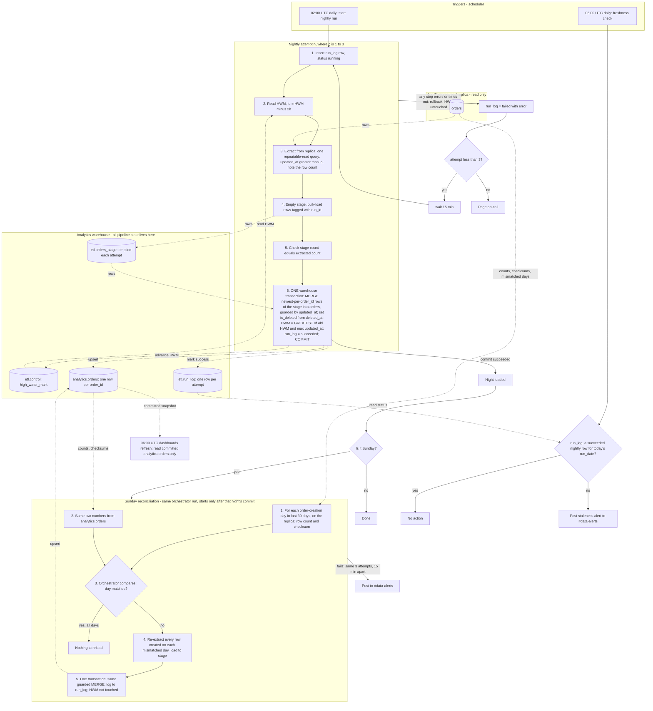

# Nightly orders ETL: replica to warehouse

A nightly job copies the app's `orders` table from a Postgres read replica into the analytics warehouse. The scheduler starts it at 02:00 UTC. Each night it extracts every row changed since the last successful high-water mark minus a 2-hour lookback, stages the rows, and merges them into `analytics.orders` in one warehouse transaction. The overlap catches rows that become visible late, so the merge keeps one newest row per order and is safe to repeat. A weekly Sunday reconciliation catches rows the lookback misses.

## Terms

- **Scheduler:** fires triggers at fixed times (02:00 and 06:00 UTC). It does nothing else.
- **Orchestrator:** the workflow runner the 02:00 trigger starts. It runs the six steps of an attempt, then (on Sundays) the reconciliation, waits between retries, and enforces the timeout.
- **Attempt:** one try at the nightly run. There are at most 3 per night.
- **High-water mark (HWM):** the latest `updated_at` we have safely loaded. Stored in `etl.control`.
- **Lookback:** 2 hours subtracted from the HWM when extracting. Bulk imports can hold a transaction open for up to 90 minutes, and `updated_at` is stamped at write time, not commit time, so a row can become visible up to 90 minutes after its `updated_at`. The extra 30 minutes allow for replica lag.
- **Stage:** `etl.orders_stage`, a scratch table holding one attempt's extracted rows.
- **MERGE:** a single SQL statement that updates matching rows and inserts new ones.
- **Reconciliation:** the Sunday check that compares replica and warehouse by creation day and reloads days that differ.

## Where state lives

All pipeline state is in the warehouse, schema `etl`. We have no write access to the app database, and the job reads only from the replica.

| Table | Contents |
|---|---|
| `etl.control` | One row, `pipeline='orders'`, with `high_water_mark` (timestamptz). Seeded once with the backfill start. |
| `etl.run_log` | One row per attempt: `run_id`, `run_date`, `kind` (nightly or reconcile), `attempt`, `status` (running, failed or succeeded), `window_lo`, `rows_extracted`, `new_hwm`, `error`, `started_at`, `finished_at`. The audit trail, and what the 06:00 check reads. |
| `etl.orders_stage` | Staging rows tagged with `run_id`. Emptied at the start of every attempt, so a retry never sees leftovers. |
| `analytics.orders` | The target. Primary key `order_id`, plus an `is_deleted` flag. The only table dashboards read. |

## Diagram

## Nightly attempt: notes on the steps

- **Start.** The 02:00 trigger starts attempt 1. After a failure, the orchestrator waits 15 minutes and starts the next attempt, up to attempt 3. The scheduler does not drive retries. The attempt number is 1 plus the count of `run_log` rows already written for this `run_date` and `kind`, so it lives in the warehouse, not in orchestrator memory.
- **Step 1.** Insert a `run_log` row with status `running` and `kind = nightly`. `run_id` is a new UUID per attempt. `run_date` is the UTC date of the 02:00 trigger. A unique partial index allows only one `running` row at a time, across both kinds, so a second trigger cannot run alongside the first. If another `running` row exists and is under 3 hours old, this trigger exits immediately. If it is older, step 1 marks it `failed` (its orchestrator is presumed dead) and carries on. That stale row normally comes from an earlier night; a night's own retries (3 attempts of at most 60 minutes plus 15-minute waits) cannot leave a 3-hour-old row, so it cannot push a night past 3 attempts.
- **Steps 2 and 3.** Read the HWM and extract rows with `updated_at > HWM - 2h`, with no upper bound, in one repeatable-read query so the snapshot is consistent. Keep the number of rows returned.
- **Steps 4 and 5.** Empty the stage, bulk-load the rows tagged with `run_id`, and check that the stage count equals the extracted count.
- **Step 6.** One warehouse transaction does all of the following, so dashboards see the whole night or none of it, and the HWM cannot advance unless the data committed.
  - Select from the stage the newest version per `order_id`. Deduplication happens in this query; the stage keeps all extracted rows.
  - `MERGE` them into `analytics.orders`: update when `stage.updated_at >= target.updated_at`, insert when the order is new. This guard means an older version can never overwrite a newer one. `is_deleted` is `deleted_at IS NOT NULL`.
  - Set the HWM to `GREATEST(old HWM, max(updated_at) of the extracted rows)`. If no rows came back, it does not move. Using the data's own timestamps rather than the clock means a lagging replica cannot push the mark past rows it has not yet shown us.
  - Mark `run_log` succeeded and record `rows_extracted`, `new_hwm` and `finished_at`.
- **Lost commit reply.** If the connection drops and the orchestrator does not know whether step 6 committed, it reads `run_log` for its `run_id`. If the row says `succeeded`, the attempt counts as a success. Otherwise it marks the row `failed` (only if still `running`) and retries. The success mark is in the same transaction as the data, so the two can never disagree.
- **Deletes.** The app never hard-deletes; it sets `deleted_at`, which also bumps `updated_at`. Deleted orders arrive as ordinary updates, land with `is_deleted = true`, and are never removed from the warehouse.
- **Idempotence.** Re-running a night re-extracts the same rows, the guard makes the merge a no-op for unchanged rows, and the HWM only moves forward. The warehouse always holds exactly one row per `order_id`, its latest version.
- **Timeout.** The orchestrator enforces a 60-minute limit per attempt. If exceeded, the attempt is aborted like any other error.
- **First run.** The HWM starts at the seeded backfill value, so the first extract is the whole history from that point, under the same rules as any night. If it would exceed the timeout, run it by hand with a longer limit.

## The 06:00 freshness check

The 06:00 trigger is independent of the nightly job, so it fires even if the job hung or the orchestrator died. It looks in `run_log` for a `succeeded` row with `kind = nightly` and `run_date` equal to today's UTC date. If there is none, it posts a staleness alert to #data-alerts, even while retries are still running or after on-call has been paged. A reconciliation still running at 06:00 does not matter to it. Dashboards refresh at 06:00 regardless and read only committed data, so they show the previous snapshot if tonight's load has not committed. An attempt that commits after 06:00 appears at the next dashboard refresh.

## What happens when things fail

| Failure | Result |
|---|---|
| Replica unreachable, extract error or timeout (steps 2 to 3) | The attempt is marked failed and the next one starts after 15 minutes. The target and HWM are unchanged. |
| Stage load or count check fails (steps 4 to 5) | Same. The next attempt empties the stage. |
| Merge fails or the connection drops (step 6) | If the commit did not happen, the warehouse rolls back the whole transaction. Target, HWM and success mark are unchanged, and the attempt is marked failed. If it did commit, the attempt counts as succeeded (see lost commit reply). Dashboards never see partial data. |
| Third attempt fails | On-call is paged. The HWM has not moved, so tomorrow night's lookback covers the missed night. Reconciliation does not run that night. On-call may rerun the night by hand; reruns are idempotent. The 06:00 check still alerts if nothing has succeeded by then. |
| Orchestrator dies mid-attempt | Nothing resumes automatically. The `running` row blocks new triggers for up to 3 hours, then the next trigger marks it failed. The 06:00 check alerts if nothing succeeded. The HWM did not move, so the next night recovers the data. |
| Load not committed by 06:00 | The freshness check posts to #data-alerts. |
| Re-run of a night that already succeeded | No harm; see idempotence above. |

## Sunday reconciliation

It is not a separate trigger. After Sunday's nightly commit succeeds, the same orchestrator run goes on to reconcile, because rows can become visible later than the lookback covers, for example when the replica falls behind.

- **Run log:** its rows use the same `run_date` as the night, with `kind = reconcile`. Its attempt number counts only `reconcile` rows for that `run_date`, so it never affects the nightly count. It shares the one-`running`-row index, which is safe because it starts only after the nightly attempt has finished.
- **Scope:** order-creation days (by `created_at`, UTC) over the last 30 days. Deleted rows count on both sides.
- **Compare:** for each day, the row count and a checksum of `order_id` + `updated_at`, on the replica and in the warehouse. The checksum is an order-independent sum of a per-row hash of `order_id || '|' || updated_at`, with `updated_at` normalised to UTC microseconds. Both sides run the same SQL expression, each on its own database. Each returns at most 30 small rows (day, count, checksum), and the orchestrator compares them in memory.
- **Reload:** every order created on a mismatched day is re-extracted and merged with the same guarded rule, all mismatched days in one transaction. The HWM is never touched. A day still mismatched afterwards, for example because the replica is still behind, is logged in `run_log` and shows up again next Sunday.
- **Failure:** the same 3 attempts, 15 minutes apart, then a post to #data-alerts rather than a page, because the nightly data is already correct by then.
- **Live writes:** an order updated on the replica just after the nightly extract shows as a mismatch. The reload picks it up, which is correct and harmless.
- **Known limit:** an order created more than 30 days ago that arrives very late is not covered.

## Rollout assumptions

- The warehouse supports multi-statement transactions with `MERGE`. If not, build the new version into a shadow table and swap it in atomically, updating the HWM in the same swap step.
- The reconciliation alert goes to #data-alerts, not on-call. Change this if you disagree.

## Open questions

- What is the backfill start value for `etl.control`?
- The 60-minute attempt timeout is a placeholder, not from the brief. Tune it after the first full run.
- Should a late success after 06:00 post a "recovered" message to #data-alerts? Currently nothing is sent.
- If the orchestrator dies, recovery is manual or by the next night. Is that acceptable?
- Does on-call have a defined runbook after a page? Currently the only stated action is an optional manual rerun.
