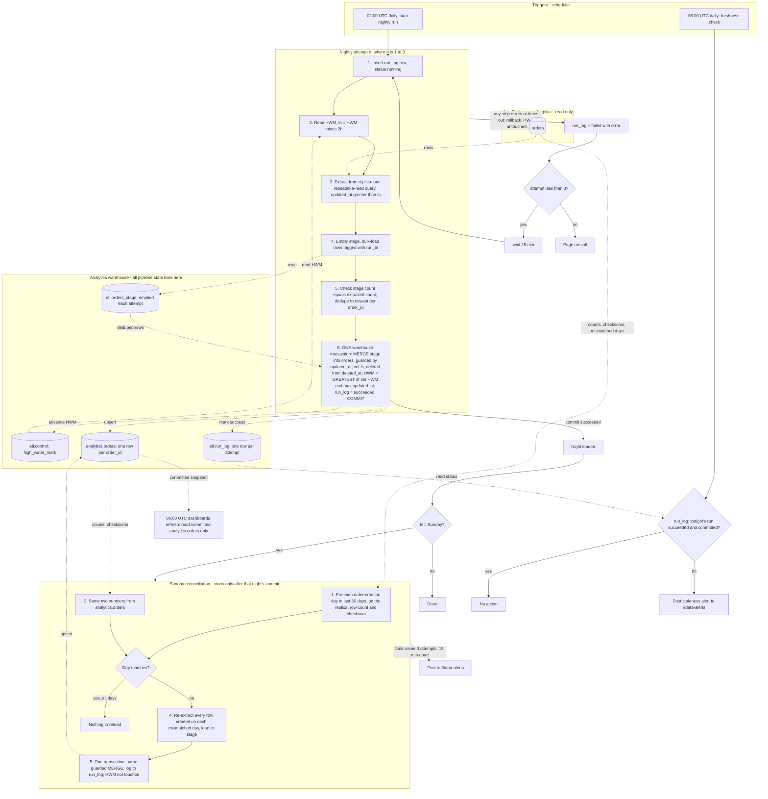

# Nightly orders ETL: replica to warehouse

## Design decisions

| Topic | Decision |
|---|---|
| Where state lives | Only in the warehouse, in schema `etl`. Nothing is written to the app database. |
| `etl.control` | One row per pipeline, with `pipeline='orders'` and `high_water_mark` (timestamptz). The job seeds it once with the backfill start. |
| `etl.run_log` | One row per attempt, with `run_id`, `run_date`, `attempt`, `status` (running, failed or succeeded), `window_lo`, `rows_extracted`, `new_hwm`, `error`, `started_at` and `finished_at`. It is the audit trail, and the 06:00 check reads it. |
| `etl.orders_stage` | A plain staging table keyed by `run_id`. It is emptied at the start of every attempt, so a retry never sees leftovers. |
| `analytics.orders` | The target table, with primary key `order_id` and an `is_deleted` flag. This is the only table dashboards read. |
| Extract window | `updated_at > high_water_mark - 2h`, with no upper bound. One repeatable-read query on the replica gives a consistent snapshot. |
| New high-water mark | `GREATEST(old HWM, max(updated_at) of the extracted rows)`. If no rows come back, the mark does not move. Using the data's own timestamps instead of the clock means a lagging replica cannot push the mark past rows it has not yet shown us. |
| Merge rule | Deduplicate the stage to the newest version per `order_id`. Then `MERGE` into the target: update when `stage.updated_at >= target.updated_at`, insert when the order is new. `is_deleted` is `deleted_at IS NOT NULL`. The guard means an older version can never overwrite a newer one. |
| Atomic commit | The `MERGE`, the HWM update and the `run_log` success mark all happen in one warehouse transaction. Dashboards therefore see the whole night or none of it, and the HWM cannot advance unless the data committed. |
| Idempotence | Re-running a night re-extracts the same rows, the guard makes the merge a no-op for unchanged rows, and the HWM only ever moves forward. |
| Single flight | A unique partial index on `run_log` allows only one `running` row. A second trigger exits immediately, and a `running` row older than 3 hours is treated as dead. |

## Diagram

## What starts each step

- **02:00 UTC scheduler** starts attempt 1 of the nightly run.
- **A failed attempt** starts the next one. The orchestrator waits 15 minutes after the failure and then starts attempt 2 or 3. Retries are not scheduler-driven. The orchestrator holds the attempt counter, and `run_log` records each attempt.
- **A successful Sunday commit** starts the reconciliation. It never starts before the load, and it does not run if the night's load failed all three attempts.
- **The 06:00 UTC scheduler** starts the freshness check. It is independent of the nightly job, so it still fires if the job hung or the orchestrator died. The dashboards refresh at the same moment regardless.

## What data moves where

1. The replica to the job: only rows with `updated_at` after HWM minus 2 hours.
2. The job to `etl.orders_stage`: the whole extract, tagged with `run_id`.
3. Stage to `analytics.orders`: the deduplicated rows, upserted by `order_id`.
4. The same transaction writes the new HWM to `etl.control` and the outcome to `etl.run_log`.

Deleted orders arrive as ordinary updates, because setting `deleted_at` also bumps `updated_at`. They land with `is_deleted = true` and are never removed from the warehouse.

## Failure and retry behaviour

| Failure | Result |
|---|---|
| Replica unreachable or extract error (steps 2 to 3) | The attempt is marked failed and the next attempt starts after 15 minutes. Nothing in the target or the HWM has changed. |
| Stage load or count check fails (steps 4 to 5) | Same. The stage is emptied by the next attempt. |
| Merge fails or the connection drops mid-transaction (step 6) | The warehouse rolls back the whole transaction. The target, HWM and `run_log` success mark all stay unchanged, and the attempt is marked failed. Dashboards never see partial data. |
| Third attempt fails | On-call is paged. The HWM has not moved, so tomorrow night's lookback automatically covers the missed night. |
| Load not committed by 06:00 | The freshness check posts to #data-alerts. This happens even while retries are still running. |
| Re-run of a night that already succeeded | It does no harm, for the reasons under "Idempotence" above. |

## Reconciliation detail

- **Scope:** order-creation days (by `created_at`, in UTC) over the last 30 days. Deleted rows are included on both sides, since nothing is hard-deleted.
- **Checksum:** an order-independent sum of a per-row hash of `order_id || '|' || updated_at`. `updated_at` is normalised to UTC microsecond precision, and both sides run the same SQL expression. A sum rather than a sequential hash avoids any dependence on row order.
- **Reload:** every order created on a mismatched day is re-extracted and merged with the same guarded rule, all mismatched days in one transaction. The HWM is never touched. A day that is still mismatched after the reload, for example because the replica itself is still behind, is logged in `run_log` and shows up again next Sunday.
- **Race with live writes:** an order updated on the replica just after the nightly extract will show as a mismatch. The reload picks it up, which is correct and harmless.
- **Known limit:** an order that was created more than 30 days ago and arrives very late is not covered.

## Assumptions I made

- The warehouse supports multi-statement transactions with `MERGE`. If it does not, the equivalent is to build the new version into a shadow table and swap it in atomically, with the HWM updated in the same swap step.
- The 2-hour lookback covers the 90-minute bulk import plus 30 minutes of replica lag. Anything beyond that is left to the Sunday reconciliation, as the brief says.
- For reconciliation failures, I reused the 3-attempt, 15-minute policy but chose #data-alerts instead of paging on-call. The nightly data is already correct by then, so a page seemed too heavy. Change this if you disagree.
