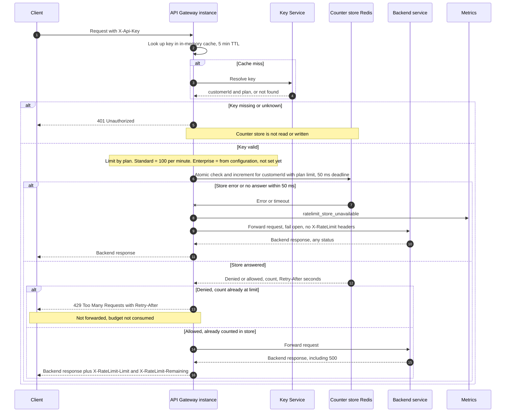

# Per-customer rate limiting on the public API: sequence design

## Summary

Today, all public traffic goes through the API Gateway. It runs as six stateless instances behind a load balancer, so any instance can receive any request. The gateway turns each client's API key into a customer and a plan through the Key Service, then forwards the request to the backend service that owns the route and returns that backend's response.

This design gives each customer a request budget, so one noisy customer cannot slow the API for everyone else. Each gateway instance checks the budget after it authenticates a request and before it forwards the request. All instances share one counter store, so a customer's budget is shared across all six instances. If the counter store fails or is slow, the gateway forwards the request anyway (fail open).

## Terms

- **API key**: a secret the client sends in the `X-Api-Key` header.
- **Customer**: the owner of one or more API keys. Limits apply per customer, so all of a customer's keys share one budget.
- **Plan**: the customer's service level, Standard or Enterprise. The plan sets the limit.
- **Gateway**: one API Gateway instance. It is stateless, so it keeps no counters of its own.
- **Key Service**: the service that turns an API key into a customer ID and a plan.
- **Counter store**: one shared Redis server that holds the request counts. Every gateway instance uses the same one.
- **Lua script**: a short program that Redis runs in one step. No other command runs in the middle, so two instances cannot both take the last slot.
- **Fixed window**: a one-minute period that starts on the clock minute, such as 12:03:00 to 12:03:59.
- **Epoch minute**: the current time in whole minutes since 1970 (Unix time). It names the window.
- **Redis TIME**: the clock of the Redis server. Using it means all gateways agree on the current window, whatever their own clocks say.
- **TTL (time to live)**: how long Redis keeps a key before it deletes the key automatically.
- **Retry-After**: a response header that tells the client how many seconds to wait before it retries.

## Sequence

## Steps

1. **Look up the key.** A request arrives with an `X-Api-Key` header. The gateway checks its in-memory cache for the key. The cache holds each answer for 5 minutes. On a cache miss, the gateway asks the Key Service. Because answers are cached, a plan change or key revocation can take up to 5 minutes to take effect. This is existing behavior, and this design does not change it.

2. **Reject unknown keys.** If the key is missing or unknown, the gateway returns `401 Unauthorized`. It does not read or change any counter.

3. **Set the limit and call Redis.** Otherwise the gateway knows the customer ID and plan. The limit comes from the plan: Standard is 100 requests per minute. Enterprise is read from configuration, and no value is set yet. Until one is set, Enterprise requests are not rate-limited. The gateway calls the Lua script in Redis with the customer ID and the limit. The script does not read the plan itself. This call has a 50 ms deadline, enforced by the client timeout.

4. **Check and count in Redis.** The script runs as one atomic step. It reads the current minute from Redis TIME and builds the key `rl:{customerId}:{epochMinute}`. The key uses the customer ID, not the API key, so all of a customer's keys share one budget. Then the script reads the count.
   - If the count is below the limit, the script adds 1. On first use it sets the TTL to about 120 seconds. It returns `allowed` with the new count.
   - If the count is at the limit, the script returns `denied` with the count and the Retry-After value. It leaves the count unchanged.

   Retry-After is the number of seconds until the current window ends, rounded up, with a minimum of 1. At second 45 of a minute, it is 15. The script computes it from Redis TIME, so gateway clock skew does not affect it.

   The window is fixed and aligned to the clock minute, because that is simple and cheap. Its known weakness is that a customer can send up to about 200 requests across a minute boundary. This is accepted for v1. A sliding-window counter can replace it later without changing the gateway contract.

5. **Denied: return 429.** The gateway returns `429 Too Many Requests` with a `Retry-After` header in seconds, copied from the script's reply. It does not forward the request. The rejected request does not use up budget.

6. **Allowed: forward and count.** The count was already increased in step 4, before forwarding. So a backend failure still uses budget. The gateway forwards the request to the backend service that owns the route. It returns the backend's response, whatever the status, including 500. The response carries two headers:
   - `X-RateLimit-Limit`: the plan limit.
   - `X-RateLimit-Remaining`: the limit minus the count after this request, never below 0. The request that takes the last slot shows 0.

7. **Store fails: fail open.** This step replaces step 4's answer. If the Redis call returns an error, or gets no answer within 50 ms, the gateway does not retry. It forwards the request right away, emits the `ratelimit_store_unavailable` metric, and sends no `X-RateLimit` headers, because the count is unknown. The client gets the backend's response. A timed-out script may still run in Redis. That only over-counts a request that was forwarded anyway.

## What happens when things fail

| Failure | What the gateway does | What the client gets |
|---|---|---|
| Key missing or unknown | Stops at step 2. Counter store not touched. | 401 |
| Customer over the limit | Stops at step 5. Not forwarded. No budget used. | 429 with Retry-After |
| Counter store error or no answer within 50 ms | No retry. Forwards the request. Emits `ratelimit_store_unavailable`. | Backend response, no `X-RateLimit` headers |
| Backend returns 500 or another error | Already counted. Passed through. | Backend response with `X-RateLimit` headers |
| Key Service slow or down on a cache miss | Not decided. See open questions. | Not decided |
| Backend slow or times out | Not decided. The request is already counted. | Not decided |

## Open questions

- **Enterprise limit.** Product has not decided it. The code reads it from configuration and must not ship with a guessed value. Until it is set, Enterprise requests are not rate-limited. This must be settled before Enterprise traffic is covered.
- **Key Service failure.** The existing system does not say what the gateway does when the Key Service is slow or down on a cache miss. It also does not say whether a "not found" answer is cached. This needs a decision.
- **Backend timeout.** The existing system does not say whether the gateway has its own backend timeout, or what the client gets if the backend times out.
- **Outage cost.** While Redis is down, every request waits up to 50 ms before it fails open. A simple circuit breaker could skip the store for a short time after repeated failures. Decide whether v1 needs it.
- **429 headers.** Decide whether the 429 also carries the `X-RateLimit` headers. This is optional.
- **Metric dimensions.** Decide whether `ratelimit_store_unavailable` is tagged with the route or the customer. A customer tag could create many separate metric series (high cardinality).
- **Redis deployment.** Choose managed or self-hosted Redis with failover. Failover behavior affects how often the fail-open path runs.