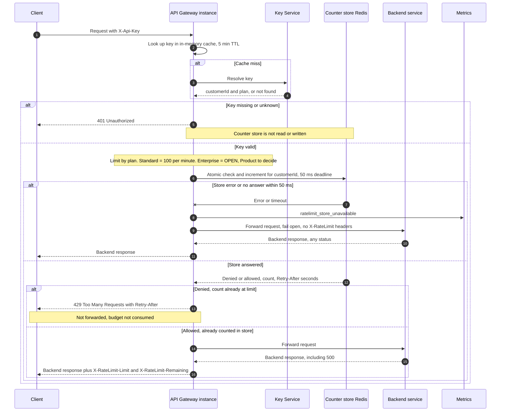

# Per-customer rate limiting on the public API: sequence design

## Sequence

## Decisions

1. **Counter store: one shared Redis.** Every gateway instance talks to the same keyspace, so six instances share one budget per customer. There is no per-instance state. Key format is `rl:{customerId}:{epochMinute}` with a TTL of about 120 s. The key is built from the customer ID, not the API key, so a customer's keys share one budget (requirement 1).

2. **Window: fixed one-minute window aligned to the clock minute.** It is simple and cheap. Its known weakness is that a customer can send up to about 200 requests across a minute boundary. This is accepted for v1. A sliding-window counter can replace it later without changing the gateway contract.

3. **Check and increment are one atomic Lua script.** The script reads the count, and only if the count is below the limit does it increment, set the TTL on first use, and return `allowed`. Otherwise it returns `denied` and leaves the count alone. This prevents overshoot across instances (requirement 7) and keeps 429s from consuming budget (requirement 4). It only runs after authentication, so a 401 never touches a counter (requirement 3).

4. **Retry-After.** The script computes the seconds until the current window ends, using Redis `TIME` so the answer does not depend on gateway clock skew. The value is rounded up with a minimum of 1. Example: at second 45 of a minute, Retry-After is 15.

5. **Rate-limit headers.** `X-RateLimit-Limit` is the plan limit. `X-RateLimit-Remaining` is the limit minus the count after this request's increment, floored at 0. Both appear only on requests that passed the check. The 429 carries Retry-After as required. Adding the X-RateLimit headers to the 429 is optional and left open.

6. **Fail open.** The store call has a 50 ms deadline, enforced by the client timeout. On error or timeout the gateway forwards the request, emits `ratelimit_store_unavailable`, and sends no X-RateLimit headers because the count is unknown. A timed-out script may still run on Redis. That only over-counts a request that was forwarded anyway, which is consistent with requirement 5.

7. **Backend failures still count.** The increment happens before forwarding, so a backend 500 does not refund budget (requirement 5).

8. **Key cache.** The existing 5-minute cache applies to plan and customer lookups. A plan change or key revocation can take up to 5 minutes to take effect. This is existing behavior and is not changed here.

## Open items

- **Enterprise limit: OPEN.** Product has not decided it. The code should read it from configuration and must not ship with a guessed value.
- **Outage cost.** While Redis is down, every request waits up to 50 ms before failing open. A simple circuit breaker could skip the store for a short period after repeated failures. Decide whether v1 needs it.
- **429 headers.** Decide whether the 429 also carries the X-RateLimit headers.
- **Metric dimensions.** Decide whether `ratelimit_store_unavailable` is tagged with the route or the customer. Tagging by customer could create high cardinality.
- **Redis deployment.** Choose a managed or self-hosted Redis with failover. Failover behavior affects how often the fail-open path runs.