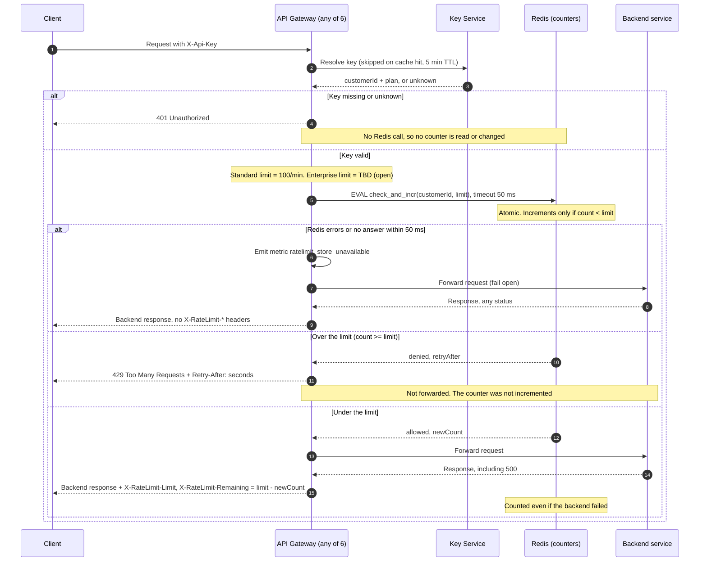

# Per-customer rate limiting on the public API

Today every public request goes through the API Gateway (6 stateless instances behind a load balancer). The gateway resolves the `X-Api-Key` header through the Key Service, then forwards the request to the backend that owns the route. This design adds a per-customer limit between those two steps. After authentication, the gateway asks one shared Redis to count the request. Over the limit, the client gets 429 and nothing is forwarded. If Redis fails, the request goes through. Redis is used because all 6 instances must share one counter.

## Terms

- **Key Service**: resolves an API key to a customer ID and a plan (Standard or Enterprise). The gateway caches that one answer, keyed by API key and holding both customer ID and plan, in memory for 5 minutes. A plan change can therefore take up to 5 minutes to show.
- **Redis**: a shared in-memory store. It is a new dependency, called by every gateway instance.
- **`check_and_incr`**: a Lua script that runs inside Redis. Redis runs scripts one at a time, so two instances cannot both take the last slot.
- **Window**: a fixed one-minute slot. The script reads the time from Redis (the `TIME` command), so gateway clock skew does not matter and the gateway never computes the window itself. `windowStart = floor(redisTime / 60) * 60`.
- **Counter key**: `rl:{customerId}:{windowStart}`. It uses the customer ID, never the API key, so all of a customer's keys share one budget (req. 1).
- **Fail open**: if the limiter cannot answer, allow the request.

## Rules

- The Standard limit is 100 requests per minute. **The Enterprise limit is open (product has not decided).**
- Until it is decided, an Enterprise request makes no Redis call. It is forwarded, not counted, and carries no `X-RateLimit-*` headers.
- The script does this in one step. It computes `windowStart` from Redis time and reads the count (a missing key counts as 0). If `count >= limit`, it denies and returns `retryAfter = max(1, windowStart + 60 - redisTime)`, in whole seconds. Otherwise it runs `INCR`. If the new count is 1, it sets the key to expire after 120 s, which outlives the 60 s window. Then it returns allowed and the new count.
- The gateway gives Redis 50 ms to answer.

## Sequence

## Notes

- **Auth first (req. 3):** the 401 branch returns before any Redis call.
- **429s and backend failures (req. 4, 5):** the script increments only when it allows a request, so 429s cost no budget. The increment happens before forwarding, so a backend 500, timeout or unreachable backend still counts. In the timeout or unreachable case, the client gets whatever error the gateway already returns today.
- **Headers (req. 6):** `Remaining = limit - newCount`. A 429 carries only `Retry-After`, and its body is a small JSON error. The `X-RateLimit-*` headers appear only on responses to requests that passed the check.
- **Example, limit 100:** the 100th request in a window sees count 99, increments to 100, is forwarded and gets `Remaining: 0`. The 101st sees count 100, is denied with 429 and `Retry-After`, and the counter stays at 100.
- **Fail-open (req. 8):** on a Redis error or a 50 ms timeout, the gateway forwards the request, emits `ratelimit_store_unavailable` and omits the headers. If the script ran anyway and Redis answers late, the gateway ignores the answer. That count is not rolled back, so a slow Redis can slightly overcount. While Redis is down, limits are not enforced and nothing is counted. Alert on the `ratelimit_store_unavailable` rate.
- **Fixed-window trade-off:** a client can send up to 2x the limit across a window boundary, for example 100 requests at 12:00:59 and 100 more at 12:01:00. This is accepted for a first version. A sliding window is a later upgrade.

## Open questions

- The Enterprise limit is a product decision.
- Redis deployment (HA or replica, region) is not covered here.
- What the gateway does on a Key Service cache miss when the Key Service is slow or down is existing behavior and is not covered here.
- The exact status the gateway returns when a backend times out or is unreachable is existing behavior and was not checked.
