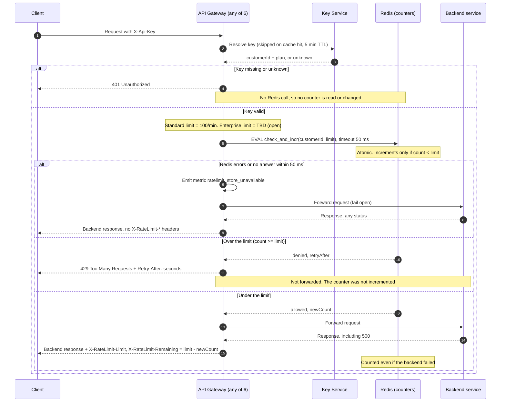

# Per-customer rate limiting on the public API

## Decisions

| Question | Choice |
|---|---|
| Counter store | A single shared Redis, called by every gateway instance. This is a new dependency, but all 6 instances can share one counter through it (req. 7). |
| Window | Fixed one-minute window. The Redis server clock sets the window boundary, so gateway clock skew doesn't matter. |
| Counter key | `rl:{customerId}:{windowStart}`, where `windowStart` is `floor(redisTime / 60) * 60`. The key expires 120 s after creation. |
| Limit lookup | The gateway picks the limit from the plan it already holds. Standard is 100/min. **Enterprise is open (TBD, product decision).** Until it is decided, an Enterprise request does not call the rate-limit check. |
| Avoiding overshoot | One atomic Lua script (`check_and_incr`) runs inside Redis. Redis runs scripts one at a time, so concurrent requests from different instances cannot both take the last slot. The script reads the count and increments it only if the count is under the limit. |
| `Retry-After` | Whole seconds until the current window ends: `max(1, windowStart + 60 - redisTime)`. The script computes it, and it is returned only on a denial. |
| Fail-open | The gateway gives Redis a 50 ms timeout. On a timeout or any error, the gateway forwards the request, emits `ratelimit_store_unavailable`, and leaves the `X-RateLimit-*` headers off. |

## Sequence

## Notes

- **Requirement 1 (per customer):** the key uses `customerId`, never the API key, so all of a customer's keys share one counter.
- **Requirement 3 (auth first):** the 401 branch returns before any Redis call.
- **Requirements 4 and 5 (denials and backend failures):** the script increments only when it allows a request, so 429s cost no budget. The increment happens before forwarding, so a backend 500 still counts.
- **Requirement 6 (headers):** `Remaining` is `limit - newCount`. It reaches 0 on the last allowed request.
- **429 body:** the body is a small JSON error. A 429 carries only `Retry-After`, as the brief specifies. The `X-RateLimit-*` headers appear only on responses to requests that passed the check.
- **Fixed-window trade-off:** a client can send up to 2x the limit across a window boundary, for example 100 requests at 12:00:59 and 100 more at 12:01:00. This is accepted for a first version. A sliding window is a later upgrade.
- **Fail-open trade-off:** while Redis is down, limits are not enforced and no counts are recorded for that period. Alert on the `ratelimit_store_unavailable` rate.
- **Open items:**
  - The Enterprise limit is a product decision.
  - Redis deployment details (HA or replica, region) are not covered here.
  - A cached plan can be up to 5 minutes stale, so a plan change takes effect within that time.
