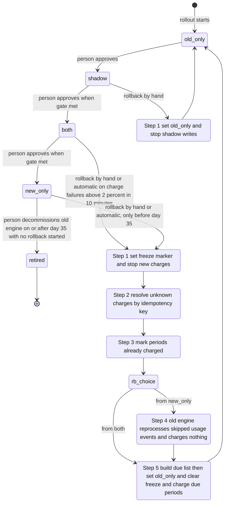

# Billing engine rollout: state machine

## Summary

Today the old billing engine reads usage events, computes invoices, writes them to the billing ledger and charges customers through the payment provider. The rollout adds a new engine and moves billing to it through four modes, `old_only`, `shadow`, `both` and `new_only`, one step at a time, with a person approving each step and a nightly comparison of the two engines' invoices gating each forward move. The shape keeps every rollback safe: until `new_only` the old engine keeps computing, so a rollback can return to `old_only` without charging anyone twice or dropping a charge that is due. From `new_only`, a rollback must finish before day 35.

## Terms

- **Billing engine**: the code that reads usage events, computes invoices, writes them to the ledger and charges customers. The **old engine** is today's engine. The **new engine** is its replacement.
- **Billing worker**: a running billing process that runs an engine. Billing workers run the old engine today. The brief does not say how many workers each engine runs.
- **Config service**: the settings service that holds `billing_mode`.
- **billing_mode**: the one global flag in the config service that selects the mode.
- **Usage event log**: keeps usage events for 35 days.
- **Billing ledger**: the system of record. It holds invoices and charge records.
- **Ledger invoice**: the invoice the ledger holds for a billing period, whichever engine wrote it. It is the invoice that gets charged.
- **Billing period**: the span of time that one invoice covers.
- **Payment provider**: the outside service that takes the charge.
- **Shadow store**: a separate store for invoices that are never charged.
- **Idempotency key**: customer, billing period and invoice version. Both engines send it to the payment provider. The provider and the ledger refuse a second charge or record with the same key.
- **Charge record**: the ledger's record of a successful charge, stored under the period's key.
- **Charge failure**: any charge attempt not confirmed as successful. That covers a decline, a provider error and a timeout. A timeout stays a failure until its outcome is resolved, because it may still have charged.
- **Mismatch**: an invoice total that differs by more than one cent between the two engines for the same customer and period.
- **Mismatch rate**: mismatches divided by invoices compared.
- **Resolved mismatch**: a mismatch whose cause is recorded in the audit log and whose totals agree within one cent in the next nightly comparison. Any other mismatch is unresolved.
- **Streak**: consecutive days that meet a daily test.
- **Gate**: the condition that must hold before a person approves a forward move.
- **Rollout controller**: the program that owns `billing_mode` and the rollout record. It is the only writer of `billing_mode`. It reads the nightly results, keeps the streaks, watches charge failures and runs the rollback steps.
- **Audit log**: an append-only log of every controller change.
- **Freeze marker**: a field in the rollout record. When it is set, the new engine stops new charges and ledger writes.
- **Due-but-uncharged period**: a period with a ledger invoice and no charge record.
- **Due list**: the due-but-uncharged periods, built in step 5 of a rollback.
- **Day 35**: 35 days after entry into `new_only`. It is the day the oldest skipped usage event leaves the usage event log.

## Diagram

## Modes

- **old_only** (start). The old engine computes, charges and writes the ledger. The new engine is off. A rollback always ends here.
- **shadow**. The old engine still computes, charges and writes the ledger. The new engine reads the same usage events and writes its invoices to the shadow store only. It never charges and never writes the ledger. A nightly job compares the two engines' invoices per customer. The controller reads the results and updates the streak and counts. New-engine errors are recorded here and never trigger a rollback.
  - Gate to `both`: 7 consecutive days with a mismatch rate under 0.1% and at least 5,000 invoices compared. A person then approves the move.
- **both**. The new engine charges and writes the ledger. The old engine keeps computing every invoice into the shadow store without charging, so it stays current for rollback. The comparison continues, and the automatic rollback trigger is armed.
  - Gate to `new_only`: 14 days in `both` with no unresolved mismatches, plus Finance sign-off. The check for unresolved mismatches is made on the day the person approves. A mismatch resolved before then does not block the gate, and the 14-day count does not restart.
- **new_only**. The new engine does everything. The old engine stops computing, so it skips every usage event from entry on. The rollback window stays open until day 35.
- **retired** (terminal). A person decommissions the old engine on or after day 35, with no rollback started. No way back exists from here.

## Rules for all modes

- Forward moves go one step at a time, in order, with no skips. A person makes each move, and the approval is recorded. Then the controller writes `billing_mode`. The approver never writes the flag. The diagram has no automatic forward moves. Automatic transitions exist only for rollback.
- Engines read `billing_mode` before each charge and never cache it for a run. A stale read during a flip is the main double-charge risk.
- The old engine charges in `old_only` and `shadow`. In `both` and `new_only` it does not charge, except in step 5 of a rollback, after every worker reads `old_only`.
- The new engine charges only in `both` and `new_only`, and never while the freeze marker is set.
- Both engines send the same idempotency key for a period. This guards against overlap, such as a retry or a flip. The brief does not state this guard; this document adds it as a requirement.

## Where the rollout state lives

- `billing_mode` is the one global flag in the config service.
- The rollout record sits beside the flag. Only the controller writes it, and every change goes to the audit log. It holds the current mode, the day-35 clock (entry into `new_only`), the shadow streak and invoice count, the unresolved mismatch count, the Finance sign-off reference, the approval references, the mode a rollback started from, the current rollback step, the freeze marker and the rollback data (the due list). The brief does not say where the record lives. Open question 1 covers this.
- The ledger is the system of record. The shadow store is separate and is never used for charging.

## Rollback

A rollback starts in one of two ways:

- On-call starts it by hand at any time, within the 35-day limit.
- It starts automatically in `both` or `new_only` when new-engine charge failures exceed 2% over any 10-minute window. New-engine errors in `shadow` never trigger it.

A rollback can start only from `shadow`, `both` or `new_only`. Its start is recorded in the rollout record and the audit log.

Rules for every rollback:

- A rollback from `shadow` runs step 1 only. A rollback from `both` or `new_only` runs steps 1 to 5.
- Only one rollback runs at a time. A second start or trigger is written to the audit log and ignored.
- Each step is idempotent and resumable. Until step 5 finishes, the rollout stays on the rollback path and does not move forward.
- A rollback always ends in `old_only`, and the gates reset.

1. **Stop the new engine.** This runs when the rollback starts.
   - From `shadow`: set `billing_mode` to `old_only` and stop shadow writes. The old engine charges the same way in `shadow` and `old_only`, and the new engine is not charging in `shadow`. So no charge depends on which value a worker reads, and no wait is needed.
   - From `both` or `new_only`: the controller sets the freeze marker. The new engine checks the marker before sending each charge request, and stops new charges and ledger writes at that check. A request already sent is not cancelled. Its outcome goes to step 2. `billing_mode` does not change during steps 1 to 4. Failed charges stay queued as due. Nothing charges during steps 1 to 4, because an in-flight charge may still have succeeded. A period that comes due in this window waits for step 5.
2. **Resolve unknown charges.** For each charge whose outcome is unknown, including a timeout, the controller asks the payment provider about the idempotency key and records the answer. Never retry a charge under a new key.
   - If the provider has no record of the key, record the charge as not charged. The period stays due, and step 5 charges it under the same key.
   - If the provider does not answer, the outcome stays unknown. Retry the lookup on the next run. Do not queue the period until the lookup is answered. Step 2 does not finish until every lookup is answered.
3. **Mark charged periods.** For each period with a successful charge, write that success to the ledger's charge record under the period's idempotency key. The old engine checks this record before every charge and skips any period that has one.
4. **Catch up (from `new_only` only).** The old engine reprocesses the usage events it skipped, inside the 35-day log. It writes the resulting invoices to the ledger and charges nothing. This must finish before the oldest skipped event expires. If it does not, the rollback cannot be completed from events. Open question 13 covers invoices the new engine already wrote in this window.
5. **Hand over.**
   - Build the due list after step 4, so it includes periods from catch-up. The due list is the ledger invoices that have no charge record. Hold it in the rollout record's rollback data. Shadow invoices are never charged. If a shadow invoice differs from its ledger invoice, the ledger invoice is the one charged.
   - Set `billing_mode` to `old_only`. Then wait until every worker reads `old_only`. This wait has no timeout. It stops a worker that still reads `both` from charging during the flip. The rollout stays on the rollback path until the wait ends.
   - Clear the freeze marker.
   - The old engine charges each due-list period from its ledger invoice, as written, with that invoice's version and idempotency key. It does not recompute the invoice. A recomputed invoice could carry a different version, and so a second charge. This queue runs before the old engine's normal run.
   - A charge that fails or times out stays due. A timeout is first resolved by the step 2 lookup, and any retry uses the same key. These charges do not count toward the automatic trigger, which watches only new-engine charges, and they do not start a rollback.
   - The rollout is now at `old_only` with its gates reset. Nothing moves forward until a person approves the move to `shadow`. The 7-day count starts when `shadow` is entered.

## What happens when things fail

| Situation | What happens |
|---|---|
| Config service unreachable | Workers keep their last-read mode and raise an alert. The rollout does not advance. |
| Nightly comparison fails or does not run | That day does not count toward any streak, so the streak resets (a proposal, since the brief says "consecutive"). The controller records the missed run. |
| Mismatch in `shadow` or `both` | Recorded and counted. It blocks the next gate but does not trigger a rollback by itself. |
| New-engine error in `shadow` | Recorded. Never triggers a rollback. |
| Charge failures above 2% in any 10-minute window, in `both` or `new_only` | Automatic rollback starts. Failed charges stay queued as due for the old engine at step 5. |
| Charge outcome unknown during the freeze | Step 2 resolves it by idempotency key. Never retry under a new key. |
| Provider has no record of the key | Recorded as not charged. The period stays due and step 5 charges it under the same key. |
| Provider lookup does not answer | The outcome stays unknown. Retry on the next run. The period is not queued until the lookup is answered. |
| Period comes due during steps 1 to 4 | Not charged. It waits for step 5. The brief sets no limit on this wait. |
| A worker still reads `both` during the step 5 flip | Nothing charges. The new engine is frozen and the old engine does not charge in `both`. The queue waits until every worker reads `old_only`, with no timeout. |
| A due-list charge fails or times out | It stays due. A timeout is resolved by the step 2 lookup first. Any retry uses the same key. It does not start another rollback. |
| A rollback step fails midway | The step resumes on retry. The rollout stays on the rollback path, and due charges stay queued. |
| A second rollback start or trigger while one runs | Logged and ignored. The running rollback continues. |
| A manual start in `old_only` | Not allowed. The brief allows rollback only from `shadow`, `both` or `new_only`. |
| Rollback or automatic trigger after day 35 in `new_only` | The rollback window is closed, and the brief defines no path. The controller pages on-call and waits for a person's decision. |

## Open questions

1. Where does the rollout record live, and who owns it?
2. Does the 35-day clock run from entry into `new_only`, which is when the first skipped event is created?
3. What is the response to an automatic trigger after day 35?
4. How is the 2% rate defined? Decide the denominator, a minimum attempt count so that a few charges cannot trip it, and whether a timeout counts as a failure.
5. Can the payment provider look up a charge by idempotency key? Step 2 depends on it. How long does the provider keep keys? A request sent before the freeze could arrive after a not-found answer, and the key stops a second charge only if the provider keeps it long enough.
6. Should a rollback start a set number of days before day 35, to leave margin for catch-up?
7. Which tool or screen does the approver use? What does an approval record contain? What does on-call see when starting a rollback by hand?
8. Who keeps the 35-day usage event log? The brief does not say.
9. Does the 5,000-invoice count apply across the 7 days, or to each day? Confirm that the mismatch rate is mismatches divided by invoices compared.
10. Where is the old engine's queue of due periods stored? Until this is decided, the due list is held in the rollout record's rollback data.
11. Who investigates a mismatch, and where is the investigation recorded? The brief does not say.
12. Who schedules the nightly comparison, and who is alerted when it does not run? The brief does not say.
13. Does catch-up write a new invoice version for a period the new engine already invoiced in `new_only`? A second chargeable invoice for a charged period would be a double charge.
14. How does the controller learn that every worker reads `old_only`, and who is alerted when a worker does not confirm? The brief does not say.