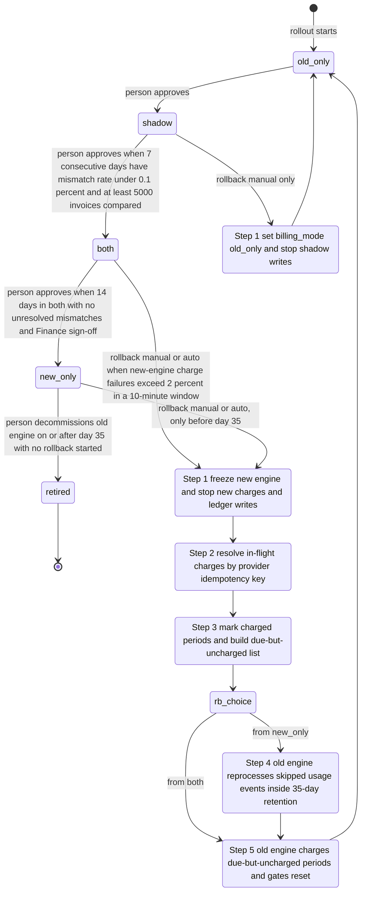

# Billing engine rollout: state machine

## Diagram

## Modes

- **old_only** (start state): the old engine computes, charges and writes the ledger. The new engine is off. This is the only state a rollback can end in.
- **shadow**: the old engine still charges and writes the ledger. The new engine reads the same usage events and writes invoices to the shadow store. It never charges and never writes the ledger. A nightly job compares the two engines per customer; a mismatch is a total that differs by more than one cent. New-engine errors are recorded but never trigger a rollback.
- **both**: the new engine charges and writes the ledger. The old engine keeps computing every invoice into the shadow store without charging, so it stays current for rollback. The comparison continues. The automatic rollback trigger is armed here.
- **new_only**: the new engine does everything. The old engine stops computing, so usage events from this point are skipped by it. The rollback window is open until day 35 after entry, when the oldest skipped event leaves the 35-day log.
- **retired**: terminal. The old engine is decommissioned after day 35 with no rollback. No way back exists from here.

Forward moves are one step at a time, each made by a person. The diagram has no skip edges. Automatic transitions exist only for rollback.

## Where the rollout state lives

- `billing_mode` is the single global flag in the config service. Both engines read it. Engines must read the flag before each charge, not cache it for a run, because a stale read during a flip is the main double-charge risk.
- The brief does not say where the gate state lives. Proposal: a rollout record kept beside the flag, written only by the rollout controller, with an append-only audit log. It holds the current mode, the time of entry into new_only (the 35-day clock), the shadow streak and invoice count, the unresolved mismatch count, the Finance sign-off reference, the mode a rollback started from, and the current rollback step.
- The ledger is the system of record. The shadow store is separate and never used for charging.
- Double-charge guard (a requirement, not yet in the brief): both engines send the same idempotency key per customer, billing period and invoice version to the payment provider, and the ledger enforces uniqueness on the same key.

## Rollback rules

- Rollback can start from shadow, both or new_only. It always ends in old_only, and the shadow gates restart from zero. The 7-day count begins again only after a later forward move back to shadow.
- From shadow, no charges need unwinding, so the rollback is a flag change plus stopping shadow writes.
- From both, the rollback first freezes the new engine, then resolves any charge with unknown outcome by querying the provider, then marks periods already charged so the old engine skips them. Due-but-uncharged periods go to the old engine's queue. Nothing is dropped.
- From new_only, the old engine must also reprocess the usage events it skipped before taking charge. This must finish before the oldest skipped event expires, or the rollback cannot be completed from events.

## What happens when something fails

- **Config service unreachable**: workers keep their last-read mode, raise an alert, and the rollout does not advance.
- **Nightly comparison fails or does not run**: that day does not count toward the 7-day or 14-day streaks, so the streak resets (proposal, since the gates say "consecutive").
- **Mismatch in shadow or both**: recorded and counted. It blocks the next gate but does not trigger rollback by itself.
- **Charge failures above 2 percent in any 10-minute window in both or new_only**: automatic rollback starts. Failed charges stay queued as due, so the old engine picks them up at handover.
- **Charge outcome unknown during freeze**: resolve through the provider by idempotency key. Never retry the charge under a new key.
- **A rollback step fails midway**: each step is idempotent and resumable. The rollout stays in the rollback path, does not move forward, and due charges remain queued.
- **Automatic trigger after day 35 in new_only**: the rollback window is closed, so there is no defined path. The brief does not cover this case. The controller should page on-call and wait for a person's decision.

## Open questions

1. Confirm the rollout record's location and owner.
2. Confirm the 35-day clock runs from entry into new_only, which is when the first skipped event is created.
3. Decide the response to an automatic trigger after day 35 (see above).
4. Define the 2 percent rate: the denominator, and a minimum attempt count so that a handful of charges cannot trip it.
5. Confirm the payment provider can look up a charge by idempotency key, which step 2 depends on.
6. Decide whether a rollback should start a set number of days before day 35 to leave margin for reprocessing.