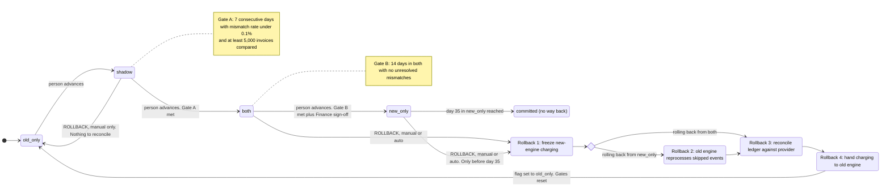

# Billing engine rollout: state machine

This models the move from the old billing engine to the new one as a state machine. Today, billing workers run the old engine: it reads usage events, computes invoices, writes them to the billing ledger and charges customers through the payment provider. The rollout moves one global flag, `billing_mode`, forward one step at a time (`old_only`, `shadow`, `both`, `new_only`), always by a person. Rollback can start from any later mode and always ends in `old_only`. The shape protects one rule above all: no customer is charged twice for a billing period, and no charge that is due is dropped.

## Terms

- **Old engine / new engine:** the two billing programs run by the billing workers. Each reads usage events, computes invoices, and can charge and write the ledger.
- **Usage log:** the existing log of usage events. Both engines read it. It keeps events for 35 days.
- **Checkpoint:** the position in the usage log up to which an engine has processed events.
- **Billing ledger:** the system of record for invoices and charges. Only the engine that is charging writes it.
- **Shadow store:** a separate store for invoices from the engine that is not charging. Only that engine writes it and only the nightly comparison reads it. It is never treated as truth. Where it physically lives is not decided.
- **Payment provider:** the outside service that moves the money.
- **`billing_mode`:** the one global flag, kept in the config service, that says which mode is live.
- **Rollout controller:** the service to be built after this model. It moves the flag, runs the rollback steps, evaluates the automatic rollback trigger and keeps the rollback record. People advance the rollout, and on-call starts a manual rollback, by sending a request to the controller. It refuses anyone not allowed to make that request.
- **Nightly comparison:** a job that compares the two engines' invoices per customer. An invoice is a mismatch if its totals differ by more than one cent. It runs in `shadow` and `both`; in `both` it compares old engine against new engine.
- **Idempotency key:** customer plus billing period. A charge sent with the same key twice is applied once.
- **Gate A:** the condition for `shadow` to `both`: 7 consecutive days with a mismatch rate under 0.1%, and at least 5,000 invoices compared.
- **Gate B:** the condition for `both` to `new_only`: 14 days in `both` with no unresolved mismatches, plus Finance sign-off.

## Diagram

After any rollback the only way forward is `old_only` to `shadow`, which a person triggers. The gate counters start from zero, so the 7-day count starts over. A rollback from `shadow` skips the rollback steps because the new engine has never charged.

### What each mode does

| Mode | Old engine | New engine | Who charges and who writes the ledger |
|---|---|---|---|
| `old_only` | Computes, charges, writes the ledger | Off | Old engine |
| `shadow` | Computes, charges, writes the ledger | Reads the same usage events and writes to the shadow store | Old engine. The new engine never charges and never writes the ledger. |
| `both` | Reads the same usage events and computes every invoice into the shadow store only, so it stays current. Not charging does not change how it computes. | Computes, charges, writes the ledger | New engine |
| `new_only` | Stopped. Its checkpoint stays where it was when this mode began. | Computes, charges, writes the ledger | New engine |
| `committed` | May be decommissioned | Does everything | New engine |

### Notes on moves

- **Advancing:** the controller sets the flag when a person asks. There is no freeze on a forward move, because the idempotency key already prevents double charges. Charges the previous charger already started finish. The next charger charges only periods that have no charge under the key. Workers read the flag before starting each charge but may see a change at different moments. So before charging, a worker also checks the key against the ledger and the provider. A worker still holding the old value is stopped by that key check, not by the flag.
- **`committed`:** the state from day 35 in `new_only`. The usage log keeps events for 35 days, so the oldest skipped events have expired and the old engine can no longer catch up. Rollback is closed. Decommissioning the old engine is a separate action a person takes afterwards.

## Rollback steps

A rollback starts when on-call requests it by hand (allowed at any time within the 35-day limit) or when the controller's automatic trigger fires (see failures). A trigger that arrives while a rollback is running is ignored.

1. **Freeze.** The controller marks the rollback record as frozen. The new engine's workers read that record, as well as the flag, before starting each charge, and start none while it is frozen. The flag cannot carry this signal because it has only four values and must not change until step 4. In-flight charges finish. Usage events keep arriving. Charges that fall due during the freeze are held, not dropped.
2. **Catch up (only from `new_only`).** The old engine reprocesses every usage event after its checkpoint, into the shadow store. These are the events it skipped while stopped. This is only possible inside the 35-day log window. From `both` there is nothing to catch up, because the old engine has computed all along.
3. **Reconcile.** For every customer and billing period, compare the ledger with the provider's record. A period is charged if the provider shows a charge for its key; add the ledger entry if it is missing. A period is due-and-uncharged if neither shows a charge. For an in-flight charge with an unknown outcome, ask the provider by key. If the provider cannot say, the period stays unresolved, is not charged, and on-call is paged. Late is safer than double.
4. **Hand over.** The old engine becomes the charger. It charges the periods marked due-and-uncharged, plus any period held because it fell due after reconcile finished, using the same idempotency key as the new engine. Before each charge it checks the key against the ledger and the provider. The amount is the old engine's own computed invoice for that period; the shadow store only kept it. Whether a period is already charged is decided from the ledger and provider, never from the shadow store. Then the flag is set to `old_only` and the freeze is cleared.

The flag changes only in step 4. Until then the old engine is not charging, so the two engines never charge at the same time.

## Where the rollout state lives

- **Mode:** the `billing_mode` flag in the config service. It is the only thing that says which mode is live.
- **Rollback progress:** a durable rollback record with the current step, where it started from, what triggered it and whether charging is frozen. It lets a restarted controller resume at the right step and lets workers see the freeze.
- **Gate counters:** the consecutive-day count, invoices compared, mismatch rate and open mismatches. They are derived from the nightly comparison results and cleared when a rollback completes.
- **Day counters:** days in `both` and days in `new_only`, taken from the timestamp of the mode change, so they survive a restart.
- **Checkpoints:** each engine's position in the usage log.
- **Money:** the billing ledger is the system of record.

## What happens when something fails

| Failure | What happens |
|---|---|
| New-engine errors in `shadow` | Recorded only. No rollback. |
| Charge failure rate above 2% over any 10-minute window in `both` or `new_only` | The controller starts an automatic rollback at step 1. It counts the new engine's charge attempts from the payment results. What counts as a failure, and whether a minimum number of charges is needed, is open. |
| A rollback step fails or stalls | Retry the step; steps must be safe to repeat. The flag does not move, charging stays frozen and on-call is paged. Held charges are late but not lost, and nobody is charged twice. |
| A failure at or after day 35 in `new_only` | The system cannot roll back. It pages on-call to fix forward. A rollback still catching up near day 35 must finish or be abandoned before events expire; what happens if it cannot finish in time is open. |
| Nightly comparison job fails or is skipped | That day does not count towards Gate A or Gate B, so the consecutive-day count breaks. |
| Config service unreachable | Workers keep their last known mode. They must never fall back to a default that could make both engines charge. |

## Assumptions to confirm

- **Gate A volume:** I read "at least 5,000 invoices compared" as the total across the 7 days. The brief could also mean 5,000 each day. The mismatch rate is checked per day.
- **Day 35 lock:** modelled as automatic at day 35.
- **Idempotency key:** I assumed the provider and the ledger both accept a key per customer and billing period. If the provider does not, step 3 has to carry more of the double-charge protection.
- **Forward moves:** no freeze is needed when advancing, because the key stops double charges.
- **Authorisation:** the controller checks who is asking; how it identifies people and on-call is not designed here.

## Open questions

- Where the shadow store physically lives.
- What counts as a charge failure for the 2% trigger (provider errors only, or also customer declines), who measures it, and whether it needs a minimum number of charges in the window.
- What happens if a catch-up rollback cannot finish before events expire at day 35.
- What to do when the provider cannot report an in-flight charge's outcome for a long time. Today the rollback waits and pages on-call.
- What makes a billing period due and starts its charge (a schedule at period end, or charging as events arrive). The model only needs each period charged once under its key.
- How a mismatch becomes "resolved" for Gate B, who resolves it, and where that is recorded.
