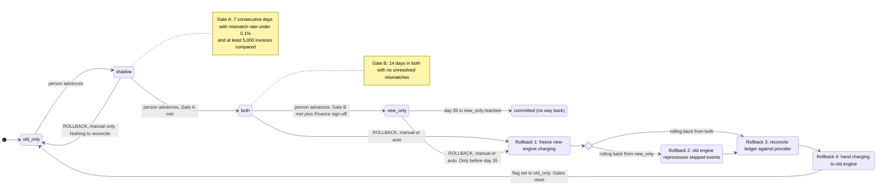

# Billing engine rollout: state machine

## Diagram

Every rollback ends in `old_only`. After that the only way forward is `old_only` to `shadow`, which a person triggers. The Gate A and Gate B counters start from zero each time.

## What each mode does

| Mode | Old engine | New engine | Who charges and who writes the ledger |
|---|---|---|---|
| `old_only` | Computes, charges, writes the ledger | Off | Old engine |
| `shadow` | Computes, charges, writes the ledger | Reads the same usage events and writes to the shadow store | Old engine. The new engine never charges and never writes the ledger. |
| `both` | Computes every invoice into the shadow store only | Computes, charges, writes the ledger | New engine |
| `new_only` | Stopped | Computes, charges, writes the ledger | New engine |
| `committed` | May be decommissioned | Does everything | New engine |

- **Nightly comparison:** it runs in `shadow` and `both`. An invoice is a mismatch if its total differs by more than one cent. In `both` the comparison is old engine against new engine.
- **`committed`:** this is the state from day 35 in `new_only`. The usage log keeps events for 35 days, so the oldest skipped events have expired and the old engine can no longer catch up. Rollback is closed.

## Rollback steps

1. **Freeze.** The new engine stops starting new charges. In-flight charges finish. Usage events keep arriving. Charges that fall due during the freeze are held, not dropped.
2. **Catch up (only from `new_only`).** The old engine reprocesses every usage event it skipped, into the shadow store. This is only possible inside the 35-day log window.
3. **Reconcile.** For every customer and billing period, compare the ledger with the payment provider's record. Mark each period as charged or due-and-uncharged. Resolve any in-flight charge whose outcome is unknown before moving on.
4. **Hand over.** The old engine becomes the charger. It charges only periods marked due-and-uncharged. It uses the same idempotency key (customer plus billing period) as the new engine. Then the flag is set to `old_only`.

The flag changes only in step 4. Until then the old engine is not charging, so the two engines can never charge at the same time. Rollback from `shadow` skips these steps because the new engine has never charged.

## Where the rollout state lives

- **Mode:** the `billing_mode` flag in the config service, as one of the four values. It is the only thing that says which mode is live.
- **Rollback progress:** a durable rollback record with the current step, where it started from, and what triggered it. I added this because the brief gives the flag only four values and no value for "mid-rollback". It lets a restarted controller resume at the right step.
- **Gate counters:** the consecutive-day count, invoices compared, mismatch rate and open mismatches. They are derived from the nightly comparison results. They are cleared when a rollback completes.
- **Day counters:** days in `both` and days in `new_only`, taken from the timestamp of the mode change, so they survive a restart.
- **Money:** the billing ledger remains the system of record. The shadow store is never read as truth.

## What happens when something fails

- **New-engine errors in `shadow`:** they are recorded only. No rollback.
- **Charge failure rate above 2% over any 10-minute window in `both` or `new_only`:** automatic rollback starts at step 1. On-call can also start a rollback by hand at any time.
- **Rollback trigger while a rollback is already running:** it is ignored. The running rollback continues.
- **A rollback step fails or stalls:** retry the step. Steps must be safe to repeat. The flag does not move, charging stays frozen and on-call is paged. Held charges are late but not lost, and nobody is charged twice.
- **A day-35 failure in `new_only`:** if the failure condition appears at or after day 35, the system cannot roll back. It pages on-call to fix forward. A rollback that is still catching up near the 35-day edge must finish or be abandoned before events expire. This needs a decision on what happens if it cannot finish in time.
- **Nightly comparison job fails or is skipped:** that day does not count towards Gate A or Gate B, so the consecutive-day count breaks.
- **Config service unreachable:** workers keep their last known mode. They must never fall back to a default that could make both engines charge.
- **Workers read the flag at different moments during an advance:** the shared idempotency key stops a double charge. Before charging, a worker checks the key against the ledger and the provider.

## Assumptions to confirm

- **Gate A volume:** I read "at least 5,000 invoices compared" as the total across the 7 days. The brief could also mean 5,000 each day. The mismatch rate is checked per day.
- **Day 35 lock:** I model the lock as automatic at day 35. The decommissioning itself is a separate action that a person takes afterwards.
- **Idempotency key:** I assumed the payment provider and the ledger both accept an idempotency key per customer and billing period. If the provider does not, step 3 has to carry more of the double-charge protection.
