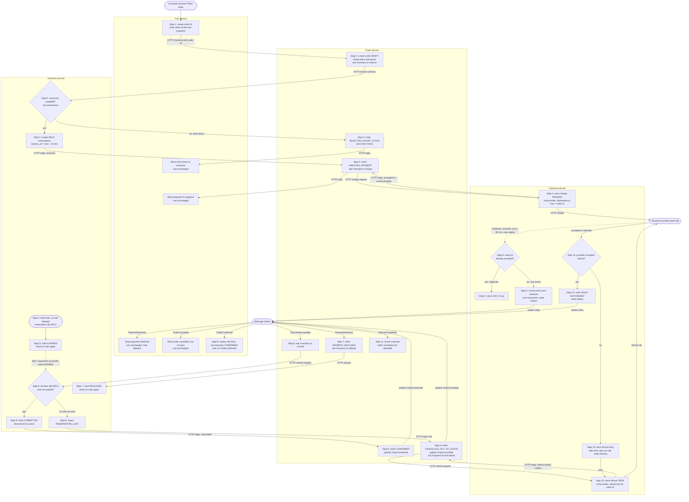

# Checkout across Cart, Inventory, Payment and Order

Today checkout runs inside the monolith. This design moves it into four services: **Cart**, **Inventory**, **Payment** and **Order**. When the customer presses Place order, Order asks Inventory to hold the stock, then asks Payment to charge. The payment provider reports the result later by webhook, and the services react to it through events on the message broker. Stock is held before any money is requested and is sold only when payment succeeds, so the customer is never kept charged for stock that has gone.

## Terms

- **Service:** a separately run program with its own database. No service reads another service's tables.
- **SKU:** a code for one product in stock.
- **Cart snapshot:** a copy of the cart's lines, quantities, unit prices and currency at the moment the customer presses Place order.
- **Order id:** a unique id that Cart creates for each Place order. Every call and event carries it.
- **HTTP call:** a request from one service to another that waits for a reply.
- **`on_hand`:** how many units of a SKU are physically in stock.
- **Hold (reservation):** Inventory's record that stock is set aside for one SKU of one order for 10 minutes. Status `HELD`.
- **Commit:** turning a hold into a sale. `on_hand` goes down and the hold becomes `COMMITTED`.
- **Release:** cancelling a hold so its stock can be sold again.
- **Provider:** the outside payment company that moves the money. Only Payment talks to it.
- **Webhook:** a message the provider sends to Payment with the result of a charge. It can arrive up to 30 minutes late, and more than once.
- **Provider event id:** the id the provider gives each webhook. A repeated webhook carries the same id.
- **Provider reference (`provider_ref`):** the id the provider gives a charge once it accepts the charge.
- **Idempotency key:** a value sent with a request so the receiver does the work only once, even if the request is sent again. Charges use the order id. Refunds use a key derived from the order id.
- **Message broker:** a shared system that carries events. A service publishes an event, and the services that need it consume it.
- **Acknowledge:** a consumer tells the broker it has handled an event. Until it does, the broker may send the event again.
- **Outbox:** a table in a service's own database. The service writes an event there in the same transaction as its state change. A relay reads unsent rows and publishes them, so an event is sent only for a change that was saved.
- **Scheduled job:** a task that runs on a timer inside one service.
- **Unique constraint:** a database rule that refuses a second row with the same value.

## Flowchart

Notes on the flowchart:
- Solid arrows wait for a reply. Dotted arrows are webhooks or later checks. Events go through the message broker.
- The customer's Place order request stays open until Order replies. Order replies once Inventory has reserved the stock and Payment has accepted the charge. Neither waits for the webhook.

## Steps

1. **Place order (Cart).** Starts when the customer presses Place order. Cart creates the order id and sends it with the cart snapshot to Order over HTTP, then waits for the reply. Cart records a `checkouts` row (order id, cart id, status in progress). Cart lines do not change. Cart keeps its lines in its own database.

2. **Create draft and reserve (Order, Inventory).** Starts when Order receives the checkout. Order creates the order in status `DRAFT`, with the lines and prices copied from the snapshot. Later cart edits and price changes do not affect it. Order stores the order's status, frozen lines and prices, total, cancel reason and short SKUs. Order sends the order id and all lines to Inventory over HTTP and waits.
   Inventory checks every line in one database transaction. A line is available when `on_hand`, minus the quantities of `HELD` holds for that SKU, covers the quantity wanted. Reservation is all-or-nothing:
   - If any line is short, Inventory writes nothing and replies with the short SKUs. Go to step 3.
   - If every line is available, Inventory writes one `HELD` reservation per SKU, with `expires_at` set to 10 minutes from now, and replies "reserved". `on_hand` does not change yet. Go to step 4.

   Inventory keeps `stock_levels(sku, on_hand)` and `reservations(order_id, sku, qty, status, expires_at)`. The reservations are unique on order id and SKU.

3. **Short stock (Order, Cart).** Starts when Inventory replies with short SKUs. Order sets `REJECTED_SHORT_STOCK`, keeps the short SKUs, and replies to Cart. Cart shows the customer exactly which items are short. No payment is requested. The cart is unchanged.

4. **Charge (Order, Payment).** Starts when Order has a reservation. Order sets `AWAITING_PAYMENT` and sends the order id and total to Payment over HTTP. Payment stores a `charges` row, unique on order id, with status `PENDING`, before it calls the provider. It calls the provider with the order id as the `Idempotency-Key`, and sends the order id as the charge reference so the webhook can name the charge. When the provider accepts the charge, Payment stores `provider_ref`. Payment replies to Order once the provider has accepted the request or the request is stored as pending for retry. It does not wait for the outcome. Order replies to Cart, which shows "payment in progress" with the order id. The cart is unchanged. Only Payment talks to the provider.
   A charge with no `provider_ref` has not been accepted yet. A scheduled job in Payment resends it with the same key until the provider accepts it. If the provider had accepted but its reply was lost, the resend returns the existing charge and then stores `provider_ref`. A charge with a `provider_ref` is waiting for a webhook, and the job leaves it alone.

5. **Hold timer (Inventory).** The 10 minutes start when the hold is created. A scheduled check in Inventory marks every `HELD` reservation past its `expires_at` as `EXPIRED`. Expired stock is no longer counted as held, so it is on sale again. The check can run while the provider is still working on the charge. An `EXPIRED` hold never returns to `HELD`.

6. **Provider result (Payment).** Starts when the provider sends a webhook. The webhook carries the provider event id, the order id and the outcome. It usually takes seconds, can take up to 30 minutes, and can be sent more than once. Payment looks up the event id in `webhook_events`:
   - If the id is already there, Payment returns 200 and does nothing.
   - If it is new, Payment finds the charge by order id, not by `provider_ref`, because the webhook can arrive before the provider's reply has stored that value. In one transaction, Payment stores the event id, changes the charge from `PENDING` to `SUCCEEDED` or `DECLINED`, and writes `PaymentSucceeded` or `PaymentDeclined` to its outbox. The charge changes only while it is still `PENDING`. The outbox relay publishes the event to the broker. Payment returns 200.

7. **Declined (Order, Inventory, Cart).** Starts when Order consumes `PaymentDeclined`. Order sets `PAYMENT_DECLINED` and sends the order id to Inventory over HTTP to release the holds. Inventory marks the order's holds `RELEASED`, so the stock is on sale at once. A hold that has already expired changes no stock, because an expired hold is not counted as held. Cart also consumes `PaymentDeclined`, sets its `checkouts` row to `DECLINED`, and shows the customer that the payment was declined. The cart is unchanged. A retry is a new Place order with a new order id, a new hold and a new charge.

8. **Success and commit (Order, Inventory, Cart).** Starts when Order consumes `PaymentSucceeded`. Order sends a commit request to Inventory over HTTP. Inventory, in one transaction, changes all of the order's holds to `COMMITTED` and reduces `on_hand`. It does this only if every hold is still `HELD` and not expired. Order stays `AWAITING_PAYMENT` until the commit succeeds.
   - If the commit succeeds, Order sets `CONFIRMED` and publishes `OrderConfirmed`. Cart consumes it, deletes its cart lines, and sets its `checkouts` row to `CONFIRMED`. The customer sees the order as confirmed the next time they view the cart.
   - If any hold is no longer `HELD` or has expired, Inventory writes nothing and replies `RESERVATION_LOST`. Go to step 9. This happens even if no other customer has bought the stock, because the hold has lapsed.

9. **Late success (Order, Cart, Payment).** Starts when Order gets `RESERVATION_LOST`. Order sets `CANCELLED_OUT_OF_STOCK`, keeps the reason, and publishes `OrderCancelled`. It then sends a refund request for the full amount to Payment over HTTP. Payment replies once it has stored the refund row as `OPEN` (step 10). Order then waits for `RefundCompleted`. Cart consumes `OrderCancelled`, sets its `checkouts` row to `CANCELLED_OUT_OF_STOCK`, and shows the customer that the order was cancelled because the stock was sold. The cart is unchanged, because the order was never confirmed. Partial orders are never shipped.

10. **Refund (Payment).** Starts when Payment receives the refund request. Payment stores a `refunds` row, unique on order id, with the full amount, status `OPEN` and `attempts` at 0, and replies to Order. Then it calls the provider to refund the full amount, with a refund key derived from the order id. Each attempt increases `attempts`, and a failed attempt stores `last_error`. When the provider accepts, Payment marks the refund `SUCCEEDED` and publishes `RefundCompleted`. A refund is never marked done before the provider confirms it.

11. **Email (Order).** Starts when Order consumes `RefundCompleted`. Order emails the customer that the order was cancelled because the stock was sold and that the money was returned.

## What happens when things fail

| Where | What goes wrong | What happens |
|---|---|---|
| Step 1 | Reply to Place order is lost | Cart sends the same order id again. Order returns the existing order. |
| Step 2 | Any line is short | Nothing is reserved. The customer sees the short items. No payment is requested. |
| Step 2 | Inventory's reply is lost | Order retries with the same order id. The unique key on order id and SKU makes the repeat harmless. |
| Step 4 | Provider call fails or times out | The charge stays `PENDING` with no `provider_ref`. The scheduled job resends the call with the same key, so the provider cannot charge twice. The result comes by webhook. The cart shows "payment in progress". |
| Step 5 | Provider still working after 10 minutes | The hold expires. A later success goes to step 9. |
| Step 6 | Webhook repeated, or two copies arrive together | A repeat finds the event id and does nothing. If two arrive together, the unique constraint lets one win and the other does nothing. The charge changes only while `PENDING`. |
| Step 7 | Provider declines the charge | Order sets `PAYMENT_DECLINED` and releases the stock. The customer is told. A retry is a new order. |
| Steps 7 and 8 | Order's call to Inventory (release or commit) fails, or its reply is lost | Order does not acknowledge the event, so the broker sends it again, and Order repeats the call with the same order id. Order acknowledges an event only after Inventory replies. A commit on an already `COMMITTED` reservation counts as success. A release on an already `RELEASED` hold changes nothing. |
| Step 8 | Hold has lapsed | Late success: the order is cancelled (step 9), refunded in full, and the customer is emailed. |
| Step 9 | Refund request to Payment fails | Order sends it again. The refund row is unique on order id, so the repeat does nothing new. |
| Step 10 | Provider rejects the refund or fails to process it | Payment retries with the same key. After the retry limit, Payment alerts on-call and keeps retrying until the provider accepts. The refund is never dropped. |
| Any event | Broker delivers an event twice | Cart and Order each keep a table of processed event ids and ignore repeats. Order also ignores `PaymentSucceeded` once it is past `AWAITING_PAYMENT`. |
| Any step | Checkout fails for any reason | The cart stays exactly as it was, so the customer can try again. Cart is emptied only on `OrderConfirmed`, never on an error. |

## Open questions

- **Which step claims the stock.** The brief says the order "claims" stock but not when. This design claims at the commit made when payment succeeds, not when the hold is created.
- **Customer messages while pending.** The brief does not say what the customer sees between the hold lapsing and the webhook arriving. The order stays `AWAITING_PAYMENT`, and Cart keeps showing "payment in progress" until the webhook arrives.
- **Missing webhook.** If no webhook arrives within 30 minutes, Payment could poll the provider using the order id. The brief does not require this.
- **Charge call that never reaches the provider.** The brief does not say how long Payment keeps retrying a charge call that fails, or what the order does then.
- **Order's wait for Inventory.** The brief does not say how long Order waits for Inventory's reply before it gives up.
- **Broker redelivery.** The brief does not name the broker. This design assumes it resends events that were not acknowledged.
- **Lapsed hold with stock still free.** This design cancels and refunds the order even if the stock is still free. Re-reserving stock is not in the brief.
- **Email sender.** Order sends the cancellation email after the refund completes. If a separate mail service exists, it should consume `RefundCompleted` instead.
- **Idempotency key retention.** Provider and service idempotency records must be kept at least as long as a webhook can arrive (30 minutes), plus a margin for retries.