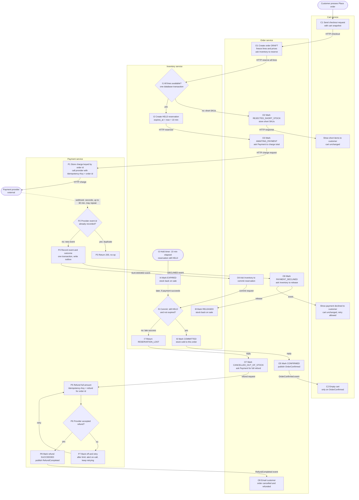

# Checkout across Cart, Inventory, Payment and Order

This design moves checkout into four services: **Cart**, **Inventory**, **Payment** and **Order**. Each owns its own database. Services call each other over HTTP when the customer is waiting for an answer, and publish or consume events on the message broker when the outcome arrives later. The payment provider's webhook is the only asynchronous input that can take up to 30 minutes.

## Key decisions

- **Reservation before payment.** Inventory holds stock for 10 minutes, keyed by order id. The hold is all-or-nothing, decided in one database transaction.
- **Stock is claimed when payment succeeds.** The order calls Inventory to commit the reservation at the moment a success is recorded. Commit succeeds only if the hold is still `HELD` and unexpired. If it has lapsed, the order is cancelled and refunded.
- **Idempotency keys.** Every charge uses the order id as the provider `Idempotency-Key`. Every refund uses a refund key derived from the order id. Retries therefore cannot charge or refund twice.
- **Webhook deduplication.** Payment records each provider event id under a unique constraint, in the same transaction as the state change. A repeated delivery finds the id already recorded and does nothing.
- **Cart changes only on confirmation.** Cart empties itself only when it receives `OrderConfirmed`. Every failure path leaves the cart as it was.

## Flowchart

## Steps

| Step | Service | Trigger | Stores |
|---|---|---|---|
| C1 | Cart | Customer presses Place order | Nothing new. Sends the cart snapshot (lines, quantities, unit prices, currency). |
| O1 | Order | HTTP from Cart | Order row in `DRAFT`, with frozen lines and prices. Calls Inventory. |
| I1, I2 | Inventory | HTTP from Order | If every line is available, one `HELD` reservation per order and SKU, with `expires_at`. If any line is short, nothing is written. |
| O2 | Order | Inventory reports short SKUs | Status `REJECTED_SHORT_STOCK` and the short SKU list. |
| O3 | Order | Reservation confirmed | Status `AWAITING_PAYMENT`. Calls Payment. |
| P1 | Payment | HTTP from Order | Charge row unique on order id, status `PENDING`. Calls the provider with the order id as the idempotency key. |
| P2 to P4 | Payment | Provider webhook | Event id recorded under a unique constraint. Charge set to `SUCCEEDED` or `DECLINED`. Outbox event written in the same transaction. |
| I3, I4 | Inventory | Hold timer, 10 minutes after creation | Reservation set to `EXPIRED` if still `HELD`. Stock returns to sale. |
| O4, I5, I6 | Order, Inventory | Payment succeeded | Conditional update: `HELD` and unexpired becomes `COMMITTED`, and stock is decremented. |
| O5 | Order | Commit succeeded | Status `CONFIRMED`. Publishes `OrderConfirmed`. |
| C2 | Cart | `OrderConfirmed` | Cart lines deleted. |
| O6, I8 | Order, Inventory | Payment declined | Status `PAYMENT_DECLINED`. Reservation set to `RELEASED`. |
| I7, O7 | Inventory, Order | Commit found the hold lapsed | Status `CANCELLED_OUT_OF_STOCK`. Refund requested for the full amount. |
| P5 to P8 | Payment | Refund requested | Refund row with status, attempt count and last error. Refund key is the idempotency key. Marked `SUCCEEDED` when accepted. |
| O8 | Order | `RefundCompleted` | Email sent. |

## What each service stores

- **Cart:** cart lines, which are mutable and deleted on `OrderConfirmed`. A table of processed event ids for broker deduplication.
- **Order:** orders with status, the frozen lines and prices, the total, the cancel reason and the short SKUs. An outbox for published events. A table of processed event ids.
- **Inventory:** `stock_levels(sku, on_hand)` and `reservations(order_id, sku, qty, status, expires_at)`, unique on order id and SKU. Outbox.
- **Payment:** `charges(order_id unique, amount, currency, provider_ref, status)`. `refunds(order_id unique, amount, status, attempts, last_error)`. `webhook_events(provider_event_id unique, received_at)`. Outbox.

## Failure branches

**Short stock.** Inventory's single transaction finds a short line, so it writes no reservations. Order records the short SKUs and the customer sees exactly which items are short. No payment is requested and the cart is unchanged.

**Declined payment.** The webhook records `DECLINED`. Order releases the reservation, so the stock returns to sale at once. The customer is told the payment was declined. The cart is unchanged and the customer can try again.

**Late success after the hold lapsed.** The timer may expire the hold while the provider is still working on the charge. When the webhook says `SUCCEEDED`, the commit in I5 fails because the reservation is no longer `HELD` and unexpired. The stock may already belong to someone else. The order is cancelled as out of stock, the full amount is refunded, and the customer is emailed. The cart is unchanged, because the order was never confirmed. Partial orders are never shipped.

**Failed refund.** A refund that the provider rejects or fails to process is retried with the same idempotency key, so retries cannot double-refund. After the retry limit, Payment alerts on-call. The refund row stays open, and retries continue until the provider accepts it. The refund is never dropped and never marked done before the provider confirms it.

**Duplicate webhook.** The first delivery is recorded in `webhook_events` in the same transaction as the state change. A repeat hits the unique constraint or finds the id already present, so it returns 200 and does nothing. Two deliveries that arrive at the same moment are settled by the constraint, and one of them loses. The charge update is also conditional on the status still being `PENDING`. Order and Inventory handle duplicate events the same way. Order ignores `PaymentSucceeded` if the order is already past `AWAITING_PAYMENT`. Inventory treats a commit on an already `COMMITTED` reservation as success.

**Transient errors.** Each HTTP call and each event carries the order id, so it can be retried safely. If Cart loses the reply to Place order, the customer can retry, and Order returns the existing order. Cart is never emptied on an error.

## Assumptions and open questions

- **Claim point.** The brief says the order "claims" stock. This design treats the claim as the commit made when payment succeeds, not when the reservation is created. The brief does not say which one it means.
- **Email sender.** The brief does not say which service sends the cancellation email. This design has Order send it after the refund completes, so the email can truthfully say the money was returned. If the mail service is separate, it consumes `RefundCompleted`.
- **Missing webhook.** If no webhook arrives within 30 minutes, Payment could poll the provider using the order id. This is a suggested addition, not something the brief requires.
- **Retention of idempotency keys.** Provider and service idempotency records must be kept at least as long as a webhook can arrive, which is 30 minutes, plus margin for retries.
- **Customer messaging while pending.** The brief does not say what the customer sees between the 10-minute hold lapsing and the webhook arriving. The design does not change the order status in that window, so the order stays `AWAITING_PAYMENT`.
