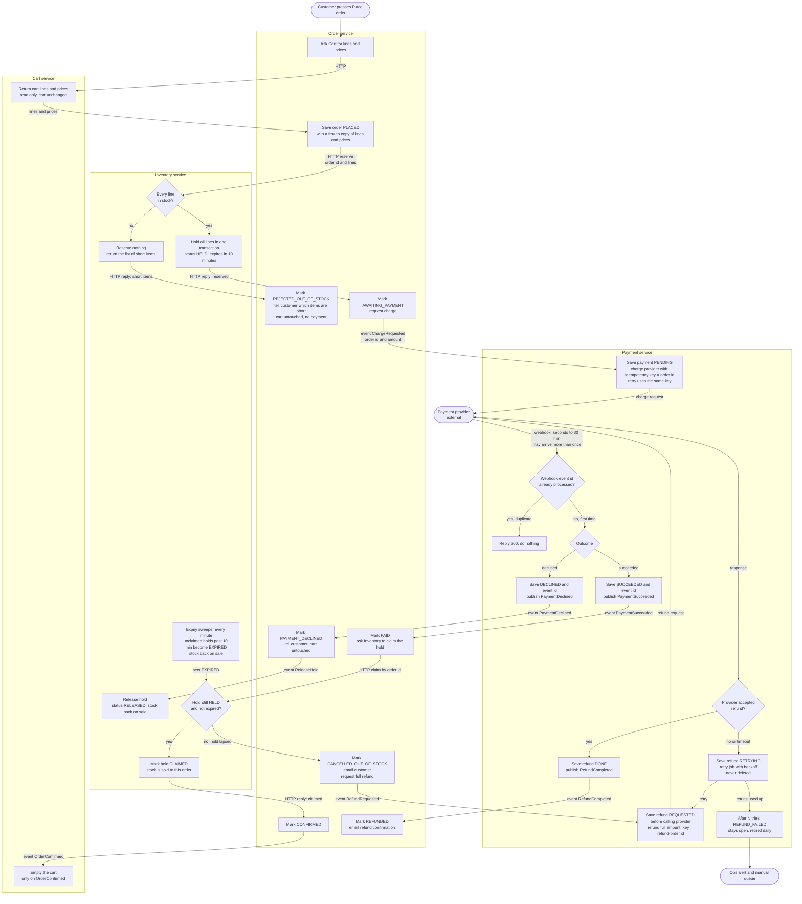

# Checkout across Cart, Inventory, Payment and Order

## Summary

Checkout used to live in the monolith. It now runs across four services: Cart, Inventory, Payment and Order. Order coordinates: it saves a frozen copy of the cart, has Inventory hold the stock, has Payment charge the customer, then claims the hold and confirms. Stock is held before any money is requested, and money is never kept for an order we cannot fulfil, so a payment that succeeds after the hold lapsed is refunded and the order cancelled.

## Terms

- **Order** is the coordinator. It is the only service that tells the others what to do next, and it keeps the order's status.
- **HTTP** means a direct call between services. **Event** means a message on the shared broker.
- **Own database.** Each service writes only to its own database and never reads another's.
- **Hold.** A reservation of stock for one order. It lasts 10 minutes (status HELD) and is then either CLAIMED by the order, RELEASED, or EXPIRED, after which the stock is back on sale.
- **Provider.** The external payment provider. Only Payment talks to it.
- **Webhook.** An HTTP endpoint on Payment that the provider calls to report a charge outcome (succeeded or declined). It usually arrives in seconds, can take up to 30 minutes, and can be delivered more than once.
- **Idempotency key.** A value sent with a provider request so that repeating the request cannot act twice. Charges use the order id. Refunds use "refund-" plus the order id.
- **Outbox.** A service saves its state change and the event it wants to publish in one local transaction. A relay, a background loop in each service, reads unsent outbox rows, publishes them, and marks each sent only after the broker confirms. If the broker is down, rows stay unsent and the relay keeps trying. A crash cannot leave a state change without its event.
- **Idempotent consumers.** Every event carries the order id. Each handler checks the current status before acting, so a repeated event has no extra effect. This also covers the relay sending an event twice.
- **Tell the customer.** Order does it in two ways: the status shown on the page, and an email through the company mailer. While the provider decides, the page shows "awaiting payment".

## Flowchart

The solid path down the middle is the happy path. Every failure branch leaves the cart as it was.

## Steps

The table adds what the diagram cannot show: triggers, stored data and rules. Failures are in the next section.

| Step | Service | Trigger | What happens | Data it keeps |
|---|---|---|---|---|
| 1 | Order | Customer presses Place order | Fetches cart lines and prices from Cart and saves the order PLACED with a frozen copy and the cart id. Later cart edits or price changes never touch it. | Order: status, cart id, frozen lines and prices, total |
| 2 | Inventory | HTTP reserve from Order | Holds all lines in one transaction, or none. The hold expires 10 minutes later. Reserve is keyed by order id, so a repeat returns the hold already made. | Reservation by order id: lines, status, expiry time. Stock levels |
| 3 | Payment | ChargeRequested event | Order saves AWAITING_PAYMENT and the event in one transaction (outbox). Payment saves the payment PENDING, then asks the provider to charge, using the order id as idempotency key. The charge carries the order id, the amount and a payment-method reference (see open questions). | Payment by order id (unique): status, provider reference |
| 4 | Payment | Provider webhook | Maps the provider's payment reference to the order id in the payment row. If the provider's event id is already in the processed table (unique), replies 200 and does nothing. Otherwise saves the outcome and the event id in one transaction, then publishes the result. A success for a payment saved as FAILED is saved as SUCCEEDED, because the money was taken. | Processed event ids (unique). Payment status: PENDING, SUCCEEDED, DECLINED, FAILED |
| 5 | Order | PaymentSucceeded | Saves the order PAID first, then asks Inventory to claim the hold. | Order status |
| 6 | Inventory | HTTP claim | Succeeds only if the hold is HELD and its expiry time has not passed. Claim and expiry both use a conditional status update, so exactly one wins. Claim is keyed by order id, so repeating it is safe. Nothing extends the hold while the order waits for payment. | Reservation status |
| 7 | Order, Cart | Claim succeeded | Order becomes CONFIRMED and publishes OrderConfirmed with the order id and cart id. Cart empties that cart on this event and only then. | Cart lines (changed only by customer edits and OrderConfirmed). Cart keeps no order data |

## When things fail

In every case below the cart stays exactly as it was, so the customer can try again, unless the row says otherwise.

| Case | What happens | Money |
|---|---|---|
| **Short stock** | Inventory reserves nothing and replies with the short items. Order marks REJECTED_OUT_OF_STOCK and tells the customer which items. Payment is never contacted. | None taken |
| **Reserve call fails or times out** | The order stays PLACED. Order repeats the call a few times (safe, keyed by order id). If there is still no answer, Order marks the order FAILED and tells the customer to try again. A hold Inventory made unseen expires after 10 minutes. | None taken |
| **Charge call fails or times out** | The payment stays PENDING. Payment repeats the call with the same key, so the provider never charges twice. When retries are used up, Payment saves FAILED and publishes PaymentDeclined, which follows the declined path. If the provider did charge, its later success webhook is an out-of-order success (below). | None, or refunded |
| **Declined payment** | Payment publishes PaymentDeclined. Order marks PAYMENT_DECLINED (final), tells the customer, and sends ReleaseHold so the stock returns at once. Inventory releases only a HELD hold and ignores a CLAIMED, EXPIRED or missing one. To retry, the customer presses Place order, which makes a new order with a new id (and so a new charge key) from the intact cart. | None taken |
| **Duplicate webhook** | The second delivery finds the stored event id, replies 200 and does nothing. The unique constraint on the id also covers two deliveries at the same moment. | Not affected |
| **Claim call fails or times out** (not "hold lapsed") | The order stays PAID. Order repeats the claim with backoff. Once the hold's expiry has passed the claim is refused and late success applies. | Paid, outcome pending |
| **Order service crashes** | Progress is the saved status. Every minute a recovery loop in Order finds orders left in PLACED or PAID for over a minute and repeats the reserve or claim call (safe, both keyed by order id). This also covers a crash after the reserve reply but before AWAITING_PAYMENT was saved: the order is still PLACED, the repeated reserve returns the existing hold, and the order moves on. A PLACED order still unanswered after 10 minutes is marked FAILED. | None, or follows the claim path |
| **Late success** (hold lapsed, stock may be sold on) | The claim is refused, either because the sweeper set EXPIRED or because the claim came after the expiry time. Order marks CANCELLED_OUT_OF_STOCK, emails the customer and publishes RefundRequested for the full amount. Order does not touch the hold: its stock is already back on sale. We never ship partial orders. | Full refund |
| **Out-of-order success** (PaymentSucceeded reaches an order not in AWAITING_PAYMENT, for example FAILED) | Order marks CANCELLED_LATE_PAYMENT, emails the customer that the charge is being refunded, and requests a full refund. Any hold expires by itself. | Full refund |
| **Refund fails at the provider** | The refund row is saved REQUESTED before the provider is called, so it survives a crash. A failure or timeout moves it to RETRYING and a retry job repeats the call with backoff. The stable key (refund-order id) means a retry cannot refund twice. After N attempts it becomes REFUND_FAILED, raises an ops alert and stays in the retry list, retried daily. A refund is never deleted or skipped. Order does not track this: the order stays cancelled until RefundCompleted arrives, then Order marks REFUNDED and emails the customer. | Refund pending until it succeeds |

Order statuses: PLACED, FAILED, REJECTED_OUT_OF_STOCK, AWAITING_PAYMENT, PAYMENT_DECLINED, PAID, CONFIRMED, CANCELLED_OUT_OF_STOCK, CANCELLED_LATE_PAYMENT, REFUNDED. Hold statuses: HELD, CLAIMED, RELEASED, EXPIRED. Refunds are stored in Payment with a status and an attempt count. Each of Order, Inventory and Payment also keeps an outbox.

## Decisions to check

- **Late payment is normal, not rare.** The hold lasts 10 minutes and the provider can take 30, so any payment succeeding after 10 minutes is refunded and the order cancelled, even if the stock is still unsold. If that is common, consider a longer hold or a re-reserve attempt before refunding. As specified, we refund and cancel.
- **Expiry is strict.** A claim at or after the expiry time is refused even if the sweeper has not run, so the outcome does not depend on the sweeper's timing.
- **Email.** The brief names no mailer. We assume Order uses the company's existing one. A failed email must not block the refund.
- **One open checkout per cart** is assumed. A second Place order while one is awaiting payment should be rejected or reuse the open order. Confirm.
- **Numbers and owners needed:** the refund retry limit N and its alert owner, and the retry counts for the reserve, charge and claim calls.

## Open questions

- If Payment is down when the provider sends a webhook, does the provider redeliver, and for how long? Not known. If it gives up, a PENDING payment could stay stuck. Check the provider's policy and whether we should query it for old PENDING payments.
- How does the customer's page learn the status, by polling or push? Not decided.
- Where do card details come from? The brief does not say. We assume the provider collects them (for example a hosted form) and gives us a payment-method reference, so card numbers never reach our services. Confirm with the provider integration.
- If the customer edits the cart after pressing Place order, OrderConfirmed empties the whole cart, including the new edits. Should it remove only the ordered lines? Not decided.
