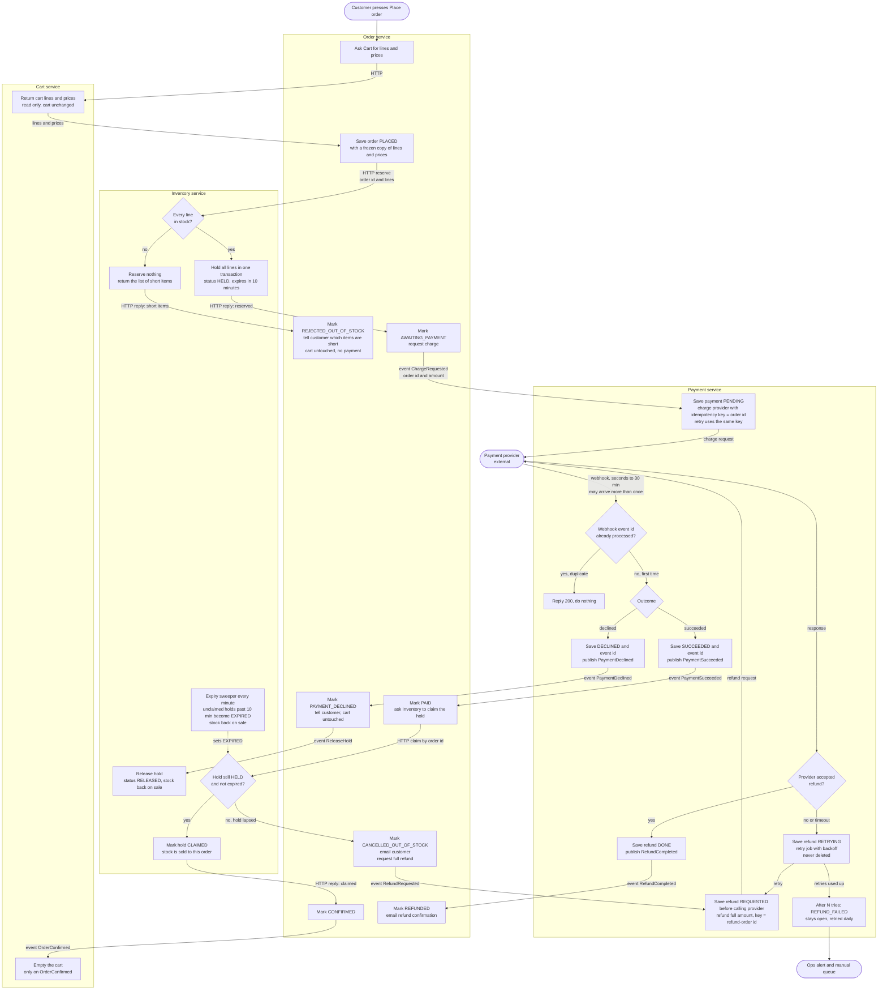

# Checkout across Cart, Inventory, Payment and Order

## How to read this

Order is the coordinator. It is the only service that tells the others what to do next, and it keeps the order's status. Each service writes to its own database only. Between services, "HTTP" means a direct call and "event" means a message on the shared broker.

Two rules apply to every event:
- **Outbox.** A service saves its state change and the event it wants to publish in one local transaction. A relay then sends the event. A crash cannot leave a state change without its event.
- **Idempotent consumers.** Every event carries the order id, and a repeat must have no extra effect. Each handler checks the current status before acting.

## Flowchart

Reading the picture: the solid path down the middle is the happy path. Each failure branch ends in a status that the customer can see and that leaves the cart as it was.

## Step by step

| Step | Service | Trigger | What happens |
|---|---|---|---|
| 1 | Order | Customer presses Place order | Fetches cart lines and prices from Cart, saves the order with a frozen copy. Later cart edits or price changes do not touch it. |
| 2 | Inventory | HTTP reserve from Order | Checks all lines and holds all of them in one transaction, or none. The hold expires 10 minutes later. |
| 3 | Payment | ChargeRequested event | Saves the payment, then asks the provider to charge. The idempotency key is the order id, so a retry cannot charge twice. |
| 4 | Payment | Provider webhook | Checks the provider's event id against its processed list. A duplicate gets a 200 reply and nothing else. Otherwise it stores the outcome and the event id in one transaction, then publishes the result. |
| 5 | Order | PaymentSucceeded | Asks Inventory to claim the hold. |
| 6 | Inventory | HTTP claim | Succeeds only if the hold is HELD and its expiry time has not passed. Claim and expiry both use a conditional status update, so exactly one of them wins. |
| 7 | Order, Cart | Claim succeeded | Order becomes CONFIRMED and publishes OrderConfirmed. Cart empties on that event, and only then. |

## Failure branches

| Case | What happens | Cart | Money |
|---|---|---|---|
| **Short stock** | Inventory reserves nothing and replies with the short items. Order marks REJECTED_OUT_OF_STOCK and tells the customer which items. Payment is never contacted. | Unchanged | None taken |
| **Declined payment** | Payment publishes PaymentDeclined. Order marks PAYMENT_DECLINED, tells the customer, and sends ReleaseHold so the stock returns at once rather than after 10 minutes. | Unchanged | None taken |
| **Late success** (hold lapsed and stock sold on) | The sweeper has set the hold to EXPIRED, or the claim arrives after the expiry time. The claim is refused. Order marks CANCELLED_OUT_OF_STOCK, emails the customer and publishes RefundRequested for the full amount. | Unchanged | Full refund |
| **Refund fails at the provider** | The refund row is saved as REQUESTED before the provider is called, so it exists even if we crash. A failure or timeout moves it to RETRYING, and a retry job repeats the call with backoff. The refund key is stable (refund-order id), so a retry cannot refund twice. After N attempts it becomes REFUND_FAILED, raises an ops alert and stays in the retry job's list. A refund is never deleted or skipped. | Unchanged | Refund pending until it succeeds |
| **Duplicate webhook** | The provider's event id is stored with the outcome in one transaction. A second delivery finds the id, replies 200 and does nothing. A unique constraint on the id also covers two deliveries arriving at the same moment. | n/a | n/a |

## What each service stores

| Service | Data it owns |
|---|---|
| **Cart** | Cart lines for each customer. It is changed by the customer's edits and by OrderConfirmed. It keeps no copy of order data. |
| **Order** | Orders with status (PLACED, REJECTED_OUT_OF_STOCK, AWAITING_PAYMENT, PAYMENT_DECLINED, PAID, CONFIRMED, CANCELLED_OUT_OF_STOCK, REFUNDED), the frozen lines and prices, the total, and an outbox. |
| **Inventory** | Stock levels. Reservations keyed by order id with lines, status (HELD, CLAIMED, RELEASED, EXPIRED) and expiry time. An outbox. |
| **Payment** | Payments by order id (unique), with status and provider reference. Processed webhook event ids (unique). Refunds with status and attempt count. An outbox. |

## Decisions and assumptions to check

- **Late-arriving payment is normal, not rare.** The hold lasts 10 minutes and the provider can take 30, so any payment slower than 10 minutes risks this path. If it is common, consider a longer hold or a re-reserve attempt before refunding. As specified, we refund and cancel.
- **Expiry is strict.** A claim at or after the expiry time is refused even if the sweeper has not run yet. This keeps the outcome the same whether or not the sweeper is late.
- **Out-of-order events.** If PaymentSucceeded reaches an order that is not AWAITING_PAYMENT, for example already cancelled, Order requests a refund rather than ignoring the money.
- **Email.** The brief does not name an email service. I assume Order sends the emails through the company's existing mailer. Retrying an email must not block the refund.
- **One open checkout per cart** is assumed. A second press of Place order while an order is awaiting payment should be rejected or should reuse the open order. This is not specified, so confirm it.
- **Retry limit N and alerting** for failed refunds need numbers and an owner.
