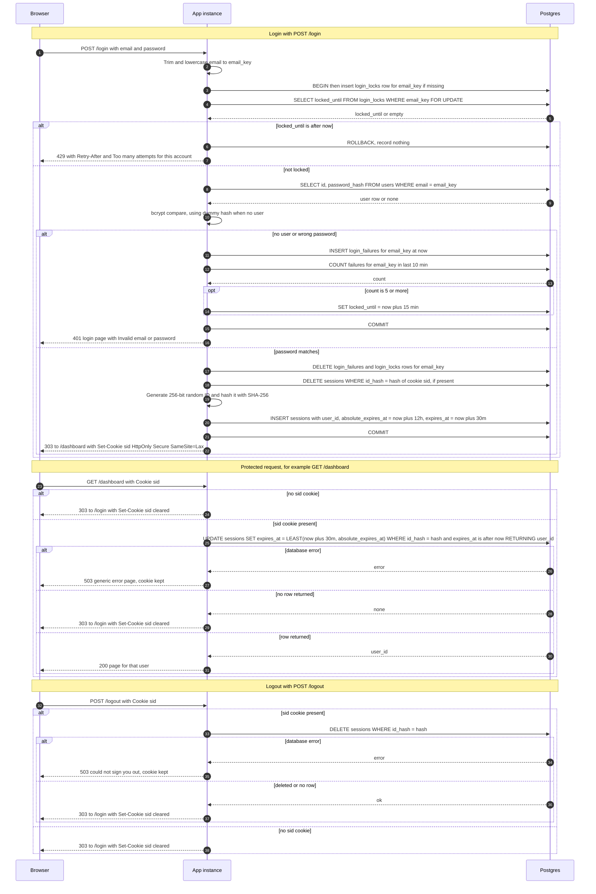

# Login with server-side sessions: design

## Summary

Today the app has no sign-in, so every page is public. It is a server-rendered site that runs as two identical instances behind a load balancer, with one Postgres database that has a `users` table. After this change, `POST /login` checks the email and password and stores a session record in Postgres. The browser gets a cookie that holds only a random session ID, and every page except `/login` checks that ID in Postgres, so both instances agree without sticky sessions. Sign-up and password reset are out of scope.

## Terms

- **Postgres**: the relational database the app already uses.
- **Session**: the server's record that one user is signed in, with its expiry times.
- **Session ID**: a random secret string that names one session. It is the only data in the cookie.
- **Cookie**: a small value the server asks the browser to store and send back on each request. This one is named `sid`.
- **HttpOnly, Secure, SameSite=Lax**: cookie flags. HttpOnly hides the cookie from page scripts. Secure sends it only over HTTPS. SameSite=Lax stops most cross-site requests from carrying it.
- **Hash (SHA-256)**: a one-way fingerprint of a value. The database stores only the hash of each session ID.
- **CSPRNG**: a random number generator that is safe for secrets.
- **bcrypt**: a deliberately slow password-hashing function. `users.password_hash` holds bcrypt output.
- **Dummy hash**: a fixed bcrypt hash used when no account matches, so an unknown email takes as long to check as a wrong password.
- **Account enumeration**: an attacker working out which emails have accounts from differences in the replies. The design removes these differences.
- **Row lock (`FOR UPDATE`)**: a lock on one database row. Other attempts that need that row wait until it is released.
- **Idempotent**: running it twice leaves the same result as running it once.
- **Database clock (`now()`)**: Postgres's own time. All expiry checks use it, so the two app instances cannot disagree about the time.
- **Sticky session**: the load balancer always sends one user to the same instance. This design does not use it.
- **303 redirect**: a reply that tells the browser to load another page with GET.
- **Cache-Control: no-store**: tells browsers and proxies not to keep a copy of the page.
- **Retry-After**: a header that tells the client how many seconds to wait before trying again.
- **CSRF**: cross-site request forgery, where another site makes the victim's browser send a form post. See open questions.
- **Cleanup job**: a background task that deletes old rows.

## Stored data

Three new tables in the existing Postgres database. Every email is stored as `email_key`: the submitted email, trimmed and lowercased, whether or not an account exists.

- `sessions`: one row per session. Columns: `id_hash` (primary key, the SHA-256 hash of the session ID), `user_id`, `created_at`, `absolute_expires_at` (login time plus 12 hours, never changed), and `expires_at` (the time the session expires next). Indexed on `expires_at`.
- `login_failures`: one row per failed attempt. Columns: `email_key` and `failed_at`. Indexed on (`email_key`, `failed_at`).
- `login_locks`: at most one row per email. Columns: `email_key` (primary key) and `locked_until`.

## Diagram

The diagram shows the arrows for sign-in, a protected request and sign-out. The steps and rules below add the data and failure handling that the arrows do not show.

## Steps

### Sign-in (starts when the browser posts the login form to `POST /login`)

1. **Check the input.** Trim and lowercase the email to `email_key`. Before any database access, check the limits. An email over 254 characters, a password over 72 bytes, or an empty field gets the generic 401 and nothing is written. Bcrypt silently ignores bytes past 72, so longer passwords are refused rather than cut short.
2. **Open a transaction and lock the email.** Insert a `login_locks` row for `email_key` if none exists, then take a row lock on it. Other attempts for the same email wait here. Attempts for other emails are not blocked.
3. **Check the lock.** If `locked_until` is later than the database clock, return 429 with Retry-After and "Too many attempts for this account". Record nothing, do not extend the lock, do not check the password, and roll back.
4. **Check the password.** Look up the user by `email_key`. Run bcrypt against the stored hash, or against the dummy hash if no user matches. Both paths cost one bcrypt run.
5. **Handle a failure.** If no user matched or the password is wrong, insert a `login_failures` row at the current time. Count this email's failures in the last 10 minutes. If the count is 5 or more, set `locked_until` to now plus 15 minutes. Commit, then return the 401 login page with "Invalid email or password". The body and headers are identical for an unknown email and a wrong password.
6. **Start the session.** If the password matches, delete this email's `login_failures` rows and its `login_locks` row. If the request has a `sid` cookie, delete the session it points to, even if that session was expired or unknown. Generate a new session ID: 32 random bytes from a CSPRNG, encoded as base64url. Store only its SHA-256 hash in `sessions`, with `user_id`, `absolute_expires_at` set to now plus 12 hours, and `expires_at` set to now plus 30 minutes. Commit. Reply 303 to `/dashboard` and set the cookie (see Rules).

### Protected page (starts when the browser requests any page except `/login` and static assets)

1. **No cookie.** If there is no `sid` cookie, reply 303 to `/login` and clear the cookie.
2. **Check and refresh.** Otherwise, run one `UPDATE` on `sessions`. It sets `expires_at` to the earlier of now plus 30 minutes and `absolute_expires_at`, only where `id_hash` matches the hash of the cookie value and `expires_at` is later than now. It returns `user_id`. One statement checks the session and refreshes it, so expired rows fail without a separate read. The data stays in `sessions`.
3. **Row returned.** Serve the page for that user with status 200 and `Cache-Control: no-store`.
4. **No row returned.** The session is missing, unknown or expired. Reply 303 to `/login` and clear the cookie.
5. **Database error.** Show a generic 503 error page. Keep the cookie and do not redirect.

Static assets (CSS, images, JavaScript) are public. They never touch the session tables and do not restart the idle clock.

### Sign-out (starts when the browser posts to `POST /logout`)

1. **Delete the session.** If there is a `sid` cookie, delete the `sessions` row whose `id_hash` matches it. This happens before the reply.
2. **Reply.** If the row was deleted, or there was no row, reply 303 to `/login` and clear the cookie. A request with no cookie gets the same reply, so the response reveals nothing about session state.
3. **Database error.** Reply 503 and keep the cookie (see the failure table).

### Cleanup job (background, starts every 15 minutes on each instance)

1. Delete in batches: `sessions` rows whose `expires_at` is more than a day old, `login_failures` rows older than 10 minutes, and `login_locks` rows past `locked_until`.
2. The job is idempotent, so both instances may run it. Leftover rows are harmless, because every check uses `expires_at` or `locked_until`.

## Rules

- **Session limits.** A session ends 30 minutes after the last valid request, or 12 hours after login, whichever comes first. Each valid request restarts the 30-minute clock. `absolute_expires_at` is never extended. `expires_at` always equals the earlier of the two.
- **Time.** All time comparisons use the database clock, not the app servers' clocks.
- **Cookie.** The value is `sid=<id>; Path=/; HttpOnly; Secure; SameSite=Lax`, with no `Max-Age`. It is a browser-session cookie, and the server alone enforces the 30-minute and 12-hour limits. It holds only the session ID, never user data. Clearing it uses the same attributes with `Max-Age=0`.
- **Headers.** Every redirect is 303. Login and protected pages send `Cache-Control: no-store`.
- **Lockout window.** Failures are counted over a sliding 10-minute window. The 5th failure inside any such window starts a lock at that failure's commit time. The lock lasts a fixed 15 minutes. Failures older than 10 minutes do not count. The lock outlasts the window, so the failures that caused it are outside the window when it ends.
- **Locked attempts.** A locked attempt records nothing, does not extend the lock and does not check the password. A successful login clears that email's failures and lock.
- **Lock key.** The key is `email_key`, whether or not an account exists, so a 429 never reveals whether an account exists. Accepted tradeoff: anyone can lock out any known email. The spec requires per-email lockout.
- **Serialization.** The row lock is held during bcrypt, so attempts for one email run one at a time, at about one bcrypt time each. Without this, parallel wrong passwords could all read a count of 4. Different emails do not block each other.
- **Enumeration.** The dummy hash keeps response times equal for unknown emails. Empty fields, over-limit inputs and unknown emails get the same 401 as a wrong password.

## Why Postgres, not Redis

- Process memory cannot work, because the two instances do not share memory.
- Redis is not in the stack today. Both instances already share Postgres, so no new service is needed. Session and lockout writes can share a transaction with the `users` lookup.
- At small-team traffic, one primary-key update per request is well within what Postgres handles. Redis would add a second place for data to stay consistent, and another service to run, for no current benefit.
- Revisit this if request volume grows and the per-request write starts to show in latency.

## What happens when things fail

| Where it fails | What happens | What the user sees | Cookie |
|---|---|---|---|
| Sign-in, input over limits or empty | Nothing written | Generic 401, "Invalid email or password" | Unchanged |
| Sign-in, account locked | Nothing recorded, password not checked | 429 with Retry-After, "Too many attempts for this account" | Unchanged |
| Sign-in, any database error | Roll back. No session created. The password result is not revealed, so it fails closed | Login page, "Sign-in is temporarily unavailable. Try again shortly.", 503, Retry-After: 30 | Unchanged |
| Protected page, session missing, unknown or expired | None | 303 to `/login` | Cleared |
| Protected page, any database error | Nothing is served | Generic 503 error page | Kept, with no redirect, so a brief outage does not sign people out |
| Sign-out, any database error | The session may still exist | "We could not sign you out. Try again.", 503 | Kept. The user is never told they are signed out while the server session exists |
| Cleanup job fails | Logged, then retried on the next cycle | Nothing | No effect. Expiry uses `expires_at`, not cleanup |

## Build and rollout

- Local development needs HTTPS, because the cookie is `Secure`.
- Before rollout, confirm that no stored password is longer than 72 bytes. Any that are cannot sign in after this change.

## Open questions

- **Login CSRF.** `SameSite=Lax` does not stop another site from making the victim's browser post the login form, because login needs no existing cookie. The brief does not cover this. Recommended, not yet decided: a CSRF token on the login form.
- **Per-request write.** Every protected request updates a row. This is intentional, so each request restarts the 30-minute clock. If it becomes a bottleneck, the only allowed optimization is to skip the write when `expires_at` is already more than a few seconds ahead. That choice must be made explicitly before it is used.