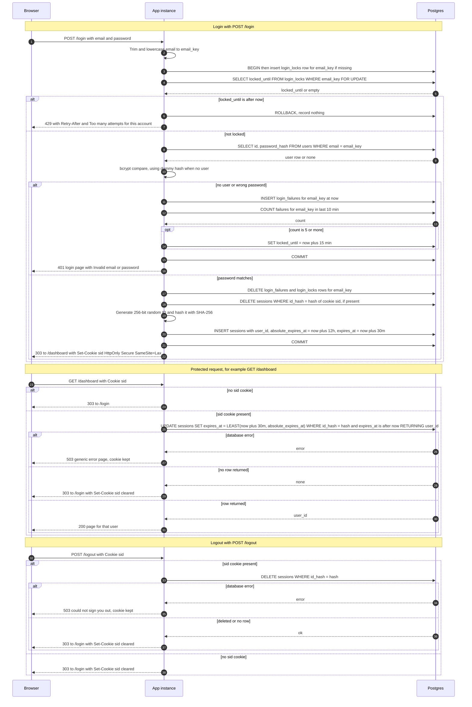

# Login with server-side sessions: design

## Decisions

1. **Storage: Postgres, not Redis.** Sessions and failure counts live in three new tables in the existing database:
   - `sessions(id_hash PK, user_id, created_at, absolute_expires_at, expires_at)`, indexed on `expires_at`.
   - `login_failures(email_key, failed_at)`, indexed on `(email_key, failed_at)`.
   - `login_locks(email_key PK, locked_until)`.

   Why not Redis: both instances already share Postgres, so no new service is needed. Session and lockout writes can share a transaction with the `users` lookup. At small-team traffic, one primary-key update per request is well within what Postgres handles. Redis would add a second consistency domain and an operational dependency for no current benefit. Revisit this if request volume grows to the point where the per-request write shows up in latency.

2. **Session ID.** 32 bytes from a CSPRNG, base64url-encoded. The cookie carries only this value. The database stores only its SHA-256 hash, so a database leak does not expose usable session IDs.

3. **Expiry is checked and recorded in one column.** `expires_at` always equals `min(last request + 30 min, absolute_expires_at)`, and `absolute_expires_at = login + 12 h` is never extended. Every valid protected request runs one `UPDATE ... RETURNING` that both checks `expires_at` is later than now and refreshes it. Expired rows fail that check without a separate read. All time comparisons use Postgres `now()`, not app-server clocks, so the two instances cannot disagree.

4. **Abandoned rows are removed by a background job** every 15 minutes. It deletes sessions whose `expires_at` is more than a day old, failure rows older than 10 minutes, and locks past `locked_until`. Deletes run in batches and are idempotent, so both instances may run the job. Dead rows are harmless because every check uses `expires_at`.

5. **Lockout.** Failures are counted over a sliding 10-minute window. The 5th failure inside any such window sets `locked_until = now + 15 min`. While locked, the handler returns 429 before any bcrypt work. A locked attempt records nothing and does not extend the lock. A successful login deletes that email's failure rows and lock row.
   - The key is the normalized submitted email string, whether or not an account exists. This means 429 never reveals whether an account exists.
   - Concurrent attempts are serialized by locking the `login_locks` row `FOR UPDATE` for the whole attempt. Without this, parallel wrong passwords could all read a count of 4.
   - Accepted tradeoff: anyone can lock out any known email. The spec requires per-email lockout, so this is intended.

6. **Enumeration hardening.** When no user matches, bcrypt runs against a fixed dummy hash so response time looks the same. The 401 body and headers are byte-identical for unknown emails and wrong passwords. Input limits apply before any database access: email at most 254 characters, password at most 72 bytes (bcrypt silently truncates beyond that, so longer passwords get the same generic 401). Empty fields get the same 401 and write nothing.

7. **Cookie.** `sid=<id>; Path=/; HttpOnly; Secure; SameSite=Lax`, with no `Max-Age`. It is a browser-session cookie, and the server alone enforces the 30-minute and 12-hour limits. Clearing uses the same attributes with `Max-Age=0`. Local development therefore needs HTTPS.

8. **Static assets** are public and never touch the session tables, so they do not restart the idle clock. Login, dashboard and other protected pages send `Cache-Control: no-store`. All redirects are 303.

## Sequence diagram

## Rules that do not fit on the arrows

- **Rotation.** On success, the old session is deleted and the new one inserted in the same transaction. This happens even if the old session was expired or unknown.
- **Lock timing.** The lock starts at the 5th failure's commit time. Lock length is fixed at 15 minutes. Failures older than 10 minutes do not count. Because the lock outlasts the window, failures that caused a lock are already outside the window when it ends.
- **Per-email serialization.** Holding the `login_locks` row lock during bcrypt serializes attempts for one email, at roughly one bcrypt time per attempt. Attempts for different emails do not block each other.
- **Logout without a session** returns the same 303 and cookie-clearing response as a successful logout, so the response reveals nothing about session state.

## What the user sees when storage fails

- **Login, any database error.** Roll back. Show the login page with "Sign-in is temporarily unavailable. Try again shortly." (HTTP 503, `Retry-After: 30`). No session is created. The password result is not revealed. This fails closed.
- **Protected page, database error.** Show a generic 503 error page. Do not clear the cookie and do not redirect to `/login`, so a brief outage does not sign people out. The page is never served.
- **Logout, database error.** Show "We could not sign you out. Try again." (HTTP 503) and keep the cookie. The user is never told they are signed out while the server session still exists.
- **Cleanup job failure.** Log it and retry on the next cycle. Users are not affected, because expiry is enforced by `expires_at` rather than by cleanup.

## Open items

- **Login CSRF.** `SameSite=Lax` does not stop an attacker from posting a login form to the victim's browser, because login needs no existing cookie. The brief does not cover this. Recommend a CSRF token on the login form.
- **Existing password lengths.** Confirm that no stored password exceeds 72 bytes. Any that do will be unable to sign in after this change.
- **Per-request write.** Every protected request updates a row. This is intentional, to satisfy "every request restarts the clock." If it becomes a bottleneck, the only allowed optimization is to skip writes when `expires_at` is already more than a few seconds in the future, and that must be decided explicitly.