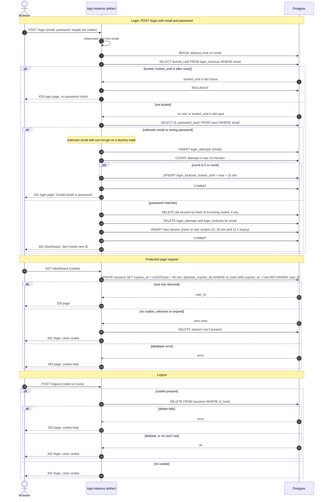

# Login with server-side sessions: design

## Summary

Today the app is a server-rendered site with no sign-in: every page is public. It runs as two identical instances behind a load balancer, with no sticky sessions, on one Postgres database. Its `users` table already holds `id`, `email` (lowercase, unique) and `password_hash` (bcrypt). Sign-up and password reset are out of scope.

After this change, every page except `/login` needs a signed-in user. A successful `POST /login` creates a session row in Postgres and gives the browser a cookie holding only a random ID. Every later request looks that ID up in Postgres, so either instance can serve it. Postgres holds the sessions and the failed-login counts because both instances already share it.

## Terms

- **Session**: a row in `sessions` that says "this browser is signed in as this user". The cookie holds only the random ID that finds the row.
- **CSPRNG**: a random number source that is safe for secrets.
- **bcrypt**: the slow password hash in `users.password_hash`. "Running bcrypt" means checking a password against a hash.
- **Advisory lock**: a Postgres lock on a number we choose (here, a hash of the email). Other transactions asking for the same number wait. Different numbers do not block each other.
- **Session fixation**: an attacker plants a known session ID in a victim's browser and waits for the victim to sign in. Never reusing an incoming ID prevents it.
- **`__Host-` cookie prefix**: the browser only accepts the cookie if it is `Secure`, has `Path=/` and has no `Domain`. Other subdomains cannot override it.
- **SameSite=Lax**: the browser does not send the cookie on cross-site `POST` requests, which also blocks a forged `POST /logout`.
- **Sliding window**: "5 failures within any 10 minutes" is counted back from now, not from fixed clock blocks.
- **Fail closed**: when storage breaks, refuse the request instead of guessing.

## Sequence diagram



## Decisions

| Choice | Decision | Why |
|---|---|---|
| Where sessions and failure counts live | Postgres, three new tables: `sessions`, `login_attempts`, `login_lockouts`. | Both instances already share it, and process memory would not. Redis would be a new service to run, secure, monitor and back up. The load is one indexed row update per page request, which a small team app absorbs easily. Revisit Redis only if measured session-table load becomes a problem. |
| Clock | All time comparisons use the database's `now()`, never an instance's clock. | Two instances can disagree on the time. |
| Session ID | 32 bytes from a CSPRNG, base64url-encoded. The database stores only its SHA-256 hash. | A leaked database or backup holds no usable session IDs. |
| Cookie | Name `__Host-sid`. `HttpOnly; Secure; SameSite=Lax; Path=/`, no `Domain`. Carries only the opaque ID, no user data. | See the `__Host-` and SameSite terms. |
| Expiry | Each session row has `expires_at`, the earlier of last activity + 30 minutes and `absolute_expires_at` (login + 12 hours). Every protected request runs one atomic `UPDATE ... WHERE expires_at > now() RETURNING user_id`. | Checking and renewing in one statement leaves no race between instances. Every request restarts the idle clock, and it can never pass the 12-hour cap. |
| Removing abandoned sessions | Each instance runs a job every 5 minutes: delete `sessions` with `expires_at < now()`, `login_attempts` older than 1 hour, and `login_lockouts` whose `locked_until` has passed. `pg_try_advisory_lock` lets only one instance sweep per run. A request that finds an expired row also deletes it. | Expiry is enforced at read time, so correctness never depends on the sweep. It only reclaims space. |
| Storage failures | Every path fails closed with a 503 page (see the failure table). | Never skip the lockout check, never issue a session without a stored row, never log someone out because of a database blip. |

## Data

```
sessions
  id_hash              bytea PRIMARY KEY   -- sha256 of the cookie value
  user_id              bigint NOT NULL REFERENCES users(id) ON DELETE CASCADE
  created_at           timestamptz NOT NULL DEFAULT now()
  absolute_expires_at  timestamptz NOT NULL   -- created_at + 12 hours
  expires_at           timestamptz NOT NULL   -- min(last request + 30 min, absolute_expires_at)
  INDEX (expires_at)

login_attempts                                -- failed attempts only
  email         text NOT NULL                 -- lowercased
  attempted_at  timestamptz NOT NULL DEFAULT now()
  INDEX (email, attempted_at)

login_lockouts
  email         text PRIMARY KEY              -- lowercased
  locked_until  timestamptz NOT NULL
```

`login_attempts` and `login_lockouts` are keyed by the submitted email string, not by `users.id`. Unknown emails are counted and locked exactly like real ones, so a 429 never reveals whether an account exists.

## Steps and rules the arrows do not show

### 1. Login: `POST /login` with email and password

1. Lowercase and trim the email. Cap its length (for example 254 characters).
2. Open a transaction and take `pg_advisory_xact_lock(hashtext(email))` first. Parallel attempts for one email, on either instance, then run one at a time, so the 5-attempt limit cannot be overshot. The lock is held through the bcrypt check, which is acceptable at this scale.
3. Lockout check, before any password work. If `locked_until > now()`, return 429 at once. Do not read `users` and do not run bcrypt. A locked attempt is not counted, so the lock never extends itself.
4. Unknown email: run bcrypt against a fixed dummy hash so timing matches a wrong password, then take the failure path.
5. Failure path (unknown email or wrong password; one code path, one response, equal timing):
   1. Insert a `login_attempts` row.
   2. Count the email's rows with `attempted_at > now() - 10 minutes`.
   3. If the count is 5 or more, upsert `login_lockouts` with `locked_until = now() + 15 minutes`.
   4. Return 401 and the login page with "Invalid email or password".

   The 5th failure still gets the 401. The 6th and later attempts get the 429. When the lock ends, the old attempts are over 10 minutes old, so the count is back to zero.
6. Success path, same transaction: delete the session row for the incoming cookie, if any; delete the email's `login_attempts` and `login_lockouts` rows; insert a new session with a fresh random ID (`absolute_expires_at = now() + 12h`, `expires_at = now() + 30min`). Commit, then send `Set-Cookie` and `302 /dashboard`. The incoming ID is never reused.
7. The 401 and 429 pages never set or alter the cookie.

### 2. Protected request: any route except `/login`

- One middleware runs the atomic `UPDATE` from the Decisions table. One returned row means signed in.
- A missing cookie, an unknown ID and an expired session all give the same result: delete the row if one exists, clear the cookie, `302 /login`.
- Responses to authenticated pages carry `Cache-Control: no-store`.

### 3. Logout: `POST /logout`

- Logout is exempt from the protected-request check, so a missing session never redirects before the logout reply.
- With a cookie, run `DELETE FROM sessions WHERE id_hash = $1` before replying. It is idempotent: no matching row still counts as success. With no cookie, skip the delete.
- Either way, reply by clearing the cookie and `302 /login`. The response is identical.

### Clearing the cookie

Send `Set-Cookie: __Host-sid=; Max-Age=0; Path=/; Secure; HttpOnly; SameSite=Lax`.

## When storage fails

| Step | Response | Rules |
|---|---|---|
| Login: database unreachable or erroring, including the lockout check | 503 page: "Sign-in is temporarily unavailable. Please try again in a moment." | Issue no session, clear no failure counts, never skip the lockout check. Never fall back to 401, which would blame the password. If the transaction fails after a correct password, the user is not signed in and no half-created session exists. |
| Protected request: session lookup fails | 503 page of the same kind | Keep the cookie and do not redirect to `/login`: the session may still be valid, and redirecting would force re-login over a transient fault. Never serve the page without a verified session. |
| Logout: delete fails | 503: "We could not sign you out. Please try again." | Keep the cookie so a retry can still destroy the session. Do not pretend logout worked: the server-side session must be gone before a success reply. |

All 503 responses send `Retry-After: 5` and `Cache-Control: no-store`. Failures are logged without emails, passwords or full session IDs.

## Open questions

- The exact email length cap is not fixed (254 is an example).
- Holding the advisory lock through bcrypt is untested under load. It is assumed fine for a small team app.
