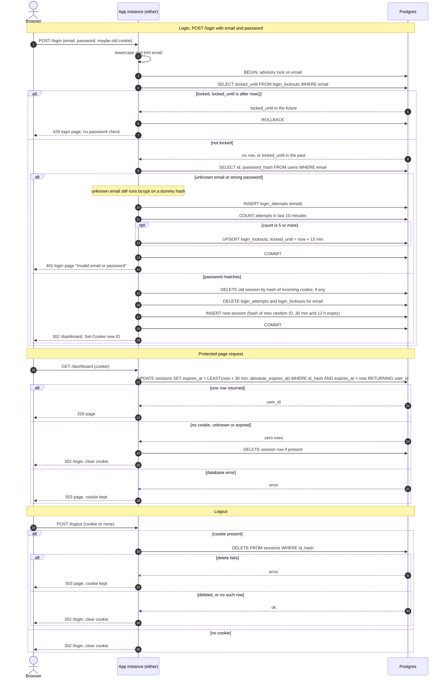

# Login with server-side sessions: design

## Decisions

| Choice | Decision | Why |
|---|---|---|
| Where sessions and failure counts live | Postgres, in three new tables: `sessions`, `login_attempts` and `login_lockouts`. | Both instances already share it. Redis would be a new service to run, secure, monitor and back up. The load here is one indexed row update per page request, which a small team app can absorb easily. Revisit Redis only if measured session-table load becomes a problem. |
| Clock | All time comparisons use the database's `now()`, never the app instance's clock. | Two instances can disagree on the time. One clock avoids that. |
| Session ID | 32 bytes from a CSPRNG, base64url-encoded. The database stores only its SHA-256 hash. | A leaked database or backup then holds no usable session IDs. |
| Cookie | Name `__Host-sid`. Attributes: `HttpOnly; Secure; SameSite=Lax; Path=/`, no `Domain`. | It carries only the opaque ID. The `__Host-` prefix stops other subdomains from overriding it. Lax also blocks cross-site `POST /logout`. |
| How expiry is checked and recorded | Each session row has `expires_at`, which is the earlier of last activity + 30 minutes and `absolute_expires_at` (login time + 12 hours). Every protected request runs one atomic `UPDATE ... WHERE expires_at > now() RETURNING user_id`. | Checking and renewing in a single statement leaves no race between the two instances. It also makes "every request restarts the clock" literally true, and it can never extend past the 12-hour cap. |
| How abandoned sessions are removed | A job on each instance runs every 5 minutes: `DELETE FROM sessions WHERE expires_at < now()`. It also deletes `login_attempts` rows older than 1 hour and `login_lockouts` rows whose `locked_until` has passed. A Postgres advisory lock (`pg_try_advisory_lock`) lets only one instance do the sweep per run. | Correctness never depends on the sweep, because expiry is enforced at read time. The sweep only reclaims space. A request that finds an expired row also deletes it. |
| What the user sees when storage fails | See "Storage failures" below. In short, every path fails closed with a 503 page. | Never skip the lockout check, never issue a session without a stored row, never log someone out because of a database blip. |

## Data

```
sessions
  id_hash              bytea PRIMARY KEY   -- sha256 of the cookie value
  user_id              bigint NOT NULL REFERENCES users(id) ON DELETE CASCADE
  created_at           timestamptz NOT NULL DEFAULT now()
  absolute_expires_at  timestamptz NOT NULL   -- created_at + 12 hours
  expires_at           timestamptz NOT NULL   -- min(last request + 30 min, absolute_expires_at)
  INDEX (expires_at)

login_attempts                                -- failed attempts only
  email         text NOT NULL                 -- lowercased
  attempted_at  timestamptz NOT NULL DEFAULT now()
  INDEX (email, attempted_at)

login_lockouts
  email         text PRIMARY KEY              -- lowercased
  locked_until  timestamptz NOT NULL
```

`login_attempts` and `login_lockouts` are keyed by the submitted email string, not by `users.id`. Unknown emails are counted and locked exactly like real ones, so the 429 response never reveals whether an account exists.

## Rules not shown on the arrows

**Login** (`POST /login`)
- Normalise the email to lowercase and trim it. Cap its length, for example at 254 characters.
- Inside one transaction, take `pg_advisory_xact_lock(hashtext(email))` first. This serialises concurrent attempts for the same email across both instances, so the 5-attempt limit cannot be overshot by parallel requests. Different emails do not block each other. The lock is held through the bcrypt check, which is acceptable at this scale.
- Lockout check, before any password work:
  - If `login_lockouts.locked_until > now()`, return 429 immediately. Do not read `users` and do not run bcrypt.
- Unknown email:
  - Run bcrypt against a fixed dummy hash so timing matches a wrong password.
  - Then take the same failure path as a wrong password.
- Failure path:
  1. Insert a `login_attempts` row.
  2. Count rows for the email with `attempted_at > now() - 10 minutes`.
  3. If the count is 5 or more, upsert `login_lockouts` with `locked_until = now() + 15 minutes`.
  4. Return 401 and the login page with "Invalid email or password".
- The 5th failure still gets the 401. The 6th and later attempts get the 429.
- Windows are sliding, so "within any 10-minute period" holds.
- While locked, attempts are refused without being counted, so the lock does not extend itself.
- After the lock expires, the old attempts are more than 10 minutes old, so the count is effectively back to zero.
- Success path, in the same transaction:
  1. Delete the session row for the incoming cookie, if any.
  2. Delete the email's `login_attempts` and `login_lockouts` rows.
  3. Insert a new session row with a fresh random ID, where `absolute_expires_at = now() + 12h` and `expires_at = now() + 30min`.
  4. Commit, then send `Set-Cookie` and `302 /dashboard`.
- The incoming session ID is never reused, so session fixation is not possible.
- The 401 and 429 pages never set or alter the session cookie.

**Protected request**
- Every route except `/login` goes through one middleware.
- An absent cookie, an unknown ID and an expired session all produce the same result: clear the cookie, then `302 /login`.
- Responses to authenticated pages carry `Cache-Control: no-store`.

**Logout** (`POST /logout`)
- Run `DELETE FROM sessions WHERE id_hash = $1` before replying. It is idempotent.
- Then clear the cookie and `302 /login`.
- With no cookie, skip the delete and take the same reply path. The response is identical.
- Logout is exempt from the protected-request check, so a missing session never redirects before the logout reply. It simply replies as above.

**Clearing the cookie**
- Send `Set-Cookie: __Host-sid=; Max-Age=0; Path=/; Secure; HttpOnly; SameSite=Lax`.

## Storage failures

- **Login, database unreachable or erroring** (including the lockout check):
  - Return HTTP 503 with a plain page: "Sign-in is temporarily unavailable. Please try again in a moment."
  - Issue no session, clear no failure counts, and do not skip the lockout check.
  - Do not fall back to a 401, because that would blame the user's password.
  - If the transaction fails after a correct password, the user is not signed in and no half-created session exists.
- **Protected request, session lookup fails:**
  - Return 503 with the same kind of page.
  - Do not clear the cookie and do not redirect to `/login`. The session may still be valid, and redirecting would make the user re-authenticate over a transient fault.
  - Never serve the page without a verified session.
- **Logout, delete fails:**
  - Return 503, "We could not sign you out. Please try again."
  - Keep the cookie, so a retry can still destroy the session.
  - Do not pretend the logout worked. The server-side session must be gone before we reply with success.
- All 503 responses send `Retry-After: 5` and `Cache-Control: no-store`. Failures are logged without emails, passwords or full session IDs.

## Sequence diagram



## Checks against the requirements

1. Email is lowercased before every lookup and every lockout key.
2. Unknown email and wrong password share one code path, one response and equal timing.
3. The limit is 5 failures in a sliding 10 minutes, then 429 for 15 minutes without a password check. Success clears the counters.
4. Success always creates a new ID and deletes the old session.
5. The cookie holds only the opaque ID, with HttpOnly, Secure and SameSite=Lax.
6. Idle and absolute expiry both live in `expires_at`, renewed atomically on each request.
7. Missing, unknown and expired sessions all clear the cookie and redirect to `/login`.
8. Logout deletes server-side first, then replies. It behaves the same without a session.
