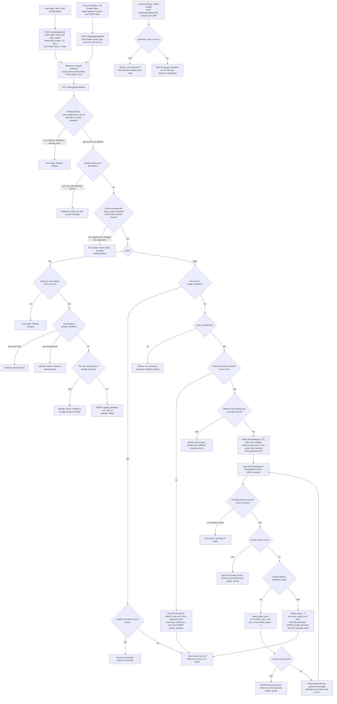

# Sign in with Google: flow and state plan

## Summary

Today one backend service renders the pages, and PostgreSQL holds the users and sessions. A user signs in with email and password. The server checks the password with bcrypt, counts failed tries, and locks the account for 15 minutes after 5 failures. Then it calls `start_session`, which creates a session row and sets the `sid` cookie. Redis exists but is used only for short-lived data such as rate limits.

This plan adds "Sign in with Google" beside the password form on the login page, and a Link Google button in Account Settings. The flow sends the browser to Google, takes Google's answer back at a callback, and matches the Google account by its permanent id (`sub`), never by email. Every successful Google sign-in ends in the same `start_session` call as password login, so there is no new kind of session.

## Terms

- **OpenID Connect (OIDC)**: a sign-in protocol on top of OAuth 2.0. Google tells us who the user is.
- **Authorization code flow**: the browser goes to Google and comes back with a one-time `code`. Our server then trades the code for an ID token.
- **PKCE**: a proof that the same server that started the flow finishes it. We send a hash of a random `code_verifier` at the start and the verifier itself at the code exchange.
- **Code exchange**: the server's direct request to Google that trades the `code` and `code_verifier` for an ID token.
- **ID token**: a signed token from Google describing the user. We check its signature, `iss` (must be Google), `aud` (must be our app), `exp` (not expired) and `nonce`. We read only `sub`, `email` and `email_verified`.
- **sub**: Google's permanent id for an account. Unlike email, it never changes.
- **state**: a random value we send to Google and must get back unchanged. It proves the callback answers our request. It is used once.
- **nonce**: a random value we send to Google that must come back inside the ID token. It proves the token answers our request.
- **intent**: why the flow started. `login` means sign in. `link` means add Google to a signed-in account.
- **return_to**: the relative path on our site where the user started. We check it is a path on our site, both at start and again before redirecting.
- **Redis**: a fast store for short-lived keys. Each key can have a TTL (time to live): the number of seconds before it disappears.
- **GETDEL**: a Redis command that reads a key and deletes it in one step. Only one caller can get the value.
- **Cookie**: a small value the browser stores and sends back. This plan uses `oidc_tx`, `oidc_pending` and the existing `sid`.
- **CSRF token**: a secret tied to the session that a form must send. It stops other sites from submitting the form for the user.
- **bcrypt**: the password hash function. Checking a password is slow on purpose.
- **Lockout**: the existing rule. Each wrong password adds 1 to `failed_logins`. At 5, `locked_until` is set to now plus 15 minutes, and the counter resets to 0.
- **start_session(user_id)**: the existing function that creates a session. It deletes the old session row if the browser sent a `sid` cookie, inserts a new row, sets `sid` (HttpOnly, Secure, SameSite=Lax), and redirects.
- **google_identities**: a new table. It holds one row per linked Google account.
- **Pending record**: a short-lived Redis record for an existing account whose password is still needed before linking.

## Flowchart



## What the flowchart does not show

1. **Start.** Starts when a user clicks Sign in with Google on the login page, or Link Google in Account Settings. The server creates the state, nonce and `code_verifier`, and stores them in Redis under `oidc:tx:state` for 600 seconds. A link start also stores `intent` = link and the signed-in `user_id`. A login start stores `intent` = login. The `return_to` path is stored too, after the check. The server sets the `oidc_tx` cookie (HttpOnly, Secure, SameSite=Lax, max age 600 s) to the state value. Then it redirects to Google. The whole round trip must finish within 10 minutes.
2. **Callback.** Only Google's redirect starts this step. The server runs GETDEL on the state, which deletes the record whatever happens next. It checks the cookie, and clears `oidc_tx` at this point. If Google sent an error, the flow stops and returns the user to `return_to`. Otherwise the server exchanges the code with the `code_verifier` and checks the ID token. The state is spent after this step, so a failed attempt means starting again.
3. **Link branch.** Runs when `intent` is link. The signed-in user must equal the stored `user_id`. The server checks whether the `sub` is already linked, and whether this user already has a Google account. If neither is true, it inserts the row in `google_identities`. No password is asked, and the email addresses need not match.
4. **Login branch, linked account.** Runs when the `sub` is already in `google_identities`. If the linked user is locked, sign-in stops. Otherwise the server calls `start_session` for that user. Google sign-in does not change `failed_logins`.
5. **Login branch, new account.** Runs when the `sub` is unknown and `email_verified` is true. If no user has that lowercased email, the server creates a user with no password and a verified email, and links the `sub`, in one transaction. Then it calls `start_session`.
6. **Login branch, existing account.** Runs when the `sub` is unknown, `email_verified` is true, and an existing user has that email. If that user already has a Google account, sign-in is refused before any password prompt. Otherwise the server stores a pending record in Redis (`oidc:pending:id`, TTL 600 s from the callback) holding `sub` and `user_id`. It sets the `oidc_pending` cookie with the same lifetime, and shows the password form. The user has 10 minutes to confirm.
7. **Password confirmation.** The form posts to `/auth/google/confirm`, with CSRF protection. The server checks that the pending record exists and the cookie matches. It checks `locked_until` first. A wrong password counts toward the same `failed_logins` counter and lockout rule as password login. The pending record stays until its TTL, so the user can retry. A lock deletes the pending record, so nothing is linked. A correct password resets `failed_logins` to 0, sets `email_verified_at` if it is NULL, inserts the `google_identities` row and deletes the pending record in one transaction. Then it calls `start_session`.
8. **Unlink.** Runs from Account Settings with a session and CSRF token. The server allows it only if the user has a password. It deletes this user's `google_identities` row. Sessions are not changed.
9. **Session.** Every successful Google sign-in calls `start_session`, exactly as password login does. It deletes the browser's old `sid` session row first, inserts a new one that lasts 14 days and slides forward, sets the `sid` cookie, and redirects to `return_to`, or `/home` if `return_to` is not valid.

## Where state lives and what removes it

| State | Where | Lifetime | Removed by |
|---|---|---|---|
| `users.password_hash` | PostgreSQL | Permanent. Now nullable. Google-created users have NULL | Never removed. Set by the existing password reset flow |
| `google_identities` row | PostgreSQL (new table) | Permanent. One row per linked Google account | Unlink (only for users with a password), or user deletion (cascade). Sign-out, session expiry and password reset do not remove it |
| Google email and Google tokens | Nowhere | Never stored. `users.email` is never changed by Google sign-in | Not applicable |
| `oidc:tx:state` | Redis | Created at start. TTL 600 s. Holds state, nonce, `code_verifier`, intent, `user_id` (link), `return_to` | Deleted by GETDEL at the first callback. A replayed callback finds nothing |
| `oidc_tx` cookie | Browser | Max age 600 s. Holds the state value | Cleared at the callback |
| `oidc:pending:id` | Redis | Created only in the password branch. TTL 600 s from the callback. Holds `sub` and matched `user_id` | Deleted on success, on lock, or by TTL |
| `oidc_pending` cookie | Browser | Same lifetime as the pending record | Cleared when the pending record is deleted |
| `sessions` row | PostgreSQL | Created by `start_session`. 14 days, slid forward on each request | Sign-out, expiry, password reset (deletes all the user's sessions), or user deletion |
| `users.failed_logins` and `users.locked_until` | PostgreSQL (existing columns) | Existing rules | Existing rules. Google password confirmation shares this counter |

## Failure behaviour

| Where | What goes wrong | What the user sees | What changes |
|---|---|---|---|
| Start or callback | Redis is unavailable | Error page | Fails closed. No state, no accounts created |
| Callback | State is unknown, expired, already used, or the cookie does not match | Error page | Nothing is read or written beyond the failed GETDEL |
| Callback | Google sends an error, such as Cancel | Return to `return_to` with a neutral message | The state is already spent. Nothing else changes |
| Callback | Code exchange fails (network error, Google 4xx such as `invalid_grant`, or a bad ID token) | Error page: sign-in failed, try again | Nothing is written. The state is spent, so the user starts again from login or settings |
| Link | The signed-in user does not match the stored `user_id` | Error page | Nothing changes |
| Link | The `sub` is already linked to this user | Settings: already linked | Nothing changes |
| Link | The `sub` is linked to another user | Settings: refuse, linked to someone else | Nothing changes |
| Link | This user already has a different Google account | Settings: refuse, a different Google account is linked | Nothing changes |
| Login | The linked user is locked | Account temporarily locked | No session |
| Login | The `sub` is unknown and `email_verified` is false | Refuse, use email and password | Nothing is created |
| Login | A concurrent request creates the same email first | Error page | The unique email constraint fails, so no partial rows are left |
| Login | The matched user already has a Google account | Refuse, before any password prompt | Nothing changes |
| Confirm | Pending record is expired, gone, or the cookie does not match | Error page: start sign-in again | Nothing is linked |
| Confirm | Account is already locked | Account temporarily locked | Pending record is deleted. Nothing is linked |
| Confirm | Wrong password | Generic wrong-password message | `failed_logins` plus 1. At 5, the account locks for 15 minutes. The pending record stays until its TTL |
| Confirm | This wrong password causes the lock | Account temporarily locked | Pending record is deleted. Nothing is linked |
| Unlink | The user has no password | Refuse, set a password first using the existing reset email | Nothing changes |

## Rollout: database migration

This is a build step, not part of how the system runs.

```sql
ALTER TABLE users ALTER COLUMN password_hash DROP NOT NULL;

CREATE TABLE google_identities (
  sub        TEXT PRIMARY KEY,                          -- Google account id
  user_id    BIGINT NOT NULL UNIQUE REFERENCES users(id) ON DELETE CASCADE,
  linked_at  TIMESTAMPTZ NOT NULL DEFAULT now()
);
```

The primary key on `sub` means one user per Google account. The unique `user_id` means one Google account per user. Both back up the checks in the flowchart and protect against races.

## Decisions made in this plan

These are not in the brief. The owner should confirm them.

- **Browser binding with the `oidc_tx` cookie.** Recommended. Without it, an attacker can start a flow with their own Google account and make a victim's browser complete it.
- **Locked accounts.** A linked user's Google login is rejected while `locked_until` is in the future, so a lock cannot be bypassed. Google sign-in does not increment the counter.
- **Email verification on confirmation.** A correct password sets `email_verified_at` if it is NULL, because Google has already verified the email.
- **Settings linking does not check `email_verified`.** The brief does not require it, and linking uses only `sub`.
- **Unlink does not end sessions.** Confirm this is wanted.
- **Password login with a NULL hash.** Password login must reject a NULL `password_hash` with the same generic message, and still run a dummy bcrypt compare, so timing does not reveal the account type. The confirmation path never reaches a NULL hash. A Google-created user always has a link, which stops the flow at the "already has a Google account" check, so confirmation never runs for them.
- **`return_to` is checked twice.** It is validated as a relative path on our site at start, and again before redirect.
- **Confirmation form protection.** The confirmation form posts are CSRF protected, the same as the settings forms.

## Open questions

- GETDEL runs before the cookie check, so a callback with a wrong `oidc_tx` cookie still deletes the state record. An attacker could therefore cancel a real user's attempt, and the user would simply start again. Is that acceptable, or should the cookie be checked before GETDEL?