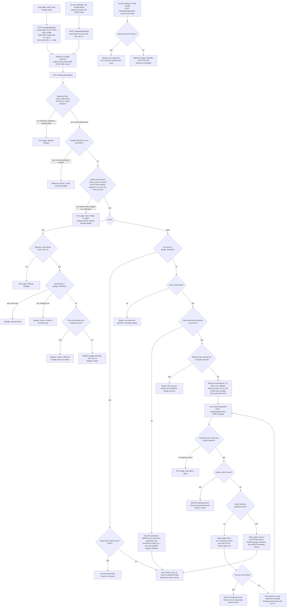

# Sign in with Google: flow and state plan

This plan adds Google sign-in (OpenID Connect, authorization-code flow with PKCE) beside email and password. It builds on `users`, `sessions`, `start_session`, and the lockout rules in the existing files. Google sign-in ends in the same `start_session` call that password login uses.

## Flowchart



## Where new state lives

Permanent (PostgreSQL):

- `users.password_hash`: becomes nullable. Google-created users have NULL. It is set by the existing reset flow and never removed.
- `google_identities` (new): one row per linked Google account. It is created when a link succeeds (login creation, password confirmation, or settings). It is removed by unlink (only for users with a password) or by user deletion (cascade). Sign-out, session expiry and password reset do not remove it.
- Google email and any Google tokens are never stored. `users.email` is never changed by Google sign-in.

Temporary (Redis, plus browser cookies):

- `oidc:tx:state` (Redis): holds code_verifier, nonce, intent (login or link), user_id for link, and a validated relative return_to. Created at start with TTL 600 s. Deleted atomically with GETDEL at the first callback, so a replayed callback finds nothing.
- Cookie `oidc_tx` (HttpOnly, Secure, SameSite=Lax, max age 600 s): holds the state value. The callback requires it to match. Cleared at callback.
- `oidc:pending:id` (Redis): holds sub and matched user_id. Created only in the password-confirmation branch. TTL 600 s from callback. Deleted on success, on lockout, or by TTL.
- Cookie `oidc_pending`: same lifetime as the pending record. Cleared when the record is deleted.
- `sessions` row: created by `start_session`, same as password login.
- `users.failed_logins` and `users.locked_until`: existing columns. The Google password confirmation shares the same counter.

Migration:

```sql
ALTER TABLE users ALTER COLUMN password_hash DROP NOT NULL;

CREATE TABLE google_identities (
  sub        TEXT PRIMARY KEY,                          -- Google account id
  user_id    BIGINT NOT NULL UNIQUE REFERENCES users(id) ON DELETE CASCADE,
  linked_at  TIMESTAMPTZ NOT NULL DEFAULT now()
);
```

The primary key on `sub` enforces one user per Google account. The unique `user_id` enforces one Google account per user. Both are backstops for the checks in the flowchart and for races.

## Failure behaviour

- Unknown, expired or reused state (or cookie mismatch): error page. Nothing is read or written beyond the failed GETDEL.
- Google error parameter, such as Cancel: the record is already consumed. The user is redirected to return_to with a neutral message.
- Failed code exchange (network error, 4xx such as invalid_grant, or ID token check failure): error page. Nothing is written. The state is spent, so the user starts again from the login or settings page.
- Redis unavailable: fail closed. Show an error page and do not create state or accounts.
- Unlinked sub with email_verified false: refuse, point to email and password. Nothing is created.
- Unlinked sub with a verified email that matches no user: create the user and link in one transaction, then sign in. A concurrent duplicate email fails the unique constraint and returns an error page with no partial rows.
- Matched user already has a Google account: refuse before any password prompt.
- Wrong password: failed_logins + 1 with the existing lock rule. The pending record stays until TTL so the user can retry.
- Lock reached during confirmation: delete the pending record. Nothing is linked. The user sees Account temporarily locked.
- Pending expired: error page, start again.
- Settings link, Google account used by someone else or already linked to this user: refuse with a message. Nothing changes.
- Settings unlink, no password: refuse. The message points to the existing reset email.

## Decisions for the owner

- Browser binding (`oidc_tx` cookie): not in the brief. Without it, an attacker can start a flow with their own Google account and make a victim's browser complete it. Recommended.
- Locked accounts and Google sign-in: the flowchart rejects linked-user Google login while `locked_until` is in the future, so a lock cannot be bypassed. Google sign-in does not increment the counter.
- Email verification on confirmation: on a correct password, set `email_verified_at` if it is NULL, since Google has verified the email. Not in the brief.
- Settings linking does not check `email_verified`. The brief does not require it, and linking uses only `sub`.
- Unlink does not end sessions. Confirm this is wanted.
- Password login must reject NULL `password_hash` with the same generic message, and still run a dummy bcrypt compare so timing does not reveal the account type. The confirmation path never reaches a NULL hash, because a Google-created user always has a link, which blocks the confirmation branch at M5.
- Return_to is validated as a relative path on our site at start and again before redirect.
- Confirmation form posts are CSRF protected, same as the settings forms.