# Sign in with Google: flow and state

Today users sign in with email and password (`POST /login`), and every success ends in `start_session`, which creates a session. This adds Google sign-in (OpenID Connect, authorization-code flow with PKCE) as a second way to reach the same session. A short-lived Redis record ties each round trip to Google to one browser, and one new table, `google_identities`, links a Google account (by `sub`, never by email) to a user. It builds on `users`, `sessions`, `password_reset_tokens`, `POST /login` and `start_session`. Nothing in them is replaced. Only `users.password_hash` becomes nullable.

## Terms

- **App**: one server-rendered service (no SPA, no mobile app) with PostgreSQL. Redis is available and today holds only rate limits.
- **Session**: a row in `sessions` plus the `sid` cookie. `start_session(user_id)` is the only way to create one. It deletes any old `sid` row, inserts a new row, sets the cookie and redirects to `next` (relative paths only) or `/home`. Every Google success ends here, or in a plain redirect to settings when the user was already signed in. There is no new session type.
- **Lockout**: the fifth wrong password sets `locked_until` to now + 15 minutes and resets `failed_logins` to 0. While `locked_until` is in the future, the password is not checked at all.
- **OIDC / ID token**: OpenID Connect, a sign-in layer on OAuth. Google returns a signed ID token. At sign-in we read only its `sub` (Google's permanent account id), `email` and `email_verified`. We keep no Google access or refresh tokens. Scopes: `openid email profile`.
- **PKCE**: the app makes a random `code_verifier`, sends its S256 hash (the challenge) to Google, and sends the verifier when trading the code for tokens. This proves the same app finishes what it started.
- **`state`**: a random value sent to Google and returned on the callback. It names the attempt's Redis record.
- **`nonce`**: a random value that must come back inside the ID token. It stops a replayed token.
- **Mode**: `login` (started from the login page) or `link` (started from Account Settings while signed in).
- **Origin**: where the attempt started, `/login` (keeping `next`) or Account Settings. "Back to origin" in the diagram means this.
- **`GETDEL`**: a Redis command that reads and deletes a key atomically. It needs Redis 6.2 or later. If the deployment is older, use a one-line Lua script that does the same.

## Routes

| Route | Purpose |
|---|---|
| `GET /auth/google/start?next=` | Login page entry. Mode is `login`. |
| `POST /settings/google/link` | Settings entry. Needs a valid session. Mode is `link`. |
| `GET /auth/google/callback` | The one redirect URI for both modes. The mode comes from the stored state record, never from the URL. |
| `GET` and `POST /auth/google/confirm` | Password confirmation when the verified email matches an existing user. |
| `POST /settings/google/unlink` | Unlink. Needs a valid session. |

## Where state lives

**Permanent (PostgreSQL), added by one migration:**

```sql
ALTER TABLE users ALTER COLUMN password_hash DROP NOT NULL;  -- NULL = no password set

CREATE TABLE google_identities (
  sub       TEXT PRIMARY KEY,                       -- one Google account links to at most one user
  user_id   BIGINT NOT NULL UNIQUE                  -- one user has at most one Google account
            REFERENCES users(id) ON DELETE CASCADE,
  linked_at TIMESTAMPTZ NOT NULL DEFAULT now()
);
```

- We store only `sub`. No email, no Google tokens. If a linked user's Google email changes, they still reach the same account. Google never changes our stored email.
- Rows are removed by unlink, or by cascade when the user is deleted.
- Users created by Google get `password_hash = NULL` and `email_verified_at = now()`.
- `POST /login` must tolerate a NULL hash. It skips bcrypt, runs a dummy bcrypt compare so timing matches, and treats the attempt as a wrong password with the same generic message and the same `failed_logins` counting.
- Password reset needs no change. It sets `password_hash`, which is how a Google-only user gets a password.

**Temporary (Redis, so TTL is the 10-minute clock):**

| Key and cookie | Holds | Created | Removed |
|---|---|---|---|
| Redis `oidc:state:<state>` | `code_verifier`, `nonce`, `mode`, `user_id` (link mode only), origin, `next` | At start, `SET ... EX 600` | First callback reads it with `GETDEL`, so it is used at most once. Otherwise it expires at 600s. |
| Cookie `oidc_bind` | Same value as `state`. HttpOnly, Secure, SameSite=Lax, Max-Age 600. It ties the callback to the browser that started the attempt. | At start | Cleared on every callback response. Otherwise it expires. |
| Redis `oidc:pending:<id>` | `sub`, `user_id` of the matched account, `next` | When the verified email matches an existing user, `SET ... EX 600` | Deleted on successful link, on account lock, on a failed re-check, or at 600s. A wrong password does not extend the TTL. |
| Cookie `g_pending` | `<id>`, 32 random bytes. HttpOnly, Secure, SameSite=Lax. | Same time as the pending record | Cleared whenever the pending record is deleted. |

The pending record holds no email and no password. It cannot be forged because the id is random and only ever read from the cookie.

## Flowchart

```mermaid
flowchart TD
  subgraph START["Start of the round trip"]
    L0["Login page: Sign in with Google<br/>GET /auth/google/start?next=...<br/>mode = login, origin = /login"]
    S0["Account Settings: Link Google<br/>POST /settings/google/link"]
    S1{"Valid sid session?"}
    S2{"User already has a Google<br/>account linked?"}
    ST["Generate state, nonce, PKCE verifier + S256 challenge<br/>Redis SET oidc:state:STATE with TTL 600s<br/>Set oidc_bind cookie = STATE<br/>Redirect to Google: code flow, scope openid email profile"]
    ST_OK{"Redis write ok?"}
    GO["User signs in and consents at Google, or presses Cancel"]
  end

  L0 --> ST
  S0 --> S1
  S1 -- no --> TO_LOGIN["Redirect to /login"]
  S1 -- yes --> S2
  S2 -- yes --> SET_MSG1["Back to settings: a Google account is already linked.<br/>Unlink it first. Nothing changed"]
  S2 -- no --> ST
  ST --> ST_OK
  ST_OK -- no --> ERR_START["Back to origin: could not start, try again.<br/>Nothing stored"]
  ST_OK -- yes --> GO

  subgraph CALLBACK["GET /auth/google/callback"]
    CB["Callback arrives with state and code, or with error"]
    C1{"Redis GETDEL oidc:state:STATE<br/>returns a record?"}
    C2{"oidc_bind cookie equals state?"}
    C3{"Google sent an error parameter?"}
    C4{"POST code + code_verifier to Google token endpoint.<br/>Response ok and ID token valid?<br/>iss, aud, exp, nonce, has sub"}
    C5{"Record mode?"}
  end

  GO --> CB
  CB --> C1
  C1 -- "no: unknown, expired or already used" --> ERR_STATE["Error page, link to /login.<br/>Nothing changed"]
  C1 -- yes --> C2
  C2 -- no --> ERR_STATE
  C2 -- yes --> C3
  C3 -- "yes, for example access_denied" --> NEUTRAL["Return to origin with neutral message:<br/>Google sign-in was not completed.<br/>Nothing changed"]
  C3 -- no --> C4
  C4 -- "no: network error, timeout, non-200,<br/>invalid_grant, bad or mismatched ID token" --> ERR_EXCH["Return to origin: Google sign-in failed, try again.<br/>No retry of the code. Nothing changed"]
  C4 -- yes --> C5

  subgraph LINKMODE["Settings link, user already signed in"]
    K0{"Current sid user equals<br/>user_id in the record?"}
    K1{"sub already in google_identities?"}
    K2{"This user already has a<br/>Google account linked?"}
    K3["INSERT google_identities sub, user_id<br/>no password asked, emails need not match"]
    K4{"Insert succeeded?"}
    K_OK["Back to settings: Google linked.<br/>Same session, no new sid"]
    K_SAME["Back to settings: already linked.<br/>No change"]
    K_OTHER["Back to settings: that Google account<br/>is linked to someone else. Refused"]
    K_HAVE["Back to settings: a different Google account<br/>is already linked. Refused"]
  end

  C5 -- link --> K0
  K0 -- no --> ERR_STATE
  K0 -- yes --> K1
  K1 -- "yes, to this user" --> K_SAME
  K1 -- "yes, to another user" --> K_OTHER
  K1 -- no --> K2
  K2 -- yes --> K_HAVE
  K2 -- no --> K3
  K3 --> K4
  K4 -- "yes" --> K_OK
  K4 -- "unique violation, lost a race" --> K_OTHER

  subgraph LOGINMODE["Login decision on sub, email, email_verified"]
    G1{"sub in google_identities?"}
    G2{"email_verified true?"}
    G3{"users row matches the<br/>lowercased Google email?"}
    G4{"Matched user already has a<br/>Google account linked?"}
    G_REFUSE_UNVER["Back to /login: Google email is not verified,<br/>use email and password. Nothing created"]
    G_CREATE["One transaction:<br/>INSERT users with password_hash NULL and email_verified_at now<br/>INSERT google_identities"]
    G_RACE{"Unique violation?"}
    G_REFUSE_HAVE["Back to /login: that account is linked to a<br/>different Google account. Refused. Nothing changed"]
    G_PEND["Redis SET oidc:pending:ID = sub, user_id, next with TTL 600s<br/>Set g_pending cookie<br/>Show password form at /auth/google/confirm"]
  end

  C5 -- login --> G1
  G1 -- "yes: sign in to the linked user, stored email untouched" --> SESSION
  G1 -- no --> G2
  G2 -- no --> G_REFUSE_UNVER
  G2 -- yes --> G3
  G3 -- no --> G_CREATE
  G_CREATE --> G_RACE
  G_RACE -- no --> SESSION
  G_RACE -- "yes: roll back and re-run from the sub lookup once" --> G1
  G3 -- yes --> G4
  G4 -- yes --> G_REFUSE_HAVE
  G4 -- no --> G_PEND

  subgraph CONFIRM["Password confirmation loop, 10 minutes"]
    PW["User submits password<br/>POST /auth/google/confirm"]
    P1{"g_pending cookie maps to a<br/>live Redis pending record?"}
    P2{"locked_until in the future?"}
    P3{"bcrypt matches?"}
    P4["failed_logins + 1<br/>at 5: locked_until = now + 15 min, failed_logins = 0"]
    P5{"Account now locked?"}
    P_AGAIN["Show form again: incorrect password.<br/>Pending record and its TTL kept"]
    P6["failed_logins = 0<br/>Transaction: re-check sub unlinked and user has no Google,<br/>INSERT google_identities"]
    P7{"Insert and checks ok?"}
    P_DROP["DEL oidc:pending:ID, clear g_pending.<br/>Half-finished link discarded"]
    P_LOCKED["Back to /login: Account temporarily locked"]
    P_EXPIRED["Error page: confirmation expired, start again from /login.<br/>Nothing changed"]
    P_REFUSE["Back to /login: could not link. Refused"]
    P_DONE["DEL oidc:pending:ID, clear g_pending"]
  end

  G_PEND --> PW
  P_AGAIN --> PW
  PW --> P1
  P1 -- no --> P_EXPIRED
  P1 -- yes --> P2
  P2 -- yes --> P_DROP
  P3 -- no --> P4
  P2 -- no --> P3
  P4 --> P5
  P5 -- yes --> P_DROP
  P5 -- no --> P_AGAIN
  P3 -- yes --> P6
  P6 --> P7
  P7 -- no --> P_DROP
  P7 -- yes --> P_DONE
  P_DONE --> SESSION
  P_DROP -. "locked or already locked" .-> P_LOCKED
  P_DROP -. "re-check failed" .-> P_REFUSE

  SESSION["start_session user_id, existing function:<br/>delete old sid row, insert sessions row,<br/>set sid cookie, redirect to next if relative, else /home"]

  subgraph UNLINK["Unlink, from settings"]
    U0["POST /settings/google/unlink, valid session"]
    U1{"users.password_hash is not NULL?"}
    U_OK["DELETE google_identities row.<br/>Existing sessions stay"]
    U_NO["Refuse: set a password first using the existing<br/>forgot-password email, then unlink"]
  end

  U0 --> U1
  U1 -- yes --> U_OK
  U1 -- no --> U_NO
```



## Notes on the steps

The diagram shows the order. These add what it cannot.

- **Start** is a click on the login page or the settings button. The only data written is the Redis state record and the `oidc_bind` cookie. If the Redis write fails, nothing is stored.
- **Callback** is Google's redirect. The state record is deleted on first read, so each attempt's callback is honoured once. Everything after that point changes PostgreSQL only through the named inserts.
- **Link mode** asks no password and the emails need not match. The signed-in user must equal the `user_id` stored at start. This stops an attempt started in one account from being finished in another.
- **Login mode** decides on `sub` first, then email. Only the "create" and "link" outcomes write to PostgreSQL.
- **Confirm** is the loop for "verified email matches an existing user". Wrong passwords use the existing lockout counters. Success links, deletes the pending record and calls `start_session`.
- **Every success** except link mode ends in the same `start_session` as a password login.

## What each failure does

All of these leave the database unchanged. The `oidc_bind` cookie is cleared on every callback response.

| Failure | Result |
|---|---|
| Unknown, expired or reused `state`, or `oidc_bind` mismatch | Generic error page. The origin is not trusted, so the page links to `/login`. The first read consumed the record. |
| Google returned `error` (Cancel and similar) | Back to origin with a neutral message. The attempt is finished. |
| Code exchange fails (network, timeout, non-200, `invalid_grant`) | Back to origin with "Google sign-in failed, try again". The state is consumed and a Google code is single-use, so we never retry the code. The user starts a new attempt. |
| ID token invalid (iss, aud, exp or nonce wrong, or `sub` missing) | Same as a failed exchange. |
| Redis unavailable at start | Back to origin with "try again". Nothing is created. |
| Redis unavailable at callback or confirm | Error page. We cannot prove the attempt is valid, so nothing changes. |
| Unverified Google email, unlinked `sub` | Refused, pointing to email and password. No user is created. |
| Matched account has a different Google account linked | Refused at callback, and again at confirm in case it changed in the meantime. |
| Wrong password at confirm | Existing lockout counters apply. The form is shown again with the same deadline. |
| Account locks, or was already locked, at confirm | Pending record and cookie deleted. The user must start over from `/login`. |
| Confirm after 10 minutes | The Redis key is gone, so the user sees the "expired" error page. |
| Concurrent duplicate create or link | The unique constraints on `sub`, `user_id` and `email` decide. The loser rolls back and re-runs the decision once, or is refused in link mode. |

## Decisions the brief did not settle

- **Lockout does not block Google sign-in for an already linked user.** The lock throttles password guessing, and the existing code checks it only in `POST /login`. To block locked accounts here too, add the `locked_until` check before `start_session` on the linked path.
- **Google sign-in does not touch `failed_logins`.**
- **Linking by password does not change `email_verified_at`.** Google never changes our stored user data except when it creates a new user.
- **The confirm form does not carry the `sub` or email.** Both come only from the server-side pending record.
- **Unlink does not end existing sessions.**

## Rollout

1. Run the migration first. It is safe for old code: the new table is unused, and the old `POST /login` does not yet tolerate a NULL hash, but no NULL hashes exist until the new code creates one.
2. Check Redis is 6.2 or later, or use the Lua form of `GETDEL`.
3. Deploy the code with the `POST /login` NULL-hash handling together with the Google routes.

## Open questions

- Should a locked account be blocked from Google sign-in on the linked path? Currently not (see Decisions).