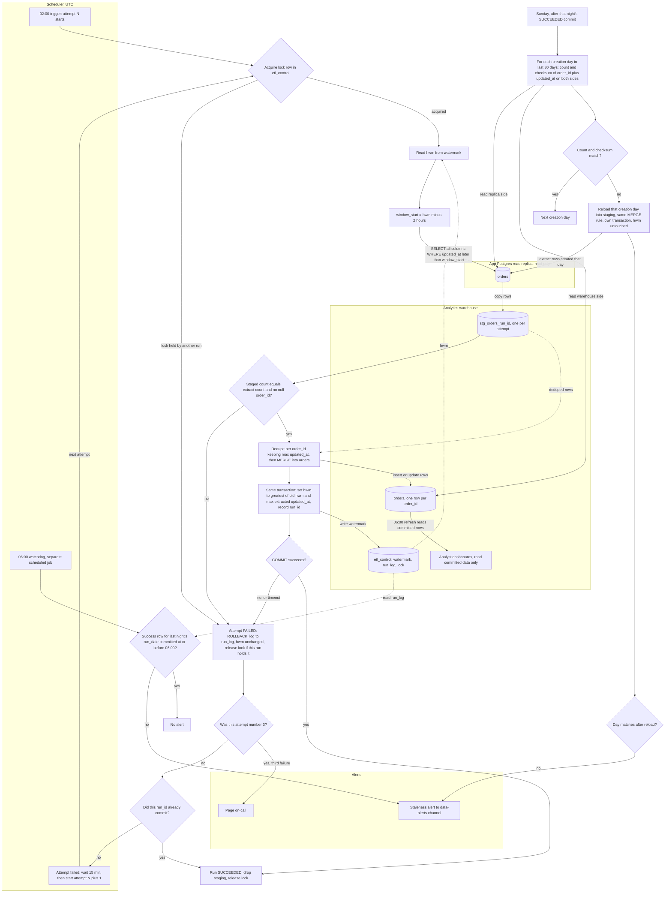

# Nightly orders ETL into the warehouse: pipeline plan

## Summary

Every night at 02:00 UTC a job copies recently changed rows of the app's `orders` table from the Postgres read replica into the analytics warehouse, then merges them so each order appears once, in its newest version. Each night re-reads a 2-hour overlap before the stored watermark, because some rows become visible long after they are stamped. The watermark moves forward only in the same transaction that commits a successful merge, so a failed night is retried from the same point and dashboards never see a half-loaded night.

## Terms

- **Replica:** a read-only copy of the app's Postgres database. The job reads from it and never writes to the app database.
- **Warehouse:** the analytics database. It holds the copy of `orders` and all pipeline bookkeeping.
- **Watermark (hwm, high-water mark):** the latest `updated_at` the pipeline has loaded and committed. It is stored in `etl_control.watermark`.
- **Lookback:** the 2-hour overlap. A bulk import can be stamped up to 90 minutes before its row becomes visible, so each night re-reads that window.
- **run_id:** the ID of one attempt. Each attempt gets its own. `run_date` is the night the attempt belongs to.
- **Staging table:** `stg_orders_<run_id>`, a temporary copy of the extracted rows for one attempt.
- **MERGE:** one SQL statement that updates matching rows and inserts new ones.
- **Lock:** one row in `etl_control.lock` that says which run may write to `orders`.
- **COMMIT / ROLLBACK:** COMMIT makes a transaction's changes final. ROLLBACK undoes all of them.
- **Shadow table:** a full copy of the target built on the side and swapped in with one atomic step. It is the fallback only if the warehouse cannot run multi-statement transactions.
- **Creation day:** the UTC calendar day on which an order's `created_at` falls.
- **Checksum:** the sum of a 64-bit hash of each `order_id` plus `updated_at` pair. Equal row counts and checksums mean both sides hold the same versions.
- **Deadline:** the time limit on each attempt.
- **On-call:** the person paged when the nightly load has failed three times.

## Where state lives

All pipeline state is in the warehouse, in schema `etl_control`:

- `watermark(pipeline, hwm, last_success_run_id, committed_at)`
- `run_log(run_id, run_date, attempt_no, started_at, ended_at, status, error)`
- `lock(pipeline, holder_run_id, acquired_at)`

## Flowchart



The solid arrows show control and data. The dashed arrows show a read of state. The steps below add the detail the diagram does not show.

## The nightly load, step by step

1. **Start the attempt.** The scheduler starts attempt 1 at 02:00 UTC. It also starts attempts 2 and 3, 15 minutes after the previous attempt ends, so a crashed job still gets its retries. Each attempt gets a new `run_id` and a deadline. An attempt still running at its deadline is stopped and counts as failed, so no attempt runs past 06:00.
2. **Take the lock.** The attempt writes its `run_id` into the `lock` row. Only one writer may run against `orders` at a time. If another run holds the lock, this attempt fails as a normal failure.
3. **Read the watermark.** Read `hwm` from `watermark`. Set `window_start = hwm minus 2 hours`.
4. **Extract from the replica.** Run a `SELECT` on the replica for all columns, including `deleted_at`, where `updated_at` is later than `window_start`. The replica is read only. A replica error or timeout fails the attempt.
5. **Stage.** Create a new table `stg_orders_<run_id>` and copy the rows into it. It has the source columns plus `run_id` and `extracted_at`. Because the name carries a new `run_id`, a retry never reuses a partial load. Check that the staged row count equals the extracted row count and that no `order_id` is null. If a check fails, the attempt fails and its staging table is dropped. Orphaned staging tables older than a few days are swept.
6. **Deduplicate and merge.** Keep one row per `order_id`, the one with the greatest `updated_at`. Then run the MERGE below. Steps 6 and 7 run in one transaction.

   ```
   MERGE INTO orders AS tgt
   USING deduped_staging AS src
     ON tgt.order_id = src.order_id
   WHEN MATCHED AND src.updated_at > tgt.updated_at THEN
     UPDATE SET <all source columns>,
                is_deleted = (src.deleted_at IS NOT NULL)
   WHEN NOT MATCHED THEN
     INSERT (<all columns>, is_deleted)
     VALUES (<all source columns>, (src.deleted_at IS NOT NULL));
   ```

   - The `updated_at` guard means a replayed or overlapping row never overwrites a newer version. Equal `updated_at` values are a no-op.
   - The app never hard-deletes. A delete sets `deleted_at`, which is a write, so it bumps `updated_at` and the normal window picks it up. The order stays in `orders` with `is_deleted = true`.
   - Re-running a night is safe. The same rows merge to the same result.
7. **Move the watermark, then commit.** In the same transaction as the merge, set `hwm` to `greatest(old hwm, max updated_at over the extracted rows)`, and record `run_id` and the commit time in `watermark`. If the extract was empty, the value stays the same.
   - Why not the wall clock: a row can be stamped at 01:50 and not visible until 03:20. A wall-clock watermark would skip it. The max-extracted value never moves past data that has not arrived yet, and it catches up by itself if the replica falls behind.
   - Fallback: if the warehouse cannot run multi-statement transactions, build the merged result in a shadow table and swap it in atomically. The watermark update must be in that same atomic step.
   - If COMMIT succeeds, go to step 8. If COMMIT fails or times out, the outcome is unknown, so go to step 9.
8. **Finish.** Mark the run SUCCEEDED in `run_log`, drop its staging table, and release the lock.
9. **Handle a failure.** Any failure before a successful COMMIT means ROLLBACK, which keeps the old state. Write the error to `run_log`, leave `hwm` unchanged, and release the lock only if this run holds it. Then:
   - If this was attempt 3, page on-call.
   - Otherwise, check whether this `run_id` committed. This matters when a COMMIT timed out. If it did, the run counts as a success and no retry runs.
   - Otherwise, the scheduler starts the next attempt 15 minutes after this one ended.

## Other scheduled jobs

**Dashboards (06:00 UTC).** Analyst dashboards refresh from the warehouse at 06:00 UTC on their own schedule, whether or not the load has finished. They read only committed rows. The merge commits in one transaction, so they never see a half-loaded night.

**Watchdog (06:00 UTC).** This is a separate scheduled job, not part of the nightly job, so a hung or crashed load cannot suppress its alert. It checks `run_log` for a SUCCEEDED run whose `run_date` is last night and whose commit time is at or before 06:00. If none exists, it posts a staleness alert to the data-alerts channel with the attempt count and the last error. It posts whether or not a page already went out.

**Reconciliation (Sundays).**

- It starts on Sunday after that night's load has committed. If that night has not committed, it waits.
- It runs under the same lock as the nightly load, so the two cannot race.
- For each creation day in the last 30 days, it computes the row count and the checksum of `order_id` and `updated_at` on the replica and on the warehouse. Both sides write `updated_at` as UTC ISO-8601 at fixed precision, so the hashes match.
- If both match, move to the next day.
- If either differs, reload that day. Extract the rows whose `created_at` falls within that UTC day, stage them, and apply the same MERGE in the reload's own transaction. Nothing is deleted. The watermark is not changed.
- Compare the day again. If it still differs, post to the data-alerts channel. This usually means the warehouse holds a newer version than the replica, which the guard blocks, or the replica is behind. Either way, the alert is the right result.

## What happens when things fail

| Failure | What happens | Data state |
|---|---|---|
| Lock held by another run | Attempt fails, retried | Nothing written |
| Replica error or timeout during extract | Attempt fails, staging dropped, retried | Nothing in `orders` |
| Staging check fails | Attempt fails, staging dropped, retried | Nothing in `orders` |
| Merge or watermark error | ROLLBACK, attempt fails, retried | Old state kept |
| COMMIT outcome unknown (timeout) | Check whether this `run_id` committed. If yes, success and no retry. If no, retry. | Atomic |
| Attempt still running at its deadline | Stopped, counts as failed, retried | As in the rows above |
| Third attempt fails | Page on-call | As in the rows above |
| Night not committed by 06:00 | Watchdog posts staleness alert to data-alerts | Dashboards show the last committed night |
| Reconciliation day still mismatched after reload | Post to data-alerts | Nothing deleted; watermark unchanged |
| Night not committed when Sunday arrives | Reconciliation waits | Nothing changed |

## Open questions

- What is the starting watermark for the very first run? The plan does not say.
- A lock left behind by a hung or crashed attempt makes every later attempt fail, and nothing releases it. A lease or takeover rule would fix this, but the brief does not ask for one, so none is added. Who clears a stale lock?
- If the third attempt's COMMIT times out but actually committed, the plan pages on-call, because the commit check runs only before a retry. Should the check run before paging?
- Assumptions to confirm:
  - `orders` has `created_at`. Reconciliation depends on it.
  - A `deleted_at` write also sets `updated_at`, as the rule that every write sets it implies.
  - "15 minutes apart" means from the end of the failed attempt to the start of the next.
  - The warehouse supports a multi-statement transaction that includes the watermark update, or the shadow-table fallback is acceptable.
  - The same order never gets two writes with the same `updated_at`. If it can, add a version column as a tie-break.