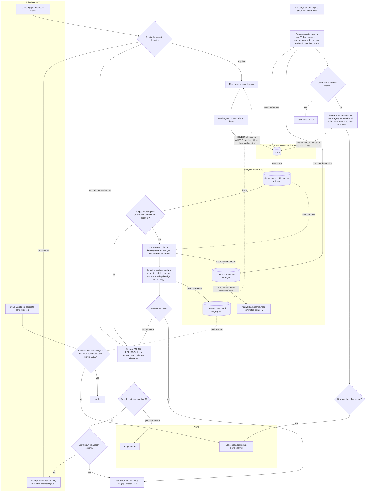

# Nightly orders ETL into the warehouse: pipeline plan

## Flowchart



## What starts each step

- **Nightly load:** the scheduler fires at 02:00 UTC. Attempt 2 and attempt 3 are started by the scheduler 15 minutes after the previous attempt ends, not by the job itself, so a crashed job still gets its retries.
- **Lock acquisition:** the first step of every attempt. Only one writer may run against `orders` at a time. A lock held by a hung earlier attempt makes the new attempt fail as a normal failure.
- **Extract and staging:** start after the lock and the watermark read.
- **Merge and watermark update:** start only after staging passes its checks.
- **Watchdog:** a separate scheduled job at 06:00 UTC. It is not part of the nightly job, so a hung or crashed load cannot suppress its alert.
- **Dashboard refresh:** starts at 06:00 UTC on its own schedule. It reads only committed data, so it never sees a partial night.
- **Reconciliation:** starts on Sunday after that night's load has committed. If that night has not committed, reconciliation waits.

## Data movement

1. The replica is read-only. The job runs `SELECT` on `orders` with `updated_at later than window_start`, where `window_start = hwm minus 2 hours`. All columns are read, including `deleted_at`.
2. Rows are copied into a per-attempt staging table in the warehouse, `stg_orders_<run_id>`. Staging has the source columns plus `run_id` and `extracted_at`. Staging is created fresh at the start of each attempt, so a retry never reuses a partial load. Orphaned staging tables older than a few days are swept.
3. Staging is merged into `orders`. The app database is never written to.

## Merge logic

Staging is first deduplicated per `order_id`, keeping the row with the greatest `updated_at`. Then the merge runs:

```
MERGE INTO orders AS tgt
USING deduped_staging AS src
  ON tgt.order_id = src.order_id
WHEN MATCHED AND src.updated_at > tgt.updated_at THEN
  UPDATE SET <all source columns>,
             is_deleted = (src.deleted_at IS NOT NULL)
WHEN NOT MATCHED THEN
  INSERT (<all columns>, is_deleted)
  VALUES (<all source columns>, (src.deleted_at IS NOT NULL));
```

- The `updated_at` guard means a replayed or overlapping row never overwrites a newer version. Equal `updated_at` values are a no-op.
- Deleted orders stay in `orders` with `is_deleted = true`. Because a delete is a write, it bumps `updated_at` and is picked up by the normal window.
- Re-running a night is safe. The same rows merge to the same result.
- Open point: if the app can write the same order twice with the same `updated_at`, add a version column as a tie-break.

## Where state lives and how the high-water mark moves

All pipeline state is in the warehouse, in `etl_control`:

- `watermark(pipeline, hwm, last_success_run_id, committed_at)`
- `run_log(run_id, run_date, attempt_no, started_at, ended_at, status, error)`
- `lock(pipeline, holder_run_id, acquired_at)`

The watermark is updated in the same transaction as the merge. The new value is `greatest(old_hwm, max(updated_at) over the extracted rows)`. If the extract is empty, the value stays the same.

Using the max extracted `updated_at` rather than the wall clock is deliberate. A bulk-import row can be stamped at 01:50 and not visible until 03:20. A wall-clock watermark would skip it. The max-extracted watermark never moves past data that has not yet arrived, and it self-heals if the replica is behind.

If the warehouse does not support multi-statement transactions, the fallback is to build the merged result in a shadow table and swap it in atomically. The watermark update must still be in the same atomic step.

## Failure and retry

| Failure point | What happens | Data state |
|---|---|---|
| Lock held | Attempt fails, retry | Nothing written |
| Replica error or timeout during extract | Attempt fails, staging dropped, retry | Nothing in `orders` |
| Staging check fails | Attempt fails, retry | Nothing in `orders` |
| Merge or watermark error | ROLLBACK, attempt fails, retry | Old state kept |
| COMMIT outcome unknown (timeout) | Before retry, check whether this `run_id` committed. If it did, the run counts as success and no retry runs. | Atomic |

- Attempts start at 02:00, 02:15 (if attempt 1 failed) and 02:30 (if attempt 2 failed). The wait is measured from the end of the failed attempt, so attempts are 15 minutes apart. Each attempt has a deadline so a hung run cannot push past 06:00.
- The third failure pages on-call.
- The 06:00 watchdog checks `run_log` for a committed success whose `run_date` is last night and whose commit time is at or before 06:00. If none exists, it posts a staleness alert to the data-alerts channel with the attempt count and last error. It posts regardless of whether a page already went out.

## Reconciliation

- Runs every Sunday after that night's commit, under the same lock, so it cannot race the nightly merge.
- For each creation day in the last 30 days, it compares a row count and an order-independent checksum, such as the sum of a 64-bit hash of `order_id` and `updated_at`, computed on the replica and on the warehouse. The hash input must use the same canonical form on both sides: `updated_at` as UTC ISO-8601 at fixed precision.
- A mismatched day is reloaded. The reload extracts all rows created that day, using `created_at` within that UTC day, into staging and applies the same MERGE rule in its own transaction. Nothing is deleted.
- The reload does not touch the watermark.
- The day is compared again after the reload. If it still mismatches, the job posts to the data-alerts channel. A still-mismatched day usually means the warehouse holds a newer version than the replica, which the guard blocks, or the replica is behind; either way an alert is the right result.

## Assumptions to confirm

- The `orders` table has `created_at`. Creation-day reconciliation depends on it.
- A `deleted_at` write also sets `updated_at`, as the brief's rule that every write sets it implies.
- "15 minutes apart" is measured from the end of the failed attempt to the start of the next.
- The warehouse supports a multi-statement transaction that includes the watermark update, or the shadow-table fallback is acceptable.
- Equal `updated_at` values for the same order do not occur, or a version tie-break is added.