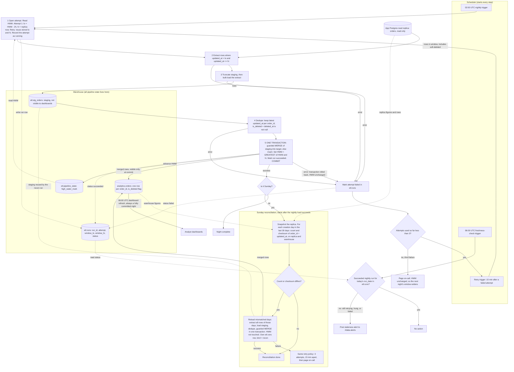

# Nightly orders ETL: replica to warehouse

## Summary

Today there is no pipeline: the app's `orders` table is not in the analytics warehouse. This job copies it there every night at 02:00 UTC. Each night it reads rows changed since the last successful run (with a 2-hour overlap), loads them into a private staging table, and then merges them into the dashboard-visible table in one transaction that also moves the high-water mark. Because the whole night commits at once or not at all, dashboards never see a half-loaded night. A Sunday reconciliation repairs rows that became visible later than the overlap covers.

## Terms

- **Read replica:** a read-only copy of the app's Postgres database. It is the only source. We have no write access to the app database, so all bookkeeping lives in the warehouse.
- **`updated_at`:** set to the write time on every write to an order. The app never hard-deletes: it sets `deleted_at`, which is also a write.
- **`is_deleted`:** our flag in the warehouse, `deleted_at IS NOT NULL`. Deleted orders stay in the warehouse.
- **High-water mark (HWM):** the `window_hi` of the last successful night. It is stored only in `etl.pipeline_state` (one row, `orders_nightly`, column `high_water_mark`).
- **Window (`window_lo`, `window_hi`):** the range a run extracts: `updated_at > window_lo AND updated_at <= window_hi`.
- **Lookback:** 2 hours. `window_lo = HWM - 2h`. It exists because bulk-import transactions can stay open up to 90 minutes and `updated_at` is stamped at write time, not commit time. A row can therefore become visible up to 90 minutes after its `updated_at`.
- **Staging (`etl.stg_orders`):** a scratch table in the `etl` schema, which dashboards cannot read.
- **Target (`analytics.orders`):** the dashboard-visible table, one row per `order_id`, always its latest version.
- **`etl.runs`:** one row per attempt: `run_id`, `kind` (`nightly` or `recon`), `run_date`, `attempt`, `window_lo`, `window_hi`, `status` (`running`, `failed`, `succeeded`), `error`, timestamps.
- **Scheduler:** starts every step and every retry. It holds no pipeline state.
- **Guarded MERGE:** a warehouse `MERGE` keyed on `order_id` that updates a matched row only if the staged `updated_at` is greater than or equal to the target's.

## Flowchart

## Reading the diagram

- **What starts a step:** solid arrows out of the scheduler box start a run. Each later step starts when the previous one finishes.
- **Data movement:** replica to staging (steps 2 and 3), staging to target (step 5, visible only on commit).
- **State:** dotted lines go to or from the `etl` tables. They show where the HWM and run status are read and written.
- **Failure:** every error route leads to the "Mark attempt failed" box.

## Nightly run: what the diagram cannot show

1. **Open attempt.** On attempt 1, read the HWM and fix `window_lo = HWM - 2h` and `window_hi` = the replica's `now()` at that moment. Store both in `etl.runs`. The upper bound keeps the window stable while the app keeps writing. Retries reuse the stored values, so every attempt of a night extracts identically. The first-ever run has HWM = epoch, which is a full backfill.
2. **Extract** from the replica only. Nothing is written to the app database.
3. **Stage.** Every attempt truncates staging first, so a half-loaded staging table is harmless: the next attempt replaces it and dashboards never read it.
4. **Dedupe.** The overlap means the same `order_id` can appear more than once. Keep the row with the highest `updated_at`.
5. **Merge and commit,** in one warehouse transaction, the only step that touches the dashboard-visible table:
   - Guarded MERGE: matched rows are updated (all columns, including `is_deleted`) only when staged `updated_at >= target updated_at`; unmatched rows are inserted. An older version never overwrites a newer one, and re-running a night rewrites identical data or nothing. Nothing is hard-deleted.
   - `high_water_mark = GREATEST(high_water_mark, window_hi)`, so replaying an old night cannot move it backwards. The HWM advances only after the night's data has loaded successfully.
   - Mark the run `succeeded`, then `COMMIT`. Data, HWM and status become visible together or not at all.
   - Assumption: the warehouse supports a multi-statement transaction with MERGE. If not, build the new table version in staging and swap it in atomically.

**Why `window_hi` is a safe HWM:** a row with `updated_at <= window_hi` may not be visible on the replica yet. The next night starts at `window_hi - 2h`, which covers the 90-minute delay.

**Single-flight rule:** a nightly or reconciliation run must not start while another run is `running` in `etl.runs`. This also protects the shared staging table. A reconciliation that overruns delays the next nightly instead of racing it.

## Staleness check, 06:00 UTC

A separate scheduler job, independent of the nightly job, so it still fires if that job hangs. It looks in `etl.runs` for a `succeeded` nightly run with today's `run_date`. If there is none, it posts to #data-alerts. That covers retries still in flight, a hung run and a paged failure. Dashboards refresh at 06:00 regardless and see either last night's complete state or tonight's complete state, never a mix.

## Sunday reconciliation: what the diagram cannot show

Some rows become visible later than the 2-hour lookback covers, for example when the replica falls behind. This job catches them.

- **Start:** only after that Sunday's nightly load has succeeded, not at a fixed clock time. If the night failed all 3 attempts, reconciliation is skipped. The next Sunday's 30-day window still covers those days.
- **Comparison:** days are grouped by `created_at::date`. Orders updated after the nightly cutoff can cause a false mismatch. The reload is idempotent, so the cost is a small extra load.
- **Reload:** the same dedupe and guarded MERGE as the nightly run, in one transaction. It does not touch the HWM.
- **No staleness alert,** because the nightly data is already published.

## What happens on failure

| Where | What happens |
|---|---|
| Extract, stage, dedupe or merge fails | Attempt marked `failed`. The merge transaction rolls back, so target and HWM are unchanged. |
| Fewer than 3 nightly attempts used | The scheduler retries the whole run 15 minutes later with the same window. |
| Third nightly attempt fails | Page on-call and stop. HWM has not moved, so the next night's window widens to cover the missed night. |
| Nightly not committed by 06:00 UTC | Staleness alert to #data-alerts. Dashboards show last night's complete state. |
| Run hangs | The 06:00 check still fires. Single-flight blocks new runs until the hung run is no longer `running`. |
| Reconciliation fails | Same policy: 3 attempts, 15 minutes apart, then page on-call. |
| Reconciliation skipped | The next Sunday's 30-day window covers the same days. |

## Open questions

- Reconciliation retry policy (3 attempts, 15 minutes apart, then page) is my choice. The brief did not specify it.
- The design assumes the warehouse supports a multi-statement transaction with MERGE. The fallback is the atomic table swap above.
- How a hung run stops being `running` (a timeout or manual clear) is not decided.