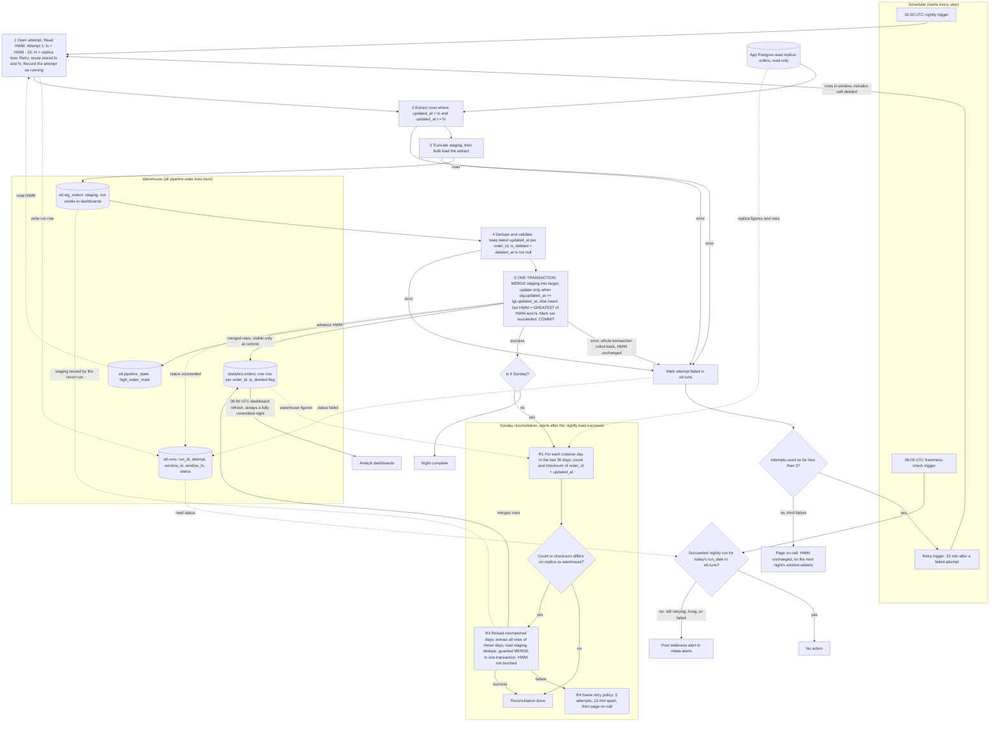

# Nightly orders ETL: replica to warehouse

## Design summary

- **Trigger:** the scheduler starts the job at 02:00 UTC. Retries come from the scheduler 15 minutes after a failure. A second scheduler job at 06:00 UTC runs the freshness check. The Sunday reconciliation starts when Sunday's nightly load succeeds, not at a fixed clock time.
- **Source:** the Postgres read replica only. Nothing is written to the app database.
- **State:** it all lives in the warehouse schema `etl`. It never lives in the scheduler or in the job's memory.
  - `etl.pipeline_state` holds one row, `orders_nightly`, with the column `high_water_mark`. This is the only place the HWM is stored.
  - `etl.runs` holds one row per attempt: `run_id`, `kind` (`nightly` or `recon`), `run_date`, `attempt`, `window_lo`, `window_hi`, `status` (`running`, `failed` or `succeeded`), `error` and timestamps.
  - `etl.stg_orders` is the staging table. It is in a separate schema that dashboards cannot read.
- **Window:** on attempt 1, the job reads the HWM and fixes `window_lo = HWM - 2h`. It fixes `window_hi` as the replica's `now()` at that moment, and records both in `etl.runs`. The extract is `updated_at > window_lo AND updated_at <= window_hi`.
  - The upper bound keeps the window stable while the app keeps writing.
  - Retries reuse the stored `lo` and `hi`, so every attempt of a night is identical.
  - The first-ever run starts with HWM = epoch, which is a full backfill.
- **Staging:** every attempt first truncates `etl.stg_orders` and bulk-loads the extract into it. A half-loaded staging table never matters, because the next attempt replaces it and dashboards never read it.
- **Dedupe:** the extract overlaps previous nights, so the same `order_id` can appear in staging more than once. Keep one row per `order_id`, the one with the highest `updated_at`. Derive `is_deleted = (deleted_at IS NOT NULL)`.
- **Merge and commit:** one warehouse transaction does all of this, and it is the only step that touches the dashboard-visible table:
  1. `MERGE` the deduped staging rows into `analytics.orders`, keyed on `order_id`.
     - `WHEN MATCHED AND stg.updated_at >= tgt.updated_at` it updates all columns, including `is_deleted`.
     - `WHEN NOT MATCHED` it inserts.
     - An older version therefore never overwrites a newer one. Re-running a night rewrites identical data, or nothing.
     - Deleted orders stay in the table, flagged `is_deleted`. Nothing is ever hard-deleted.
  2. Set `high_water_mark = GREATEST(high_water_mark, window_hi)`. The HWM can never move backwards, so replaying an old night is safe.
  3. Mark the run `succeeded`.
  4. `COMMIT`.

  The data, the HWM and the run status become visible together or not at all. A failure before the commit rolls everything back and leaves the HWM where it was. This assumes the warehouse supports a multi-statement transaction with MERGE. If it does not, the equivalent is to build the new table version in staging and swap it in atomically.
- **Why `hi` is a safe HWM:** a row with `updated_at <= hi` may not be visible on the replica yet, because a bulk transaction can stay open for up to 90 minutes. The next night starts at `hi - 2h`, so it picks that row up.
- **Failure and retry:** any failure in steps 1 to 4 leaves the HWM untouched.
  - The attempt is marked `failed`.
  - If fewer than 3 attempts have run, the scheduler retries the whole run after 15 minutes.
  - After the third failed attempt, the job pages on-call and stops. The HWM has not moved, so the next night's window widens to cover the missed night.
- **Staleness check, 06:00 UTC:** this is a separate scheduler job. It does not depend on the nightly job being alive, so it still fires if that job hangs. It looks in `etl.runs` for a `succeeded` nightly run with today's `run_date`. If there is none, it posts to #data-alerts. This covers retries still in flight, a hung run and a paged failure. Dashboards refresh at 06:00 regardless and see either last night's complete state or tonight's complete state, never a mix.
- **Single-flight:** a nightly run or a reconciliation run must not start while another run is `running` in `etl.runs`. A reconciliation that overruns therefore delays the next nightly rather than racing it.

## Sunday reconciliation

It starts only after the Sunday nightly run has succeeded. If that night failed all 3 attempts, reconciliation is skipped. The next Sunday's 30-day window still covers those days.

1. Take one consistent snapshot of the replica.
2. For each order-creation day (`created_at::date`) in the last 30 days, compute `count(*)` and a checksum over `order_id` + `updated_at`. Do this on the replica and on the warehouse.
3. Compare the two sets of figures. The days that differ are the mismatched days.
   - Orders updated after the nightly cutoff can cause a false mismatch. The reload is idempotent, so the cost is a small extra load.
4. For the mismatched days, extract every row of those days from the replica. Load the rows into staging and use the same dedupe and guarded MERGE as the nightly run. Do this in one transaction.
   - This reconciliation does **not** touch the HWM.
   - It writes its own `etl.runs` row with `kind = recon`.
5. If it fails, it uses my choice of the same retry policy (3 attempts, 15 minutes apart) and then pages on-call. The brief did not specify this, so adjust it if you want something different. There is no staleness alert, because the nightly data is already published.

## Flowchart

## Reading the diagram

- **Trigger:** each solid arrow out of the scheduler box starts a step. Each step after that starts when the previous one finishes.
- **Data movement:** replica to staging (steps 2 and 3), staging to target (step 5, on commit only).
- **State:** dotted lines go to or from the `etl` tables. They show where the HWM and run status are read and written.
- **Failure:** every error route leads to the F box. The HWM is untouched, the retry runs the same window, and the third failure pages on-call.
