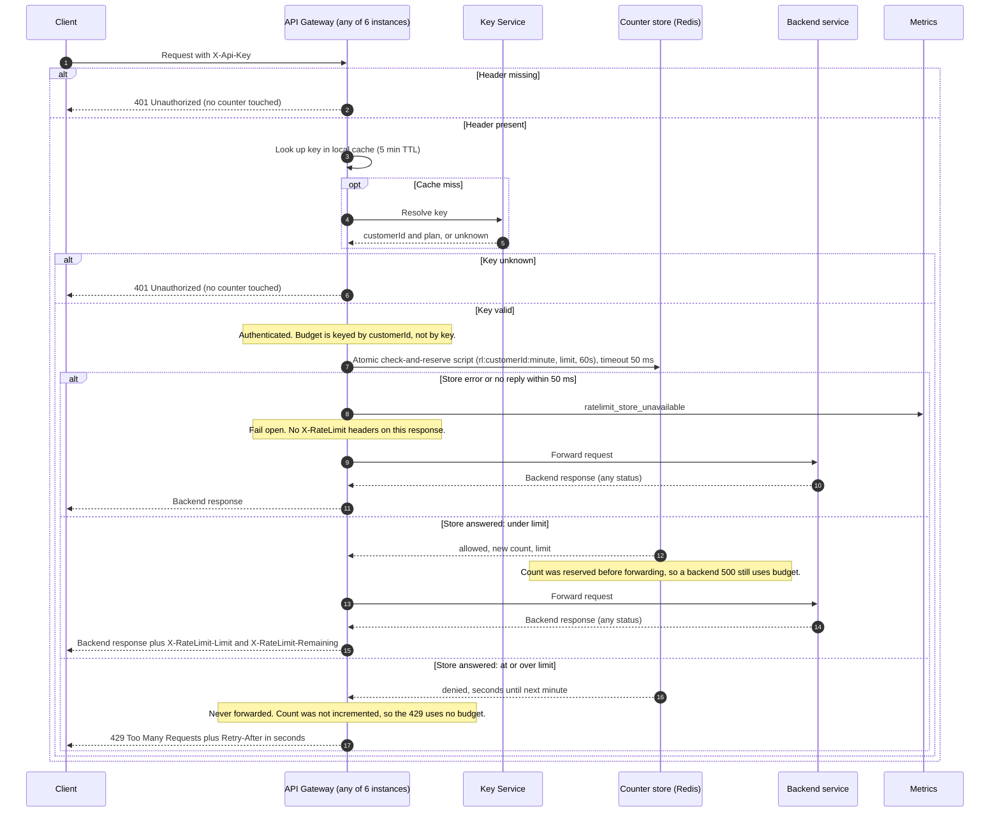

# Per-customer rate limiting on the public API (v1 design)

## Summary

Today the API Gateway checks each request's API key with the Key Service, then forwards the request to the backend that owns the route. This design adds a request budget per customer. The gateway checks the budget after it knows the customer and before it forwards the request. The budget is a counter in Redis, a shared store, so all six gateway instances count against the same number. A request over the budget gets `429` and is never forwarded. If the counter store is slow or down, the gateway forwards the request anyway, so a store outage does not stop the API.

## Terms

- **API key**: a secret string that the client sends in the `X-Api-Key` header.
- **Customer ID and plan**: the customer that owns a key, and the plan (Standard or Enterprise) that sets its limit.
- **Key Service**: the existing service that turns an API key into a customer ID and plan.
- **API Gateway**: the front door for all public traffic. It runs as 6 stateless instances behind a load balancer, so any instance can take any request.
- **Backend service**: the service that owns the route the request asks for.
- **Redis**: a fast shared store. Here it holds the counters.
- **Lua script**: a small program that Redis runs in one go, so no other command runs in the middle of it. "Atomic" means this here.
- **Fixed window**: a one-minute period on the clock. Each customer gets a fresh budget at each minute boundary.
- **Counter key**: `rl:<customerId>:<minute>`, where minute is Unix time in seconds divided by 60, rounded down. The key expires 60 seconds after it is written.
- **Redis TIME**: Redis's own clock. Using it means all instances agree on the time.
- **Retry-After**: an HTTP response header that tells the client how many seconds to wait before it retries.
- **Fail open**: when the check gets no answer, let the request through instead of blocking it.
- **Metric**: a count the system records for monitoring. Here it is `ratelimit_store_unavailable`.

## Sequence

## Steps

1. **Request arrives.** A client sends a request with an `X-Api-Key` header to any gateway instance. Nothing is stored yet.
2. **Authenticate.** The gateway looks the key up in its own memory cache, which keeps answers for 5 minutes. On a miss it asks the Key Service and caches the answer. A missing or unknown key ends here with `401`, and no counter is touched. Data kept: the cache, in each gateway instance's memory.
3. **Check the budget.** The gateway runs the check script in Redis on this customer's counter for the current minute, with a 50 ms timeout. The script reads the count. If the count is below the limit, it adds one and reports allowed. Otherwise it reports denied and changes nothing. Data kept: the counter in Redis, which expires 60 seconds after it is written.
4. **Forward or reject.** If allowed, go to step 5. If denied, return `429` with `Retry-After`, and never forward. If there is no answer or an error, emit `ratelimit_store_unavailable`, forward the request, and return the response without rate-limit headers.
5. **Return the backend response.** The backend's response goes back to the client. Allowed requests also get the two `X-RateLimit` headers. The count was already used in step 3, so a backend error still counts against the budget.

## What happens when things fail

| Situation | What happens |
|---|---|
| `X-Api-Key` header missing | `401`. No counter is read or changed. |
| Key unknown | `401`. No counter is read or changed. |
| Key Service does not answer and the key is not cached | Not decided in this design. See Open questions. |
| Redis errors, or does not answer within 50 ms | Emit `ratelimit_store_unavailable`, forward the request, send no `X-RateLimit` headers. A request that should have been rejected can pass. |
| Customer is over the limit | `429` with `Retry-After`. Not forwarded. No budget used. |
| Backend fails, for example returns `500` | The request already counted. The backend's response is returned as it is. |

## Rules the design must meet

1. Limits are per customer. All keys of one customer share one budget.
2. Standard customers get 100 requests per minute. The Enterprise limit is open and must not be guessed.
3. A missing or unknown key gets `401` before any counter is read or changed.
4. The check runs after authentication and before forwarding. An over-limit request gets `429` with `Retry-After` in seconds, is never forwarded, and uses no budget.
5. A request that passes the check counts, even if the backend then fails, for example with `500`.
6. Responses to requests that passed the check carry `X-RateLimit-Limit` and `X-RateLimit-Remaining`.
7. Counts are shared across all gateway instances. Spreading a customer's traffic over 6 instances must not give 6 times the limit.
8. If the counter store errors or does not answer within 50 ms, forward the request anyway and emit `ratelimit_store_unavailable`. A counter outage must not take the API down.

## Notes

**Limits.** The limit is read from plan configuration. The Enterprise limit is **OPEN: awaiting product decision.** The number can be filled in later without changing the flow.

**Store.** Use Redis, or any store with atomic server-side scripts and a single clock. Every gateway instance uses the same counter for a customer.

**Window.** A fixed window. The counter key is `rl:<customerId>:<floor(unixSeconds / 60)>`, and it expires after 60 seconds. The budget resets at each minute boundary. Known trade-off: a customer can send up to about twice the limit across a boundary, for example 100 at 0:59 and 100 at 1:00. A sliding window is the upgrade path if this matters.

**One script, no overshoot.** The check and the increment run as one Lua script, so Redis runs them atomically. The script reads the count. If it is below the limit, it increments and returns allowed with the new count. Otherwise it returns denied and leaves the count unchanged. Do not use a separate INCR and then compare. That would count rejected requests against the budget and break rule 4.

**Retry-After.** The script reads Redis TIME and returns the seconds until the next minute boundary. The gateway sends that value, rounded up, with a minimum of 1. It does not use the counter key's expiry. The key is set to expire 60 seconds after it is first written, so its expiry can differ from the minute boundary where the budget really resets.

**Remaining.** `X-RateLimit-Remaining` is the limit minus the new count. `X-RateLimit-Limit` is the customer's plan limit.

**Fail open.** The store call has a 50 ms timeout. Any error counts as a failure too. On failure the gateway emits the metric and forwards the request without rate-limit headers. A rejection missed because of a timeout can pass through. Rule 8 accepts this.

**Cache lag.** The 5-minute key cache means a plan change or a new key can take up to 5 minutes to take effect. A new customer ID is picked up on the first request for an uncached key. This is acceptable for v1.

**Not in v1.** Per-route limits, burst allowances, per-IP limits, and a dedicated rate-limit service.

## Open questions

1. **Enterprise limit:** OPEN, awaiting product decision.
2. Should a fail-open response carry any rate-limit header, or none at all? This design sends none.
3. What should happen when the Key Service does not answer and the key is not in the cache? This design does not decide it.