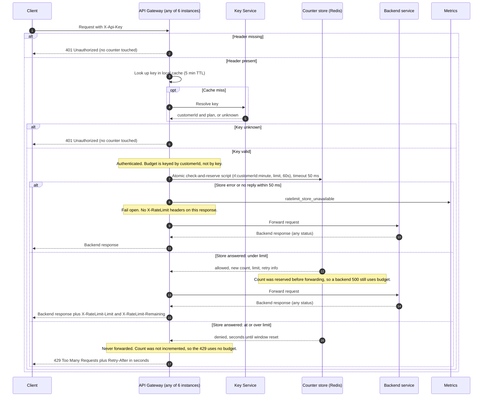

# Per-customer rate limiting on the public API (v1 design)

## Sequence

## Notes

**Limits and open decision.** Standard customers get 100 requests per minute. The Enterprise limit is **OPEN: awaiting product decision.** The design reads the limit from plan configuration, so the number can be filled in later without changing the flow.

**Store.** Use Redis (or any store with atomic server-side scripts and a single clock). All gateway instances share one counter per customer, so spreading a customer over 6 instances does not multiply their limit (requirement 7).

**Window.** A fixed window. The key is `rl:<customerId>:<floor(unixSeconds / 60)>` with a 60-second expiry. Budget resets at each minute boundary. Known trade-off: a customer can send up to about 2x the limit across a boundary (for example 100 at 0:59 and 100 at 1:00). A sliding window is the upgrade path if this matters.

**No overshoot across instances.** The check-and-increment runs as one Lua script, so Redis executes it atomically. The script runs in this order:

1. Read the current count.
2. If the count is below the limit, increment it and return allowed with the new count.
3. Otherwise return denied and leave the count unchanged.

Do not use a separate INCR-then-compare. That would count rejected requests against the budget and break requirement 4.

**Retry-After.** The script reads Redis `TIME` and returns the seconds until the window key expires. The gateway sends that value, rounded up, with a minimum of 1.

**Remaining.** `X-RateLimit-Remaining` is `limit - newCount`. `X-RateLimit-Limit` is the customer's plan limit.

**Fail open.** The store call has a 50 ms timeout, and any error also counts as a failure. On failure the gateway emits `ratelimit_store_unavailable` and forwards the request without rate-limit headers. A rejection that was not seen because of a timeout can therefore pass through. This is accepted by requirement 8.

**Auth first.** Missing or unknown keys return 401 before any store call, so the 401 path cannot read or change a counter (requirement 3).

**Cache lag.** The 5-minute key cache means a plan change or a new key can take up to 5 minutes to take effect. A new customer ID is picked up on the first request for an uncached key. Acceptable for v1.

**Not in v1.** Per-route limits, burst allowances, per-IP limits, and a dedicated rate-limit service are out of scope.

## Open questions

1. **Enterprise limit:** OPEN, awaiting product decision.
2. Should a fail-open response carry any rate-limit header, or none at all? This design sends none.
