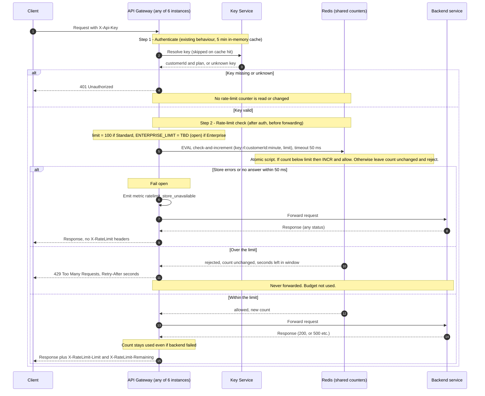

# Per-customer rate limiting on the public API

## Summary

Today every public request goes through the API Gateway (6 stateless instances behind a load balancer, any instance can take any request). The gateway resolves the `X-Api-Key` header to a customer and plan through the Key Service, then forwards the request to the backend. We add a rate-limit check between authentication and forwarding. The gateway asks one shared Redis to count the customer's requests in the current minute and either forwards the request or answers 429. Redis is shared so that six instances cannot give a customer six times their limit.

## Terms

- **Key Service:** the existing service that turns an API key into a customer ID and a plan (Standard or Enterprise). The gateway caches each answer in memory for 5 minutes.
- **Redis:** a fast in-memory key-value store. One shared instance (a primary with a replica for failover) holds all counters.
- **Lua script:** a small program Redis runs as one indivisible step. No other command runs while it executes.
- **Window:** the clock minute, for example 12:00:00 to 12:00:59. The count starts at zero in each new minute (a fixed window, not a sliding one).
- **Fail open:** when the counter store is broken, let requests through instead of blocking them.

## Sequence diagram

## What the diagram does not show

**How the counter works (step 2)**
- The counter key is `rl:{customerId}:{windowStart}`, where `windowStart` is epoch seconds divided by 60. It is per customer, so all of a customer's API keys share one budget. Each key expires after 120 s, which is long enough to cover its window.
- The gateway makes a single call to Redis and never reads then writes separately. The Lua script reads the count and increments it only if it is below the limit. Because Redis runs scripts one at a time, two instances cannot both take the last slot. A rejected request therefore leaves the counter unchanged, so 429s use no budget.
- Fixed windows have a known trade-off: a customer can send up to 2x the limit across a minute boundary (the end of one window plus the start of the next). We accept this for a first version.

**Headers**
- `Retry-After` is whole seconds until the window ends: `60 - (now mod 60)`, minimum 1. The script uses the Redis clock, so gateway clocks cannot disagree. Example: a request rejected at 12:00:42 gets `Retry-After: 18`, because the next window starts at 12:01:00.
- `X-RateLimit-Limit` is the customer's plan limit. `X-RateLimit-Remaining` is `limit - count`, using the count the script returned, never below 0. Both go on every response to a request that passed the check, whether the backend succeeded or failed.

**Failures**

| What goes wrong | What happens |
|---|---|
| Key missing or unknown | 401. No counter is read or changed. |
| Over the limit | 429 with `Retry-After`. Not forwarded. Counter unchanged. |
| Backend fails after the check passed (for example 500) | The count stays used. It is incremented before forwarding and never rolled back, so the gateway needs no bookkeeping after the response. |
| Redis errors or does not answer within 50 ms | Fail open: forward the request, emit `ratelimit_store_unavailable`, and add no `X-RateLimit-*` headers (wrong numbers are worse than none). No retry, because a retry would exceed the 50 ms budget. |
| Redis outage | Limits are not enforced while it lasts. The metric should drive an alert. After recovery, counting resumes from Redis state. A full Redis loss just resets the current windows. |
| Customer's plan changes | Takes up to 5 minutes to apply, because the plan comes from the cached Key Service answer. |

## Limits and rollout

- Standard customers: 100 requests per minute.
- Enterprise: the limit is **open**, because Product has not decided it. The plan-to-limit mapping holds the placeholder `ENTERPRISE_LIMIT = TBD`, and the design does not depend on its value. Until it is set, the rollout must not enable limiting for Enterprise customers. They are treated as unlimited and skip the check.

## Open questions

- The Enterprise limit (owner: Product). Everything else is decided for v1.