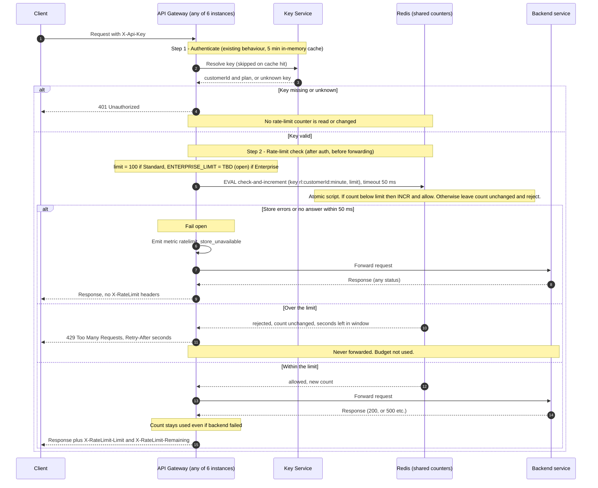

# Per-customer rate limiting on the public API

## Decisions

- **Store:** Redis, one shared instance (primary with replica for failover). All 6 gateway instances talk to the same counters, so requirement 7 holds.
- **Counter key:** `rl:{customerId}:{windowStart}`, where `windowStart` is the current minute (epoch seconds divided by 60). The key is per customer, so every API key of a customer shares one budget. Each key expires after 120 s.
- **Window:** fixed one-minute window aligned to the clock minute, not a sliding window. Known trade-off: a customer can send up to 2x the limit across a minute boundary (the end of one window plus the start of the next). We accept this for a first version.
- **Concurrency:** the gateway makes one atomic call to Redis, a small Lua script, which does "read count, and only if below the limit, increment". Redis runs scripts one at a time, so two instances cannot both take the last slot. There is no separate read-then-write from the gateway.
- **429s do not use budget:** the script increments only when the count is below the limit. A rejected request leaves the counter unchanged.
- **Limits:**
  - Standard: 100 requests per minute.
  - Enterprise: **OPEN. Product has not decided.** The plan to limit mapping has a placeholder `ENTERPRISE_LIMIT = TBD`. The design does not depend on its value. Until it is set, the rollout must not enable limiting for Enterprise customers (they are treated as unlimited and skip the check).
- **Retry-After:** whole seconds until the current window ends, computed by the script from the Redis clock: `60 - (now mod 60)`, minimum 1. A single clock (Redis) avoids skew between gateway instances.
- **Fail open:** if Redis errors or does not answer within 50 ms, the gateway forwards the request, emits the `ratelimit_store_unavailable` metric, and adds no `X-RateLimit-*` headers (the real values are unknown, and wrong numbers are worse than none). No retry, because a retry would exceed the 50 ms budget.

## Sequence diagram

## Notes on what the diagram does not show

- **Remaining:** `X-RateLimit-Remaining = limit - count`, using the count returned by the script (never below 0). `X-RateLimit-Limit` is the customer's plan limit. Both are added to the response whether the backend returned success or failure, as long as the request passed the check.
- **Retry-After example:** a request rejected at 12:00:42 gets `Retry-After: 18`, because the next window starts at 12:01:00.
- **Backend failure:** the counter is incremented before forwarding and never rolled back, which satisfies requirement 5 and keeps the gateway free of any post-response bookkeeping.
- **Auth cache:** a plan change can take up to 5 minutes to take effect, because the plan comes from the existing cached Key Service answer.
- **Fail-open consequence:** during a Redis outage, limits are not enforced. The metric should drive an alert. Counters restart from the Redis state when it recovers, and a full Redis loss simply resets the current windows.
- **Open items:** the Enterprise limit (Product). Everything else above is decided for v1.
