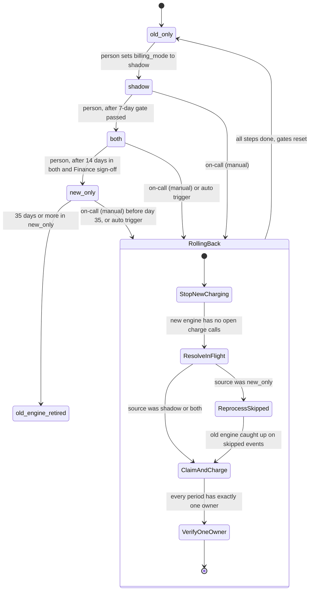

# Billing engine rollout: state machine

## Summary

Today, billing workers run the old billing engine. It reads usage events from the usage event log, computes invoices, writes them to the billing ledger (the system of record) and charges customers through the payment provider. The rollout moves billing to a new engine in four modes, selected by one global flag, `billing_mode`. A person moves the rollout forward one mode at a time, and each move waits for its gate to pass. Rollback always ends in `old_only`. Each billing period has one owner in the ledger before anyone charges it, so no period is charged twice.

## Terms

- **Billing mode (`billing_mode`):** one global setting in the config service. It holds one of four values: `old_only`, `shadow`, `both`, `new_only`.
- **Old engine and new engine:** the two billing calculators. The old engine runs today. The new engine is being rolled out.
- **Usage event log:** keeps usage events for 35 days. Older events are gone.
- **Billing ledger:** the system of record for invoices and charges.
- **Shadow store:** a separate store where invoices are written without being charged or posted to the ledger.
- **Payment provider:** the outside service that charges customers.
- **Idempotency key:** a unique key sent with each charge. The provider runs a key only once, and can be asked later whether a key succeeded.
- **Billing period:** the time span an invoice covers. Each period is charged exactly once.
- **Mismatch:** an invoice total that differs by more than one cent between the two engines.
- **Rollout controller:** the component that changes `billing_mode` and runs rollback. It is the only writer of `billing_mode`.
- **Charge ownership record:** one row per customer and billing period in the ledger. It names the engine that owns the period and the idempotency key used to charge it.
- **Charge failure rate:** the share of new-engine charge attempts that fail.
- **On-call:** the engineer on duty, who can start a rollback by hand.

## Diagram

Notes on the diagram: `RollingBack` is a state of the rollout controller, not a `billing_mode` value. After a rollback, `billing_mode` is `old_only`. A person must set `shadow` again to restart the rollout.

## The modes

### old_only (start state and rollback target)

- **Starts:** the initial state. Every rollback ends here.
- **Does:** the old engine computes invoices, writes the ledger and charges customers. The new engine is off.
- **Data:** the ledger and the charge ownership records.

### shadow

- **Starts:** a person sets `billing_mode` to `shadow`.
- **Does:** the old engine still charges and writes the ledger. The new engine reads the same usage events and writes its invoices to the shadow store. It never charges and never writes the ledger. Each night, a job compares the two engines' invoices for each customer and records any mismatch.
- **Gate to leave:** 7 consecutive days, each with a mismatch rate under 0.1% and at least 5,000 invoices compared. A person then moves the mode to `both`.
- **When it goes wrong:** new-engine errors are recorded here, but they never start a rollback. A failed or skipped nightly comparison does not count toward the 7 days, and it resets the consecutive count.

### both

- **Starts:** a person moves the mode from `shadow` after the 7-day gate.
- **Does:** the new engine charges and writes the ledger. The old engine keeps computing every invoice into the shadow store without charging, so it stays current for rollback. The nightly comparison continues.
- **Gate to leave:** 14 days in `both` with no unresolved mismatches, plus Finance sign-off. A person then moves the mode to `new_only`.
- **Automatic rollback:** starts when the new engine's charge failure rate is above 2% over any 10-minute window.
- **When it goes wrong:** an unresolved mismatch blocks the move to `new_only`. It does not start a rollback.

### new_only

- **Starts:** a person moves the mode from `both` after both gates pass.
- **Does:** the new engine does everything. The old engine stops computing and no longer processes usage events. The 35-day rollback clock starts when this mode is entered.
- **Rollback:** on-call can start it by hand until day 35. The 2% automatic trigger also applies.
- **After day 35:** rollback is no longer possible. The old engine may then be decommissioned.

## Rollback

Rollback can start from `shadow`, `both` or `new_only`. It always ends in `old_only`. It must never charge a customer twice for a billing period, and it must never drop a charge that is due. After any rollback, the gates reset. The rollout must pass through `shadow` again, and its 7-day count starts over.

The steps run in this order:

1. **Stop new-engine charging and writes.**
2. **Resolve unconfirmed charges.** Look up every new-engine charge attempt with no confirmed outcome at the payment provider, using its idempotency key. A timeout does not mean the charge failed.
3. **Reprocess, only if the source was `new_only`.** The old engine reprocesses the usage events it skipped. This must finish before the earliest skipped event passes the 35-day limit. Rollback from `shadow` or `both` skips this step, because the old engine has computed throughout.
4. **Claim, then charge.** The old engine writes the ledger and charges only periods that have no owner yet and are due. Each charge uses an idempotency key.
5. **Verify.** Check that every period has exactly one owner. Only then set `billing_mode` to `old_only` and reset the gates.

## Where the rollout state lives

- **`billing_mode`:** in the config service. It is the only global switch. The rollout controller is its only writer, and a person makes each forward move through the controller.
- **Rollout record:** holds the gate counters, the day count in `both`, the Finance sign-off, the start time of the 35-day clock, and the current rollback step. It must survive restarts, so it needs durable storage. Where it lives is open (see below).
- **Charge ownership records:** one per customer and billing period in the billing ledger. They prevent double charges. A period is charged only after its owner is claimed.

## What happens when things fail

| Failure | What happens |
|---|---|
| Workers see different modes during a flip | This is the main double-charge risk. Every charge claims the period in the ledger before calling the provider. A period claimed by one engine cannot be charged by the other. |
| Provider timeout on a new-engine charge | The outcome is unknown. Do not retry under the new engine. Resolve it by idempotency key during rollback. Count it as a failure for the 2% trigger. |
| Config service unreachable | Workers keep their last-read mode and raise an alert. They never default to `new_only`. |
| Nightly comparison fails or is skipped | That day does not count toward the 7-day gate, and the consecutive count resets. |
| Unresolved mismatch in `both` | Blocks the move to `new_only`. Does not start a rollback. |
| New-engine error in `shadow` | Recorded. Never starts a rollback. |
| Rollback fails partway | The state stays `RollingBack`. Each step is idempotent and can be retried. `billing_mode` does not become `old_only` until verification passes. |
| Usage events approach the 35-day limit in `new_only` | Rollback becomes impossible from day 35. Alert well before then. |

## Open questions

- Where is the rollout record stored? The brief does not say. It needs durable storage that survives restarts.
- Must all 7 days of the `shadow` gate pass on their own? This draft assumes yes: each day needs a mismatch rate under 0.1% and at least 5,000 invoices compared.
- Does the 35-day clock start when `new_only` is entered? This draft assumes yes, because that is when events start being skipped.
- Does the 2% trigger need a minimum charge volume? Without one, a single failure in a quiet 10-minute window could start a rollback.
- Does rollback from `shadow` need no reprocessing? This draft assumes so, because the old engine has charged throughout.