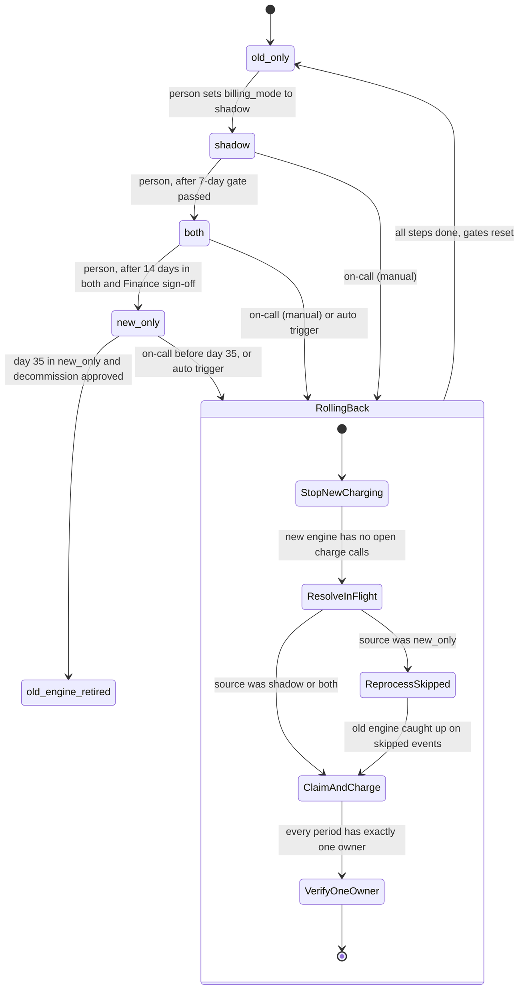

# Billing engine rollout: state machine

## Diagram

## Notes on the modes

- **old_only:** The old engine computes, writes the ledger and charges. The new engine is off. This is the start state and the rollback target.
- **shadow:** The old engine still charges and writes the ledger. The new engine reads the same usage events and writes invoices to the shadow store. It never charges and never writes the ledger. A nightly job compares the two engines per customer, and a mismatch is any total that differs by more than one cent. New-engine errors are recorded here but never trigger rollback.
- **both:** The new engine charges and writes the ledger. The old engine keeps computing every invoice into the shadow store without charging, so it stays current for rollback. The nightly comparison continues.
- **new_only:** The new engine does everything. The old engine stops computing, so usage events are skipped from this point. The 35-day clock for rollback starts when this mode is entered.
- **RollingBack:** This is a state of the rollout controller, not a `billing_mode` value. The config flag has only four values. The rollback steps are:
  1. Stop new-engine charging and writes.
  2. Resolve every new-engine charge attempt that has no confirmed outcome by looking it up at the payment provider using its idempotency key. A timeout does not mean the charge failed.
  3. If the source is `new_only`, the old engine reprocesses the skipped usage events. This must finish before the earliest skipped event passes the 35-day retention limit.
  4. The old engine writes the ledger and charges only periods that have no owner yet and are due, each under an idempotency key.
  5. Verify that every period has exactly one owner. Only then set `billing_mode` to `old_only` and reset the gates.

## Where the rollout state lives

- **`billing_mode`** lives in the config service. It is the only global switch, and the controller is the only writer. Forward moves are written by a person through the controller.
- **Rollout record** holds the gate counters, the day count in `both`, the sign-off, the start time of the 35-day clock, and the current rollback step. It needs durable storage that survives restarts. The brief does not say where, so this is a decision to make.
- **Charge ownership** is one record per customer and billing period in the billing ledger, with the owning engine and the idempotency key sent to the payment provider. This is what prevents double charges. A period is charged only after its owner is claimed.

## What happens when something fails

- **Workers see different modes during a flip.** This is the main double-charge risk. Every charge must claim the period in the ledger before calling the provider. A period claimed by one engine cannot be charged by the other.
- **Provider timeout on a new-engine charge.** The outcome is unknown. Do not retry it under the new engine. Resolve it by idempotency key during rollback, and count it as a failure for the 2 percent trigger.
- **Config service unreachable.** Workers keep their last-read mode and raise an alert. They never default to `new_only`.
- **Nightly comparison fails or is skipped.** That day does not count toward the 7-day gate, and a missed day resets the consecutive count. This is the conservative reading.
- **Unresolved mismatch in `both`.** This blocks the move to `new_only`. The brief does not say it triggers rollback, so it does not.
- **Rollback fails partway.** The state stays `RollingBack`. Each step is idempotent and can be retried. `billing_mode` does not become `old_only` until verification passes.
- **Usage events approach the 35-day limit in `new_only`.** Rollback becomes impossible from that point on, so alert well before day 35.

## Assumptions to confirm

- The 7-day gate applies per day: each of the 7 days needs a mismatch rate under 0.1 percent and at least 5,000 invoices compared.
- The 35-day clock starts when `new_only` is entered, because that is when events begin to be skipped.
- The 2 percent auto-rollback trigger needs a minimum charge volume. Without one, a single failure in a quiet 10-minute window could trigger rollback.
- Rollback from `shadow` needs no reprocessing, because the old engine has been charging throughout.