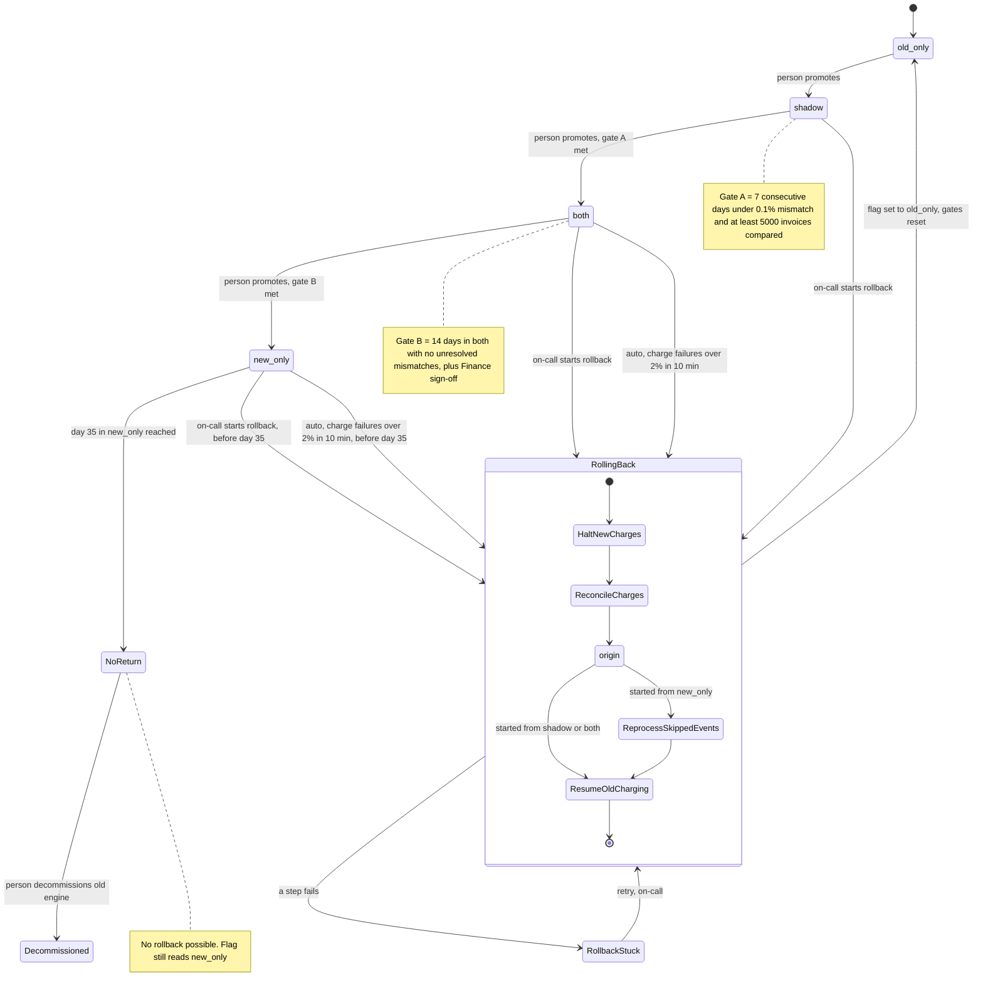

# Billing engine rollout: state machine

## Summary

Today the old billing engine reads usage events, computes invoices, writes them to the billing ledger and charges customers through the payment provider. This document models the switch to a new engine as four modes set by one flag, `billing_mode`. A person promotes the rollout one mode at a time, each move guarded by a gate. Rollback always ends in `old_only` through a fixed sequence of steps whose order prevents double or dropped charges. The switch is gradual and reversible, and must never charge a customer twice.

Items marked **Assumption** or **Open question** are my reading of the brief. Please confirm them before the controller is built.

## Terms

- **`billing_mode`**: the one global flag in the config service. Its values are `old_only`, `shadow`, `both` and `new_only`.
- **Usage event log**: the stream of usage events both engines read. It keeps events for 35 days.
- **Billing ledger**: the system of record for invoices and charges.
- **Shadow store**: a separate store for invoices that are computed but not charged and not written to the ledger.
- **Nightly comparison**: a job that compares the two engines' invoices per customer. A mismatch is any invoice total that differs by more than one cent.
- **Charge key**: a customer plus a billing period. An engine skips any key that already has a charge.
- **Rollback record**: a durable record, written when a rollback starts, holding the origin mode, the current step and who triggered it.
- **Gate A**: 7 consecutive days with a mismatch rate under 0.1%, and at least 5,000 invoices compared.
- **Gate B**: 14 days in `both` with no unresolved mismatches, plus Finance sign-off.
- **Day 35**: the 35th day in `new_only`. From then on there is no way back.

## Diagram

`NoReturn` and `Decommissioned` are not flag values. The flag stays `new_only` in both. They mark that rollback is no longer possible and, later, that the old engine is retired.

## What each mode does

| Mode | Old engine | New engine | Who charges and writes the ledger |
|---|---|---|---|
| `old_only` | Computes, charges, writes ledger | Off | Old |
| `shadow` | Computes, charges, writes ledger | Reads the same usage events and writes invoices to the shadow store only | Old |
| `both` | Computes every invoice into the shadow store, never charges, so it stays current | Computes, charges, writes ledger | New |
| `new_only` | Stopped | Computes, charges, writes ledger | New |

The nightly comparison runs in `shadow` and `both`. Forward moves are made only by a person, one step at a time with no skipping, and the controller refuses a promotion whose gate is not met.

## Rollback

Rollback can start from `shadow`, `both` or `new_only` and always ends in `old_only`. On-call can start it by hand at any time before day 35 in `new_only`. It starts automatically in `both` or `new_only` when the new engine's charge failure rate is above 2% over any 10-minute window. New-engine errors in `shadow` are recorded but never trigger a rollback.

Each step starts when the previous one finishes. Their order prevents a double charge or a dropped charge.

1. **HaltNewCharges.** The new engine stops charging. In `shadow` there is nothing to halt.
2. **ReconcileCharges.** Wait for in-flight charges to settle with the payment provider. Then treat the billing ledger as the list of charge keys already charged.
3. **ReprocessSkippedEvents.** Only when the rollback started from `new_only`, because the old engine skipped events there. The old engine reads the skipped usage events, up to 35 days back, and computes those invoices. Computing does not charge. The 35-day limit exists because the log keeps events only 35 days, so after day 35 the earliest skipped events would be gone.
4. **ResumeOldCharging.** The old engine charges every period that is due and has no recorded charge, and writes the ledger. Periods the new engine already charged are skipped, so nobody is charged twice and no due charge is dropped. From `both`, the old engine's invoices are already current, so steps 3 is skipped.
5. **Commit.** The flag is set to `old_only`, the new engine is switched off, and the gates reset. The rollout must go through `shadow` again, and the 7-day count starts over.

## Where the rollout state lives

- **Current mode**: the `billing_mode` flag is the only source.
- **Time in mode**: the 14-day and 35-day clocks derive from when the flag last changed.
- **Gate evidence**: nightly comparison results, kept next to the shadow store, hold the daily mismatch rate and invoice counts.
- **Finance sign-off**: a recorded approval that the controller reads.
- **Charges**: the billing ledger. Rollback relies on it.
- **Rollback progress**: the flag has only four values, so it cannot show a rollback in progress. **Assumption:** the rollback record is written when rollback starts. While it exists, it decides which engine may charge.

## What happens when things fail

| Failure | What happens |
|---|---|
| New-engine errors in `shadow` | Recorded only. No rollback. |
| Charge failure rate over 2% in 10 minutes, in `both` or `new_only` before day 35 | Rollback starts automatically. |
| The same trigger from day 35 on | Rollback is impossible, so the system pages on-call. |
| Rollback triggered twice | The rollback record makes it idempotent. A second trigger during a rollback is ignored. |
| A rollback step fails | The rollback moves to `RollbackStuck` and pages on-call. The mode is not yet `old_only` and new charges stay halted. Due charges are delayed, never dropped. On-call retries from the failed step. Every step is safe to re-run because it is keyed by charge key. |
| A gate is not met | The rollout stays in its current mode. A day that misses the mismatch threshold restarts the 7-day count. A missed nightly comparison does not count as a passing day. |

## Open questions

1. **Order of the flag flip.** I flip the flag last, so the rollback record controls who charges during the rollback. Flipping first risks both engines charging at once.
2. **The 14-day gate.** I read "no unresolved mismatches" as zero unresolved at the end of the 14 days. A stricter reading restarts the clock whenever a mismatch appears. Which is intended?
3. **A rollback in progress at day 35.** Should one that started before day 35 be allowed to finish? The usage events it needs may expire while it runs.
4. **Payment provider idempotency.** I assumed charges can be keyed by customer and period. If the provider has no idempotency keys, step 2 must check the provider's own records.
