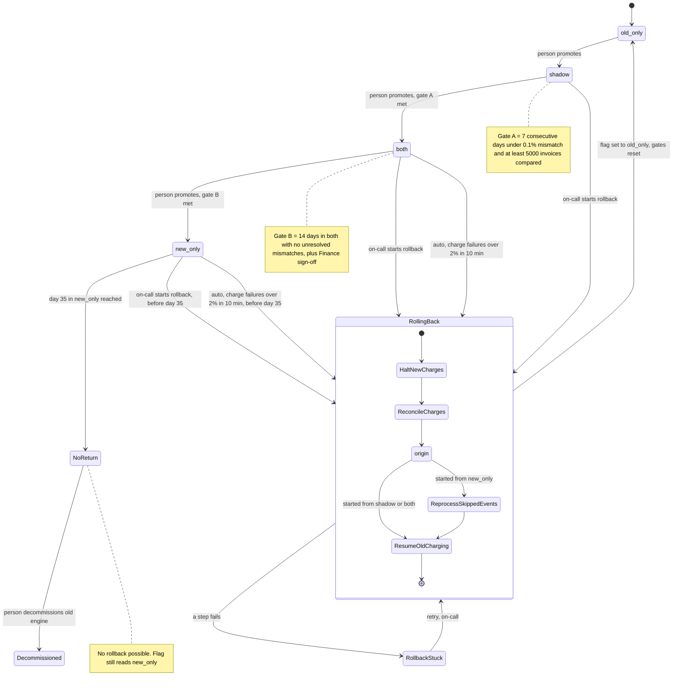

# Billing engine rollout: state machine

## Summary

The rollout has four modes, set by the `billing_mode` flag. A person moves forward one step at a time. Rollback goes from `shadow`, `both` or `new_only` back to `old_only` through a fixed sequence of steps. Rollback is unavailable from day 35 in `new_only` onward.

Items marked **Assumption** or **Open question** are my reading of the brief. Please confirm them before the controller is built.

## Diagram

Gate A is checked on the `shadow` to `both` move, and Gate B on the `both` to `new_only` move. Both gates restart after any rollback.

`NoReturn` and `Decommissioned` are not new flag values. The flag stays `new_only` in both. They mark that rollback is no longer possible and, later, that the old engine is retired.

## What each mode does

| Mode | Old engine | New engine | Who charges and writes the ledger |
|---|---|---|---|
| `old_only` | Computes, charges, writes ledger | Off | Old |
| `shadow` | Computes, charges, writes ledger | Reads the same usage events and writes invoices to the shadow store only | Old |
| `both` | Computes every invoice into the shadow store, never charges | Computes, charges, writes ledger | New |
| `new_only` | Stopped | Computes, charges, writes ledger | New |

- **Comparison.** A nightly job compares the two engines' invoices per customer. A mismatch is any total that differs by more than one cent. It runs in `shadow` and `both`.
- **Forward moves.** Only a person makes them, one step at a time, with no skipping. The controller refuses a promotion whose gate is not met.
- **Gates.** Gate A and Gate B are defined in the diagram notes.

## Rollback steps

The order of the steps is what prevents a double charge or a dropped charge.

1. **HaltNewCharges.** The new engine stops charging. In `shadow` there is nothing to halt, because the new engine never charges there.
2. **ReconcileCharges.** Wait for in-flight charges to settle with the payment provider. Then treat the billing ledger, the system of record, as the list of customer-and-period pairs already charged. Every charge is keyed by customer and billing period, and an engine skips a pair that already has a charge.
3. **ReprocessSkippedEvents.** This runs only when the rollback started from `new_only`. The old engine reads the usage events it skipped, up to 35 days back in the usage event log, and computes those invoices. Computing alone does not charge anything.
4. **ResumeOldCharging.** The old engine charges every period that is due and has no recorded charge. It writes the ledger, so no due charge is dropped. Periods the new engine already charged are skipped, so nobody is charged twice.
5. **Commit.** The flag is set to `old_only`, the new engine is switched off, and the gates reset. Forward moves then start again at `shadow`.

When the rollback started from `both`, the old engine's invoices in the shadow store are already current. It needs no reprocessing, only steps 4 and 5.

The 35-day limit follows from the usage event log's 35-day retention. After day 35 the earliest skipped events would be gone, so step 3 could not be completed.

## Where the rollout state lives

- **Current mode.** The `billing_mode` flag in the config service is the only source for the mode.
- **Time in mode.** Both the 14-day clock and the 35-day clock are derived from when the flag last changed.
- **Gate evidence.** Nightly comparison results, kept next to the shadow store, hold the daily mismatch rate and invoice counts.
- **Finance sign-off.** A recorded approval that the controller reads.
- **Charges.** The billing ledger holds which customer-and-period pairs have been charged. Rollback relies on it.
- **Rollback progress.** The flag has only four values, so it cannot show that a rollback is in progress. **Assumption:** a durable rollback record, written when rollback starts, holds the origin mode, the current step and who triggered it. While a rollback is in progress, that record decides which engine may charge.

## What happens when something fails

- **New-engine errors in `shadow`.** They are recorded and never trigger a rollback.
- **Charge failure rate over 2% in any 10-minute window, in `both` or `new_only`.** Rollback starts automatically.
- **The same trigger from day 35 on.** Rollback is impossible, so the system pages on-call instead of rolling back.
- **Rollback triggered twice.** The rollback record makes the trigger idempotent. A second trigger during a rollback is ignored.
- **A rollback step fails.** The rollback moves to `RollbackStuck` and pages on-call. The mode is still not `old_only`, and new charges stay halted. Charges that are due are delayed, never dropped. Retrying resumes from the failed step. Every step can be re-run safely because each is keyed by customer and period.
- **A gate fails.** The rollout stays in its current mode. A day that misses the mismatch threshold restarts the 7-day count, since the days must be consecutive. A missed nightly comparison does not count as a passing day.
- **After any rollback.** Gates reset, so the rollout goes through `shadow` again and the 7-day count starts at zero.

## Open questions

1. **Order of the flag flip.** I put it last, so the rollback record controls who charges during the rollback. The alternative is flipping the flag first, which risks both engines charging at once.
2. **The 14-day gate.** I read "no unresolved mismatches" as zero unresolved mismatches at the end of the 14 days. A stricter reading restarts the clock whenever a mismatch appears. Which one is intended?
3. **A rollback in progress at day 35.** Should a rollback that started before day 35 be allowed to finish? The usage events it needs may expire while it runs.
4. **Payment provider idempotency.** I assumed charges can be keyed by customer and period. If the provider does not support idempotency keys, step 2 must check the provider's own records.
