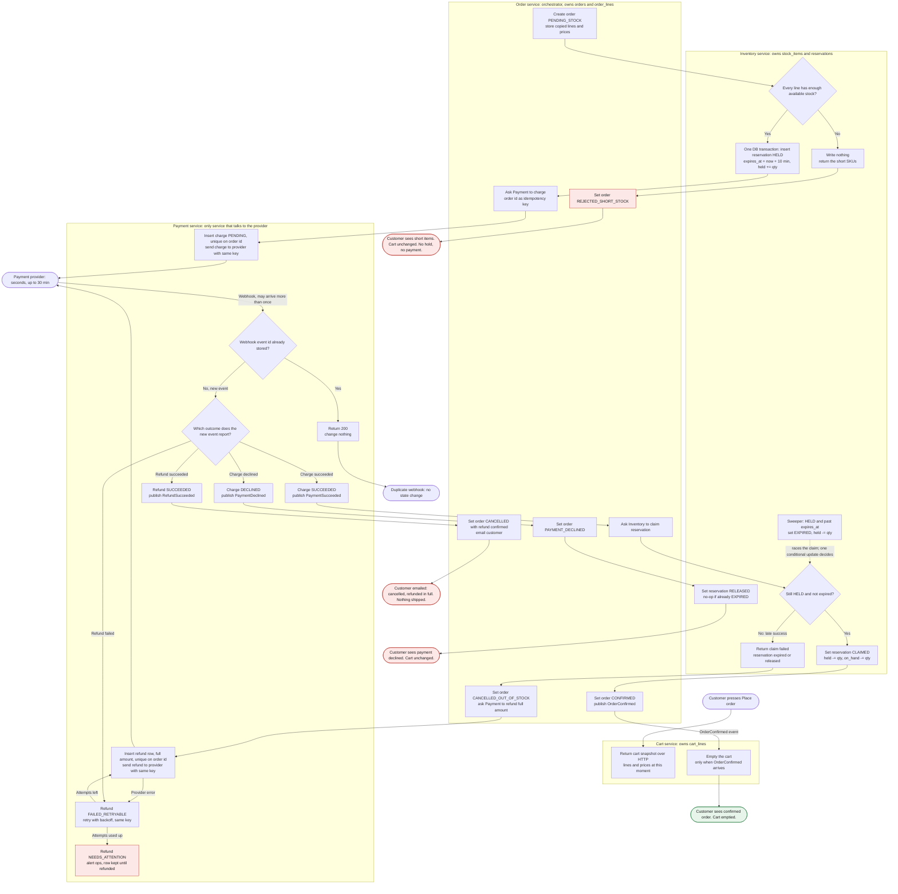

# Checkout across Cart, Inventory, Payment and Order

Checkout moves out of the monolith into four services: Cart, Inventory, Payment and Order. Order drives the flow. It takes a snapshot of the cart, asks Inventory to hold the stock, asks Payment to charge the customer, and then either confirms the order or cancels it and refunds the customer in full. Stock is held before any money is requested, so we never charge for stock we cannot give. The cart is emptied only after the order is confirmed. The payment provider can take up to 30 minutes to report, so a payment can succeed after the hold has expired. In that case the order is cancelled and refunded.

## Terms

- **Service**: a separate program with its own database. Each service reads and writes only its own tables.
- **Orchestrator**: the one service that runs the steps and calls the others. Here, Order.
- **HTTP call**: a direct request from one service to another that waits for an answer.
- **Event**: a message on the shared message broker (a queue that services publish to and read from) announcing that something happened, such as PaymentSucceeded.
- **Payment provider**: the outside company that moves the money. Only the Payment service talks to it.
- **Webhook**: a call the provider makes to Payment to report an outcome. It can arrive late or more than once.
- **Idempotency key**: an ID sent with a request so that a repeat of the same request is recognised as a repeat. Here it is the order id.
- **Hold (reservation)**: stock set aside for one order for 10 minutes.
- **on_hand**: stock physically counted in the warehouse. **held**: stock set aside for holds. Available stock is on_hand minus held.
- **Claim**: turning a hold into a sale.
- **Sweeper**: a background job that releases holds whose time has run out.
- **Transaction**: a group of database writes that all happen, or none do.
- **Unique constraint**: a database rule that a value can appear only once in a column. A second insert fails.
- **Conditional update**: an update that changes a row only if the row still matches a test, such as status = HELD. It reports how many rows it changed.
- **Outbox**: a table of messages or emails a service will send. They are written together with the data change, so a message is not lost if the service fails part-way.
- **At-least-once delivery**: a message may arrive more than once, so receivers must ignore repeats.
- **Terminal state**: a final status, such as CONFIRMED or DECLINED, that never changes again.
- **Backoff**: waiting longer before each retry.
- **Ops**: the operations team, who are alerted when a refund needs a person.

## Diagram

Mermaid is a text format for flowcharts. Read the diagram top to bottom. Each swimlane is one service, and the lane name gives the store that service owns. Dashed lines are concurrent, not sequential. Red boxes are failure outcomes and green is the success outcome.

## What each service stores

- **Cart**: `cart_lines`, the live, editable cart. Checkout reads only a snapshot of it. The cart changes only when OrderConfirmed clears it.
- **Order**: `orders` (id, cart id, status, total, currency); `order_lines` (sku, quantity, unit price copied at Place order time); `order_status_history`; `processed_events` (event ids already handled); an outbox for events and customer emails.
- **Inventory**: `stock_items` (sku, on_hand, held); `reservations` (keyed by order id, status HELD, CLAIMED, RELEASED or EXPIRED, `expires_at`); `reservation_lines`; `processed_messages` (message ids already handled).
- **Payment**: `charges` (order id unique, amount, status PENDING, SUCCEEDED or DECLINED, provider reference); `refunds` (order id unique, amount, status REQUESTED, SUCCEEDED, FAILED_RETRYABLE or NEEDS_ATTENTION, attempt count, last error); `provider_events` (provider event id unique, raw payload, processed time); an outbox.

## Steps

1. **Start checkout.** This starts when the customer presses Place order. Order asks Cart over HTTP for a snapshot of the lines and prices at that moment. Cart writes nothing. If checkout fails at any step, the cart stays exactly as it was, so the customer can try again.

2. **Create the order.** Order writes the order with status PENDING_STOCK and copies each line and its price into `order_lines`. Later cart edits or price changes do not affect the order.

3. **Check and hold stock.** Order asks Inventory to reserve every line. Inventory runs one transaction that checks whether each line has enough available stock. Stock is reserved before any payment is requested, and the reservation is all-or-nothing.
   - **Any line short:** the transaction writes nothing and returns the short SKUs. Order sets REJECTED_SHORT_STOCK, and the customer is told which items are short. Nothing is held, no payment is requested, and the cart is unchanged.
   - **All lines available:** Inventory inserts a reservation HELD with `expires_at` set to now plus 10 minutes, and adds each quantity to `held`.

4. **Request the charge.** Order sets PAYMENT_PENDING and asks Payment to charge the order, sending the order id as the idempotency key. Payment inserts a charge PENDING, unique on order id, and sends the charge to the provider with the same key. Because the key is the order id, a retried request returns the stored state and never charges the customer twice. If the call times out, Order retries with the same key. If Payment still cannot say whether the charge happened, Order keeps the hold until it knows, and does not release on a guess.

5. **Receive the outcome.** The provider reports the outcome by webhook. This usually takes seconds but can take up to 30 minutes, and the same webhook can arrive more than once. Payment first checks whether this event id is already in `provider_events`.
   - **Already stored (duplicate):** Payment returns 200 and changes nothing.
   - **New event:** Payment stores the event id and reads the outcome. A charge moves from PENDING to SUCCEEDED or DECLINED only once. Terminal states never move back.
     - Declined: go to step 6a.
     - Succeeded: go to step 6b.

6a. **Declined.** Payment sets the charge DECLINED and publishes PaymentDeclined. Order sets PAYMENT_DECLINED and asks Inventory to release the hold. Inventory sets the reservation RELEASED and frees the held stock. If the hold has already expired, the release changes nothing. The customer sees that the payment was declined, and the cart is unchanged.

6b. **Succeeded: claim the stock.** Payment sets the charge SUCCEEDED and publishes PaymentSucceeded. Order asks Inventory to claim the reservation. Inventory runs one conditional update: set the reservation CLAIMED where it is still HELD and `expires_at` is in the future, judged by the database clock. At the same time, the sweeper (a background job; the diagram assumes it runs about once a minute) sets reservations that are HELD and past `expires_at` to EXPIRED, and takes their quantities off `held`. Both touch the same row, so only one can succeed.
   - **Claim succeeds:** Inventory sets the reservation CLAIMED and takes the quantities off `held` and `on_hand`. Order sets CONFIRMED and publishes OrderConfirmed. Cart empties its cart when it receives OrderConfirmed. The customer sees a confirmed order.
   - **Claim fails** (the hold expired or was released): Inventory returns "claim failed". Go to step 6c.
   - A redelivered PaymentSucceeded is harmless. Claim and release are idempotent per order id, and Order and Inventory skip message ids they have already handled.

6c. **Late success after the hold lapsed.** The stock has been sold to someone else. We never keep money for an order we cannot fulfil, and we never ship partial orders. Order sets CANCELLED_OUT_OF_STOCK and asks Payment to refund the full amount. Payment inserts a refund REQUESTED, unique on order id, and sends the refund to the provider with its own idempotency key.
   - **Refund succeeds:** Payment sets the refund SUCCEEDED and publishes RefundSucceeded. Order sets CANCELLED with refund confirmed and writes a customer email to its outbox, which a mail sender sends. The customer is told the order is cancelled, refunded in full, and nothing ships. The cart is unchanged.
   - **Refund fails** (a provider error, or a refund failure report): go to step 7.

7. **Refund fails.** The refund row becomes FAILED_RETRYABLE. Payment retries with backoff, using the same key. A refund is never silently dropped, and no refund row is deleted until the refund succeeds. After the retry budget is used up, the row becomes NEEDS_ATTENTION, stays in the table, and ops is alerted. The customer sees the order cancelled with the refund pending. The cart is unchanged.

## What happens when things fail

| Case | What happens | Customer sees | Cart |
|---|---|---|---|
| Short stock | Inventory writes nothing and returns the short SKUs. Order is REJECTED_SHORT_STOCK. No hold, no payment. | Which items are short | Unchanged |
| Declined payment | Charge is DECLINED. Order releases the hold, which changes nothing if it already expired. | Payment declined | Unchanged |
| Late success after the hold lapsed | Claim fails. Order cancels as out of stock and refunds the full amount. | Cancelled and refunded, by email | Unchanged |
| Refund fails at the provider | Retried with the same key. After the retry budget, NEEDS_ATTENTION and an ops alert. The row is kept until the refund succeeds. | Cancelled, refund pending | Unchanged |
| Duplicate webhook | Event id already stored, so Payment returns 200 and changes nothing. | Nothing new | Unchanged |
| Any other failure before the order is confirmed | The flow stops. Nothing is confirmed. | Can try again | Unchanged |

## Open questions and decisions to confirm

1. **Claim when payment succeeds, not when the charge is requested.** This is what makes the late-success branch possible. Claiming at charge time would hold stock sold through a 30-minute provider window and would need a release on decline.
2. **Reservation expiry does not cancel the order.** The order waits in PAYMENT_PENDING. If the provider later reports success, the claim fails and the order goes to step 6c. This keeps the flow simple, but the order can sit pending for up to 30 minutes after the hold lapses.
3. **Timeouts on the charge call.** Order retries with the same key. If Payment still cannot say whether the charge happened, Order keeps the hold until it knows, and does not release on a guess. Releasing early is safe, because a later success would reach step 6c, but the customer would get a refund for an order they could have had.
4. **Cart clearing scope.** The brief says the cart is emptied. Items added while checkout was running would also be removed. Decide whether to clear only the snapshot lines.
5. **Email sender.** The brief does not say which service sends email. The diagram assumes Order writes an outbox event that a mail sender consumes.
6. **Numbers not set.** Refund retry count and backoff, the sweeper interval (the diagram assumes about a minute), and the alert channel for NEEDS_ATTENTION are not defined.