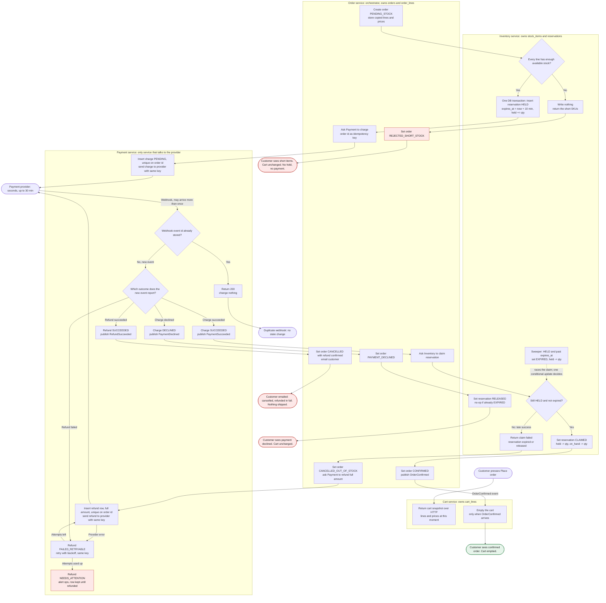

# Checkout across Cart, Inventory, Payment and Order

Order is the orchestrator. It starts checkout, asks the other three services for work over HTTP, and reacts to their events. Each service writes only to its own database. Inventory decides the stock race with one conditional row update, and Payment is the only service that talks to the provider.

Read the diagram top to bottom. Each swimlane is one service, and the lane names the store that service owns. Dashed lines are concurrent, not sequential.

## Flowchart

## What each service stores

- **Cart**: `cart_lines`, the live editable cart. Checkout only reads a snapshot from it. The cart changes again only when OrderConfirmed clears it.
- **Order**: `orders` (id, cart id, status, total, currency), `order_lines` (sku, quantity, unit price copied at Place order time), `order_status_history`, `processed_events` (event ids already handled), and an outbox for events and customer emails.
- **Inventory**: `stock_items` (sku, `on_hand`, `held`), `reservations` (order id as key, status HELD, CLAIMED, RELEASED or EXPIRED, `expires_at`), `reservation_lines`, and `processed_messages`. Available stock is `on_hand - held`.
- **Payment**: `charges` (order id unique, amount, status PENDING, SUCCEEDED or DECLINED, provider reference), `refunds` (order id unique, amount, status REQUESTED, SUCCEEDED, FAILED_RETRYABLE or NEEDS_ATTENTION, attempt count, last error), `provider_events` (provider event id unique, raw payload, processed time), and an outbox.

## Rules that make the flow safe

- **Stock before payment.** The availability check and the hold run in one Inventory transaction. If any line is short, the transaction writes nothing, so nothing is held and Payment is never called.
- **One winner for the stock.** Claim is `UPDATE reservations SET status = 'CLAIMED' WHERE order_id = ? AND status = 'HELD' AND expires_at > now()`. The sweeper runs `... WHERE status = 'HELD' AND expires_at <= now()`. Both use the database clock and the same row, so only one can succeed. A claim that finds nothing to claim returns "failed", which triggers the refund branch.
- **Idempotent charges and refunds.** The charge uses the order id as the provider idempotency key, and `charges` has a unique constraint on the order id. A retried HTTP request returns the stored state and never charges again. Refunds follow the same pattern with their own key.
- **Duplicate webhooks.** Each provider event id is stored with a unique constraint, so a repeat returns 200 and changes nothing. State changes are also conditional: a charge moves from PENDING to SUCCEEDED or DECLINED only once, and terminal states never move back.
- **At-least-once events.** Order and Inventory record handled event or message ids. Claim and release are idempotent per order id, so a redelivered PaymentSucceeded is harmless.
- **Refunds are never dropped.** A failed refund stays in the `refunds` table as FAILED_RETRYABLE and is retried with backoff using the same key. After the retry budget it becomes NEEDS_ATTENTION and alerts ops. Rows are not deleted until the refund succeeds.
- **Cart changes only on confirmation.** Every failure path leaves the cart as it was, so the customer can retry.

## Failure cases

| Case | What happens | Customer sees | Cart |
|---|---|---|---|
| Short stock | Inventory writes nothing and returns the short SKUs. Order is REJECTED_SHORT_STOCK. | Which items are short | Unchanged |
| Declined payment | Charge is DECLINED. Order releases the hold, which is a no-op if it already expired. | Payment declined | Unchanged |
| Late success after the hold lapsed | Claim fails. Order cancels as out of stock and refunds the full amount. | Cancelled and refunded, by email | Unchanged |
| Refund fails at the provider | Retried with the same key. After the budget, NEEDS_ATTENTION and an ops alert. | Cancelled, refund pending | Unchanged |
| Duplicate webhook | Event id already stored, so return 200 and do nothing. | Nothing new | Unchanged |

## Decisions the brief leaves open (please confirm)

1. **Claim happens when the payment succeeds, not when the charge is requested.** This is what makes the late-success branch possible. Claiming at charge time would hold stock sold through a 30-minute provider window and would need a release on decline.
2. **Reservation expiry does not cancel the order.** The order waits in PAYMENT_PENDING. If the provider later reports success, the claim check sends it to the refund branch. This keeps the flow simple, but the order can sit pending for up to 30 minutes after the hold lapses.
3. **Timeouts on the charge call.** Order retries with the same key. If Payment still cannot say whether the charge happened, Order keeps the hold until it knows, and does not release on a guess. Releasing early is safe, because a later success would reach the refund branch, but the customer would get a refund for an order they could have had.
4. **Cart clearing scope.** The brief says the cart is emptied. Items added while checkout was running would also be removed. Decide whether to clear only the snapshot lines.
5. **Email sender.** The brief does not say which service sends email. The diagram assumes Order writes an outbox event that a mail sender consumes.
6. **Numbers not set.** Refund retry count and backoff, the sweeper interval (the diagram assumes about a minute), and the alert channel for NEEDS_ATTENTION are not defined.