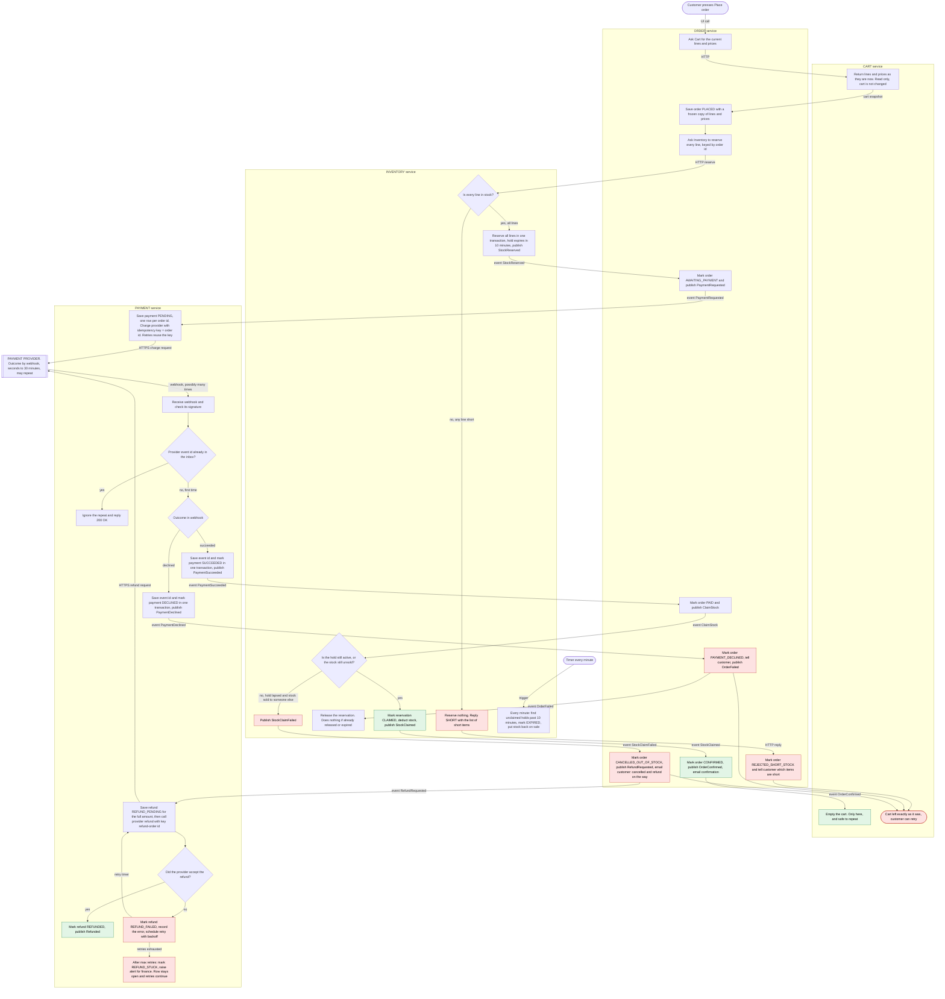

# Checkout across Cart, Inventory, Payment and Order

Checkout is moving out of the monolith into four services that already exist as stubs: Cart, Inventory, Payment and Order. When the customer presses **Place order**, Order freezes the cart, Inventory reserves stock, and only then does Payment charge the customer. The provider's answer arrives later by webhook. Order confirms and empties the cart, or it fails and leaves the cart alone. If the money arrives after the stock hold lapsed and the stock was sold to someone else, Payment refunds in full and Order cancels. Stock is reserved before payment so we never take money for goods we cannot hold. Every step is idempotent, so retries and repeated messages are safe.

## Terms

- **Service:** one of Cart, Inventory, Payment, Order. Each owns its own database. No service reads another's tables. They talk over HTTP or through events on the shared **message broker** (the shared queue that delivers events between services). Every message carries the order id.
- **Event:** a message on the broker, named like `StockReserved`.
- **Outbox:** how a service publishes. It writes the new state and the event in one local transaction, and a relay then publishes the event. A state change therefore never happens without its event.
- **Inbox:** how a service consumes. It records each event id it has handled and ignores repeats. Every consumer is idempotent this way, for broker events and for repeated HTTP calls.
- **Hold (reservation):** stock set aside for an order. It lasts 10 minutes unless the order claims it.
- **Claim:** turning a hold into a permanent deduction from stock.
- **Payment provider:** the outside company that charges cards. Only Payment talks to it.
- **Idempotency key:** a value sent with a request so that a retry is treated as the same request. Charges use the order id. Refunds use `refund-<order id>`.
- **Webhook:** an HTTP call from the provider to Payment with the outcome (succeeded or declined). It usually takes seconds, can take up to 30 minutes, and may be delivered more than once.

## How to read the diagram

- Each box sits inside the service that does the step.
- A solid arrow is the next step. Its label says what triggers it: an HTTP call, a broker event, a webhook or a timer.
- Red boxes are failure branches. Green boxes are happy-path endings.

## Flowchart

## Notes on the steps

Each step lists what the diagram cannot show: its data and what happens when it goes wrong.

**1. Start (Order, Cart).** The customer presses Place order. Order asks Cart for the current lines and prices. Cart only reads. Order saves the order with a frozen copy of them, and every later step uses that copy, so later cart edits or price changes cannot affect the order.

**2. Reserve stock (Inventory).** Order calls Inventory with the order id as reservation key, so a retried call cannot reserve twice. Inventory checks all lines in one transaction.
- If any line is short, it reserves nothing and returns the short items. Order marks the order `REJECTED_SHORT_STOCK` and tells the customer which items are short. No payment is requested. The cart is untouched.
- Otherwise it reserves every line with a 10-minute expiry and publishes `StockReserved`.

**3. Charge (Payment).** On `PaymentRequested`, Payment saves a payment row (one allowed per order id) and calls the provider with the order id as idempotency key. If the call times out, Payment retries with the same key, so the customer cannot be charged twice.

**4. Webhook (Payment).** Payment checks the signature, then looks up the provider's event id in its inbox.
- Already seen: reply 200 OK and do nothing (the duplicate-webhook branch).
- New: save the event id and the new payment status in one transaction, so a crash cannot leave a half-processed event.

**5a. Declined.** Order marks the order `PAYMENT_DECLINED`, tells the customer and publishes `OrderFailed`. Inventory releases the hold at once, and does nothing if it already expired. The cart is untouched, so the customer can retry.

**5b. Succeeded.** Order marks the order `PAID` and publishes `ClaimStock`. Inventory decides in one transaction:
- Hold still active: it becomes `CLAIMED` and the stock is deducted.
- Hold lapsed but the stock is still unsold: Inventory takes it again for this order, so we do not refund when we could have fulfilled it. This is a design choice. For the strict reading, where a lapsed hold always fails, remove this clause.
- Hold lapsed and the stock was sold to someone else (the late-success case): Inventory publishes `StockClaimFailed`.

**6a. Confirmed.** On `StockClaimed`, Order marks the order `CONFIRMED`, emails the customer and publishes `OrderConfirmed`. Cart empties on that event, by cart id and version so lines added after Place order are kept.

**6b. Late success, out of stock.** On `StockClaimFailed`, Order marks the order `CANCELLED_OUT_OF_STOCK`, publishes `RefundRequested`, and emails the customer that the order is cancelled and a full refund is coming. The email goes out whether or not the refund has finished. Nothing ships, so there are no partial orders. The cart is untouched.

**7. Refund (Payment).** Payment writes a `REFUND_PENDING` row for the full amount before calling the provider, with key `refund-<order id>` so a retry cannot refund twice.
- Accepted: the refund becomes `REFUNDED`.
- Failed: it becomes `REFUND_FAILED` with the error recorded, and a retry timer re-runs it with backoff. After the maximum retries it becomes `REFUND_STUCK` and an alert goes to finance. The row stays open and retries continue, so a refund is never silently dropped.

**8. Hold expiry (Inventory).** A timer runs every minute. Any reservation unclaimed after 10 minutes is marked `EXPIRED` and its stock goes back on sale. This is why a slow payment can find its stock gone.

## What each service stores

| Service | Data it owns | Used for |
|---|---|---|
| **Cart** | Carts and their lines, a cart version, an inbox | Read at step 1. Emptied only on `OrderConfirmed`. |
| **Order** | Orders with status and frozen lines and prices, an inbox, an outbox | Status history. The order id is the key every other service uses. |
| **Inventory** | Stock levels, reservations (order id, lines, expiry, status `HELD`, `CLAIMED`, `RELEASED` or `EXPIRED`), an inbox, an outbox | All-or-nothing reserve and claim. Expiry job. |
| **Payment** | Payments (one per order id, with status), webhook event-id inbox, refunds (status, attempt count, last error), an outbox | Idempotent charge and refund. Duplicate-webhook protection. Refund retries. |

## Rules that hold everywhere

- The cart changes in one place only, on `OrderConfirmed`. Short stock, a declined payment and an out-of-stock cancellation all leave it exactly as it was.
- Refund state lives in Payment. Order only sends the cancellation email.
- Order sends customer emails through the mailer that exists today.

## Open questions

- Confirm that the cart should empty by cart id and version, so lines added after Place order are not lost.
- Decide the refund retry limit and backoff, and who receives the `REFUND_STUCK` alert.
- If the provider never sends a webhook, a reconciliation job in Payment should poll the provider for payments still `PENDING` after 30 minutes. This is recommended, but it is not in the diagram.
- Confirm that no fifth service is wanted for email.
- Confirm the choice in step 5b to re-take unsold stock after a lapsed hold.
