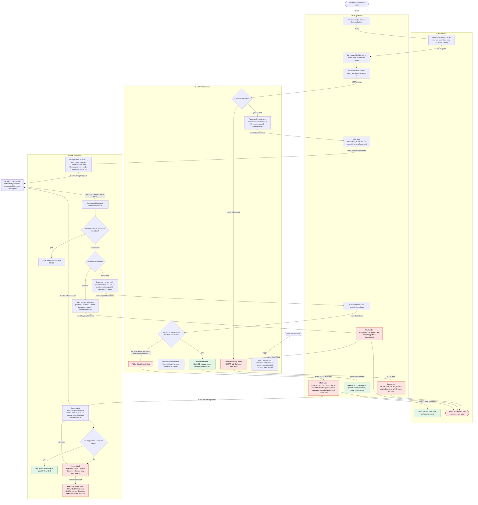

# Checkout across Cart, Inventory, Payment and Order

## How to read this

- Each box in the diagram sits inside the service that does the step.
- A **solid arrow** is the next step. The arrow label says what triggers it: an HTTP call, a broker event, a webhook or a timer.
- Red boxes are failure branches. Green boxes are the happy path ending.
- Event names are written like `StockReserved`. All events go through the shared message broker.
- Every service publishes its events from an **outbox**. It writes the new state and the event in one local transaction, and a relay then publishes the event. This means a state change can never happen without its event.
- Every service consumes events through an **inbox**. It records each event id it has handled and ignores repeats.

## Flowchart

## Step by step

**1. Start (Order, Cart).** The customer presses **Place order**. Order asks Cart for the current lines and prices. Cart only reads. Order saves the order with a frozen copy of those lines and prices, and every later step uses that copy. Later cart edits or price changes cannot affect the order.

**2. Reserve stock (Inventory).** Order calls Inventory to reserve all lines, using the order id as the reservation key, so a retried call cannot reserve twice.
- Inventory checks all lines in one transaction. If any line is short, it reserves nothing and returns the list of short items. Order marks the order `REJECTED_SHORT_STOCK` and shows the customer which items are short. **No payment is requested.**
- If every line is available, Inventory reserves all of them with a 10-minute expiry and publishes `StockReserved`.

**3. Charge (Payment).** Order publishes `PaymentRequested`. Payment saves a payment row, with one row allowed per order id, and calls the provider. The idempotency key is the order id. If the call times out, Payment retries with the same key, so the customer cannot be charged twice.

**4. Webhook (Payment).** The provider calls the webhook when it has an outcome. This takes seconds, or up to 30 minutes. Payment checks the signature, then looks up the provider's event id.
- If it has seen the event id, it replies 200 OK and does nothing. This is the duplicate-webhook branch.
- If not, it saves the event id and the new payment status in the same transaction. A crash between the two therefore cannot leave a half-processed event.

**5a. Declined.** Payment publishes `PaymentDeclined`. Order marks the order `PAYMENT_DECLINED`, tells the customer, and publishes `OrderFailed`. Inventory releases the hold straight away, and it does nothing if the hold has already expired. The cart is untouched.

**5b. Succeeded.** Payment publishes `PaymentSucceeded`. Order marks the order `PAID` and publishes `ClaimStock`. Inventory then decides in one transaction.
- **Hold still active:** the reservation becomes `CLAIMED` and the stock is deducted.
- **Hold lapsed but the stock is still unsold:** Inventory takes it again for this order. The customer is not refunded when we could have fulfilled the order. This is a design choice. If you want the strict reading, where a lapsed hold always fails, remove this clause.
- **Hold lapsed and the stock was sold to someone else:** Inventory publishes `StockClaimFailed`. This is the late-success case.

**6a. Confirmed.** On `StockClaimed`, Order marks the order `CONFIRMED`, emails the customer, and publishes `OrderConfirmed`. Cart empties on that event and nowhere else.

**6b. Late success, out of stock.** On `StockClaimFailed`, Order marks the order `CANCELLED_OUT_OF_STOCK`, publishes `RefundRequested`, and emails the customer that the order is cancelled and a full refund is coming. Nothing ships, so there are no partial orders. The cart is untouched.

**7. Refund (Payment).** Payment writes a `REFUND_PENDING` row for the full amount before it calls the provider. The provider call uses the idempotency key `refund-<order id>`, so a retry cannot refund twice.
- **Accepted:** the refund becomes `REFUNDED`.
- **Failed:** the refund becomes `REFUND_FAILED` with the error recorded, and a retry timer re-runs the refund with backoff. After the maximum number of retries it becomes `REFUND_STUCK` and an alert goes to finance. The row stays open and retries continue, so a refund is never dropped, and someone is told if it is stuck.

**8. Hold expiry (Inventory).** A timer runs every minute. Any reservation that is unclaimed after 10 minutes is marked `EXPIRED`, and its stock goes back on sale. This is why a slow payment can find its stock gone.

## What each service stores

| Service | Data it owns | Used for |
|---|---|---|
| **Cart** | Carts and their lines, a cart version, an inbox of handled event ids | Read at step 1. Emptied only on `OrderConfirmed`. |
| **Order** | Orders with status and the frozen lines and prices, an inbox, an outbox | Order status history. The order id is the key used by every other service. |
| **Inventory** | Stock levels, reservations (order id, lines, expiry, status `HELD`, `CLAIMED`, `RELEASED` or `EXPIRED`), an inbox, an outbox | Atomic all-or-nothing reserve and claim. Expiry job. |
| **Payment** | Payments (one per order id, with status), the webhook event-id inbox, refunds (status, attempt count, last error), an outbox | Idempotent charge and refund. Duplicate-webhook protection. Refund retries. |

## Rules that hold everywhere

- No service reads another's tables. They share only HTTP calls (steps 1 and 2) and broker events, and every message carries the order id.
- Every consumer is idempotent. It checks its inbox first, so redelivered events and repeated HTTP calls are safe.
- The cart changes in one place only, on `OrderConfirmed`. Short stock, a declined payment and an out-of-stock cancellation all leave it exactly as it was.
- Only Payment talks to the provider. Charge and refund both use idempotency keys derived from the order id.
- The email on cancellation is sent by Order, whether or not the refund has finished. The refund state is tracked in Payment.

## Assumptions to confirm

- Order sends customer emails through whatever mailer exists today. No fifth service is added.
- Cart empties by cart id and version, so lines added after Place order are not lost. Confirm that this is wanted.
- The retry limit and backoff for refunds, and who receives the `REFUND_STUCK` alert, are still to be decided.
- If the provider never sends a webhook, a reconciliation job in Payment should poll the provider for payments still `PENDING` after 30 minutes. This is not in the diagram and is a recommended addition.
