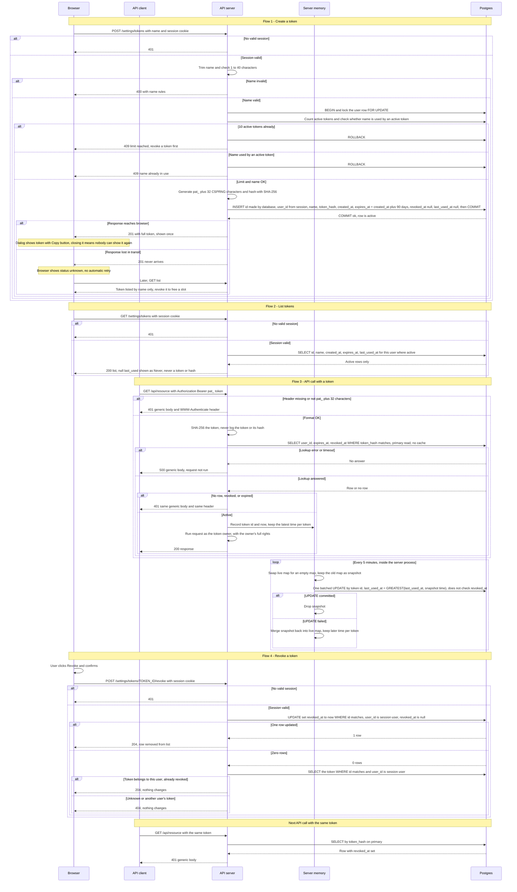

# Personal API tokens on Account Settings: sequence design

## What this is

Signed-in users create named personal API tokens on Account Settings, so scripts and CI jobs can call the REST API without a password. Session-cookie login already works, and the settings endpoints sit behind it. The system is one web/API server with one Postgres database, and there is no token table yet. Each API call checks its token against Postgres, so a revoke takes effect on the next request. The last-used time is kept in server memory and written in batches every 5 minutes, so the API does not write to the database on every call.

## Terms

- **Token**: a secret string, `pat_` followed by 32 random characters. It is shown once, when created.
- **Session**: the login cookie from the existing sign-in. Every settings call needs a valid one.
- **Hash**: the SHA-256 output of a token. The database stores the hash and finds a token by it. The token itself is never stored.
- **Active**: not revoked and not expired. Only active tokens count toward the limit and appear in the list. It is computed from `revoked_at` and `expires_at` on each check, so expiry needs no background job.
- **Revoke**: mark a token as revoked by setting `revoked_at`. The row stays in the table.
- **Bearer header**: `Authorization: Bearer <token>`, the header API clients send with each call.
- **CSPRNG**: a random number source built for secrets (cryptographically secure).
- **Unique index**: a database rule that stops two rows from holding the same value in the given columns.
- **Row lock**: `SELECT ... FOR UPDATE` on the user's row, so two create requests for the same user run one at a time.
- **Primary**: the Postgres server that accepts writes. Checks that must see the newest change read from it.
- **Last used**: the most recent time a token was used.
- **Flush**: saving the buffered last-used times to the database.
- **Snapshot**: the buffered times taken out of memory for one flush.
- **GREATEST**: a Postgres function that returns the larger of its inputs.
- **CSRF**: cross-site request forgery, an attack where another site makes the browser send a request with the user's cookie.

## Diagram

## Notes on the diagram

**Session.** Every settings call checks the session cookie first. A missing or invalid session gets 401, not a redirect, because these are page calls rather than browser navigations. The session is the existing login. Where it is stored does not change this design.

**Create (Flow 1).**
- Trigger: the user submits a name in the dialog.
- The name is trimmed and must be 1 to 40 characters. Otherwise the server returns 400 and writes nothing.
- The lock, the count and the name check run in one transaction. Two concurrent creates therefore cannot exceed 10 active tokens or take the same name.
- Name uniqueness is enforced in the transaction, not by a unique index on (user, name). That index would block reusing the name of a revoked or expired token.
- The token is `pat_` plus 32 characters from a 62-character alphabet (A-Z, a-z, 0-9). The characters come from a CSPRNG with unbiased sampling, which gives about 190 bits. Only the SHA-256 hash is stored.
- The row is inserted with these values:
  - `id` is made by the database.
  - `user_id` comes from the session, never from the request body.
  - `name`, `token_hash`, `created_at` as the insert time, and `expires_at` as `created_at` plus 90 days.
  - `revoked_at` and `last_used_at` are null.
- A token expires 90 days after creation and cannot be renewed.
- A user may have 10 active tokens. The 11th create is refused with a message to revoke a token first.
- Expired and revoked rows are never deleted. They stop counting toward the limit and stop appearing in the list.

**Lost create response.** The row is committed before the 201 is sent. The browser shows "status unknown" after a network error or when no response arrives. The brief sets no timeout, which is an open question. The browser does not retry the POST by itself. A retry would hit the name check and show a misleading "name in use" error for a token that already exists. If the response is lost, the token is active and cannot be recovered. It counts toward the limit until revoked or expired. It appears in the list by name, so the user can revoke it. A pending state with a browser acknowledgement would avoid this orphan, but it adds a state and a round trip. That option is deferred unless orphans prove to be a real problem.

**List (Flow 2).** The list returns only this user's active tokens: name, created date, expiry date and last-used time. A token never used shows "Never". The list never returns the token or its hash. Last-used may be up to 1 hour out of date.

**Bearer call (Flow 3).**
- The server first checks the Bearer format. A missing or malformed header gets 401 with the generic body and the `WWW-Authenticate` header.
- It hashes the token with SHA-256. The token and its hash are never logged.
- It reads the row by `token_hash` from the primary, with no cache. A cache could let a revoked token pass after the revoke commits.
- If the lookup errors or times out, the server returns 500 with a generic body and does not run the request. It is not a 401, because the token was never checked. A database error never lets a token through.
- No row, a revoked row or an expired row gets 401 with the same body and header. The response does not say which case it was.
- An active token is recorded in memory as the token id and the current time. The request then runs as the token owner. The brief defines no scopes, so the token has the same rights as its user.

**Last-used flush.** Every 5 minutes, inside the one server process:
1. The server swaps the live map for an empty map. The old map becomes the snapshot. Calls made during the write go into the new map and wait for the next interval.
2. One batched UPDATE names each row by token id and sets `last_used_at = GREATEST(stored value, snapshot time)`. A flush never moves a time backwards. The UPDATE does not check `revoked_at`.
3. If the UPDATE commits, the snapshot is dropped.
4. If the UPDATE fails, the snapshot is merged back into the live map, keeping the later time for each token. The next interval retries. No time is lost, and none moves backwards.

Staleness stays within the 1-hour allowance in the brief. A crash loses at most one interval of updates. The brief names one server, so one process holds the map. If more instances were added, each would flush its own times. GREATEST would still keep the rows correct, but a crash would still lose that instance's unflushed times.

**Revoke (Flow 4).**
- The user clicks Revoke and confirms. The browser sends the request with the session cookie.
- The UPDATE changes only an active row owned by the session user.
- If one row changes, the server returns 204 and the row leaves the list.
- If zero rows change, one SELECT checks whether the id belongs to this user. If it does and it is already revoked, the answer is 204, so a repeated revoke is harmless. If the id is unknown or belongs to another user, the answer is 404. Both cases look the same, so another user's tokens cannot be detected.
- If the UPDATE fails, the server returns 500. The token stays active, and the UI must not show it as revoked.
- The next API call with the token gets 401. The lookup reads `revoked_at` on the primary with no cache, so the first request after the revoke commits is refused.

## Where state lives

| State | Location | Lifetime and rule |
|---|---|---|
| Plaintext token | Server memory during the create request, the 201 body, browser dialog memory | Until the dialog closes or the response is dropped. Never in the DB, logs or analytics. |
| Id, user, hash, name, created, expires, revoked | Postgres `api_tokens` | Rows are kept for audit. Retention is not decided. |
| Last used | Server memory map, plus a snapshot while a flush runs, then `api_tokens.last_used_at` after each flush | Memory holds at most 5 minutes of updates, plus one snapshot while a flush writes. |
| Limit and name checks | Derived from `api_tokens` inside the create transaction | Computed per request, under the user row lock. |
| Token validity | Derived from `api_tokens` on each API call | No cache. |
| Browser state | None persistent, no localStorage | The list never returns a token. Gone on reload. |

## What happens when things fail

| Failure | Server result | Browser shows | State afterwards |
|---|---|---|---|
| No valid session on any settings call | 401 | Sign in again | Nothing written |
| Name invalid | 400 | Field error | Nothing written |
| 11th active token | 409, revoke a token first | Limit message | Nothing written |
| Name in use by an active token | 409 | Name error | Nothing written |
| DB error during create | 500, rollback | Generic error, retry | No row |
| Create response lost | 201 sent, not received | Status unknown, check the list | Row active, token unrecoverable, counts toward limit until revoked or expired |
| Bad token (missing, malformed, unknown, revoked, expired) | 401, same body and `WWW-Authenticate` header in every case | Not applicable to API clients | Nothing changes |
| Bearer lookup error or timeout | 500 generic body, request not run | Not applicable to API clients, retry later | Nothing changes |
| Revoke DB error | 500 | Not revoked, retry | Token stays active. UI must not show it as revoked. |
| Revoke of another user's or unknown token | 404 | Not found | Nothing changes |
| Last-used flush fails | Logged, snapshot merged back into memory, retried next interval | Nothing | Last used stale a little longer |
| Crash before flush | None | Nothing | Last used lost for up to one interval |

## Rollout checks

These are checks to make before building. They are not part of how the system runs.

- **Log redaction.** Strip the `Authorization` header and the create response body from request logs and error traces. Never log the token or its hash. Analytics events carry only token id and user id.
- **Read routing.** Bearer validation reads from the primary, or from a replica with a lag guarantee. A lagging replica would let a revoked token pass.
- **Route scope.** The brief does not say which routes accept bearer tokens. Assumed: REST API routes accept them, and session-only settings routes do not. Needs confirmation.
- **CSRF.** The three settings endpoints assume the existing settings CSRF protection applies. The brief does not cover it. Needs confirmation.
- **Failed-auth rate limit.** Not in the brief. Recommended, so guessing unknown tokens is throttled per IP.
- **Orphan tokens.** Monitor how often a lost create response leaves an unseen active token. Revisit the pending-state option only if it causes real limit complaints.

## Open questions

- Should a disabled or deleted user's tokens stop working? The brief does not say. If yes, the bearer lookup should also check the user row.
- How long should revoked and expired rows be kept? Not decided.
- How long should the browser wait before it reports a create as "status unknown"? The brief sets no timeout.