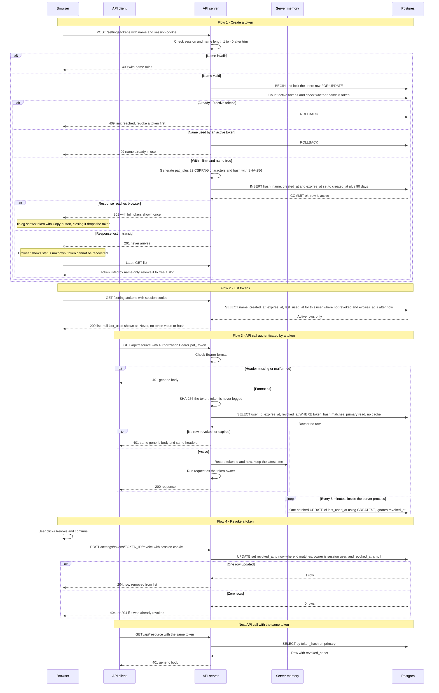

# Personal API tokens on Account Settings: sequence design

## Decisions before the diagram

- **Token format.** `pat_` followed by 32 characters from a 62-character alphabet (A-Z, a-z, 0-9). That is about 190 bits. Characters come from a CSPRNG with unbiased sampling.
- **Stored fields.** `api_tokens` holds `id`, `user_id`, `name`, `token_hash` (SHA-256, unique index), `created_at`, `expires_at`, `revoked_at` and `last_used_at`. No column holds the plaintext.
- **Active is computed, not stored.** A token is active when `revoked_at` is null and `expires_at` is after now. Limit and name checks use this same definition, so expiry needs no background job to be correct.
- **Name uniqueness is enforced in the transaction, not by a unique index.** A plain unique index on (user, name) would block reusing the name of a revoked or expired token. Create takes a row lock on the user row, so two concurrent creates cannot exceed 10 tokens or take the same name.
- **Validity is read on every request.** Bearer auth looks up `token_hash` in Postgres on each call and reads from the primary. Nothing caches validity, so the first request after a revoke commits gets a 401.
- **Last-used is buffered.** Each authenticated request writes the token id and time into an in-memory map that keeps the latest time per token. A timer flushes the map every 5 minutes in one batched `UPDATE` using `GREATEST`, so a flush never moves the timestamp backwards and ignores `revoked_at`. Staleness stays within the 1-hour allowance. A crash loses at most one interval of updates.
- **Lost create response (judgment call).** The server commits the row before it responds. If the response never reaches the browser, the token is active, cannot be recovered and counts toward the limit until revoked or expired. It does appear in the list by name, so the user can revoke it. A pending state with a browser acknowledgement would avoid the orphan, but it adds a state and a round trip. This design defers that unless orphans prove to be a real problem.

## Sequence diagram

## Where state lives

| State | Location | Lifetime and rule |
|---|---|---|
| Plaintext token | Server memory during the create request, the 201 body, and browser dialog memory | Until the dialog closes or the response is discarded. Never in the DB, logs or analytics. |
| Hash, name, created, expires, revoked | Postgres `api_tokens` | Rows kept for audit. Retention is not decided. |
| Last used | Server memory map, then `api_tokens.last_used_at` after each flush | Memory holds at most 5 minutes of updates. |
| Limit and name checks | Derived from `api_tokens` inside the create transaction | Computed per request, under the user row lock. |
| Token validity | Derived from `api_tokens` on each API call | No cache. |
| Browser state | None persistent. No localStorage. The list never returns a token. | Gone on reload. |

## Failure behaviour

| Failure | Server result | Browser shows | State afterwards |
|---|---|---|---|
| Name invalid | 400 | Field error | Nothing written |
| 11th active token | 409, revoke a token first | Limit message | Nothing written |
| Name in use | 409 | Name error | Nothing written |
| DB error during create | 500, rollback | Generic error, retry | No row |
| Create response lost | 201 sent but not received | Status unknown, check the list | Row active, token unrecoverable, counts toward limit until revoked or expired |
| Bad token (missing, malformed, unknown, revoked, expired) | 401, same body and `WWW-Authenticate` header in every case | Not applicable to API clients | Nothing changes |
| Revoke DB error | 500 | Not revoked, retry | Token stays active. UI must not show it as revoked. |
| Revoke of another user's token | 404 | Not found | Nothing changes |
| Last-used flush fails | Logged, entries kept and retried next interval | Nothing | Last used stale a little longer |
| Crash before flush | None | Nothing | Last used lost for up to one interval |

## Checks before build

- **Log redaction.** Strip the `Authorization` header and the create response body from request logs and error traces. Never log the token or its hash. Analytics events carry only token id and user id.
- **Read routing.** Bearer validation must read from the primary, or from a replica with a lag guarantee. A lagging replica would let a revoked token pass.
- **Route scope.** The brief does not say which routes accept bearer tokens. Assumed: REST API routes accept them, and session-only settings routes do not. This needs confirmation.
- **CSRF.** The three settings endpoints assume the existing settings CSRF protection applies. The brief does not cover this.
- **Failed-auth rate limit.** Not in the brief. Recommended, so unknown-token guessing is throttled per IP.
- **Orphan tokens.** Monitor how often a lost create response leaves an unseen active token. Revisit the pending-state option only if it causes real limit complaints.