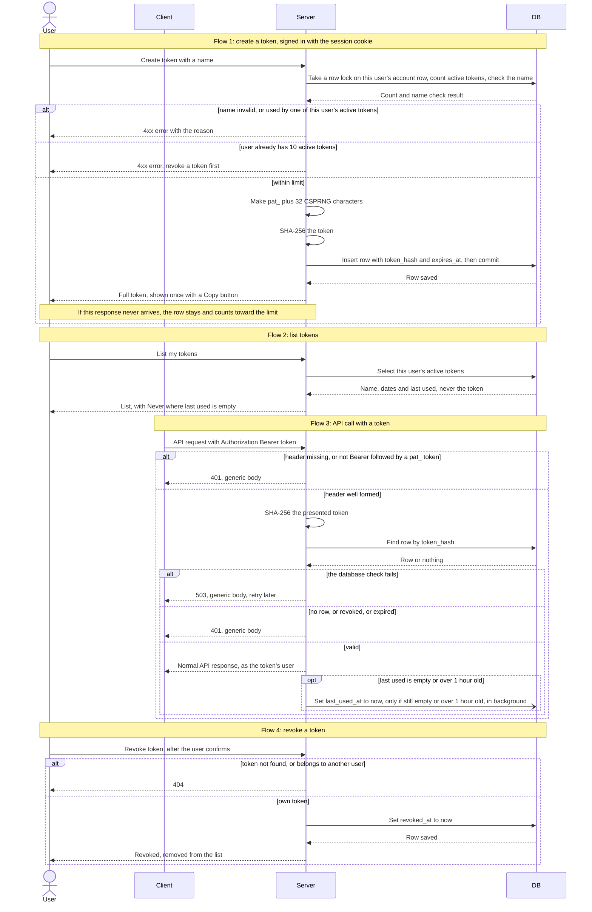

# Personal API tokens on Account Settings

Signed-in users create personal API tokens on the Account Settings page, so their scripts and CI jobs can call the REST API without a password. Everything runs on our single web and API server, which is backed by a Postgres database. The server shows each token once and stores only its SHA-256 hash. Each API call hashes the token it receives and looks up that hash, so a leaked database does not leak working tokens, and a revoke takes effect on the next call.

Today the settings page knows who is signed in through a session cookie, and there is no token table yet. This adds an `api_tokens` table and the endpoints behind it.

## Terms

- **Session cookie**: the browser's proof that a user is signed in. It already exists. It protects the settings page and its create, list and revoke endpoints, and those endpoints accept only the cookie.
- **API client**: a user's script or CI job. It runs outside the browser and calls the REST API on the same server.
- **API token**: a secret string made of `pat_` followed by 32 random characters. It identifies the user to the REST API only. It does not sign anyone into the settings page.
- **Bearer header**: `Authorization: Bearer <token>`, the HTTP header where an API client sends its token.
- **CSPRNG** (cryptographically secure random number generator): the only source for the 32 random characters.
- **SHA-256 hash**: a fixed, one-way fingerprint of the token. The database keeps only this. A check hashes the token the client sent and looks for the same fingerprint.
- **Unique index**: a database lookup structure that refuses two rows with the same value. Here it is on `token_hash`.
- **Commit**: the moment the database makes a transaction permanent. Before a commit, the database can undo all of the transaction's writes.
- **Row lock**: a lock on one database row. Another write that needs that row waits until the lock is released.
- **Active token**: a token that is neither revoked nor past its expiry date.
- **Last used**: the time of the most recent successful API call with that token. It is written at most once an hour per token.

## Where state lives

| State | Where it lives | Notes |
| --- | --- | --- |
| Session cookie | The user's browser | Existing sign-in. |
| Full token | The browser dialog, then the user's own script or CI secret | Shown once. The server never keeps it. |
| Token row | Postgres table `api_tokens`, one row per token | Columns: `id`, `user_id`, `name`, `token_hash` (unique), `created_at`, `expires_at` (created plus 90 days), `last_used_at` (empty means Never), `revoked_at` (empty means not revoked). |

The full token never goes into the database, the logs or analytics.

## Flow

## Rules for every flow

- **Name**: 1 to 40 characters, unique among that user's active tokens. A name can be reused once the old token is revoked or expired.
- **Limit**: 10 active tokens per user. Revoked and expired tokens do not count. An 11th create is refused with a message that tells the user to revoke a token first. Nothing is replaced.
- **Expiry**: 90 days after creation. It cannot be renewed, so the user creates a new token. At day 90 nothing deletes the row. The check rejects it, and the list drops it, because the list shows active tokens only.
- **Ownership**: users see and revoke only their own tokens.
- **Failed token check**: a missing, malformed, unknown, revoked or expired token gets the same 401 body in every case, so the response does not say which one it was.
- **Logs and analytics**: they never contain the full token.

## Notes on each flow

**Create (Flow 1)**

- The full token exists only in the response and the open dialog. The server returns it only after the commit succeeds. The page keeps no copy. Closing the dialog, or refreshing the list, shows name, dates and last used only. Nobody can show the token again, including support and engineering.
- The create takes a row lock on the user's existing account row. The lock is taken in the same transaction as the count and the name check, and it is held until commit. So two creates for the same user run one after the other, and both cannot pass the limit check. The second create waits; it does not fail. The wait is short, because the first create only counts rows and inserts one. The brief sets no lock timeout, so the plan adds none. If the database is down, the create fails like any other database error. The exact table name was not checked in the code, so the plan says account row without naming the table.

**List (Flow 2)**

- The list shows active tokens only: name, created date, expiry date and last used. Last used reads Never when it is empty. The token itself is never returned. Last used can be up to an hour out of date, because of the write rule in Flow 3.

**API call (Flow 3)**

- Which credential counts: API routes read only the Bearer header. Settings endpoints read only the session cookie and ignore any Authorization header. If an API route request carries both, the Bearer token decides the user and the cookie is ignored. The reason is that the API caller is a script, and one credential per request keeps the user identity unambiguous. This split is a plan rule. The current route wiring was not checked in the code.
- Header check: a missing header, a scheme other than Bearer, an empty token, or a token without the `pat_` prefix gets 401 before any hash or database read. No issued token has that form, so the database could not find it. A well-formed header with an unknown token still goes to the lookup.
- Lookup: the server hashes the presented token with SHA-256 and finds the row by `token_hash` through the unique index. The row must exist, have no `revoked_at`, and have an `expires_at` in the future. The request then runs as the row's `user_id`.
- No cache: every call reads the row. That is how a revoke takes effect on the next call. The token has the same access as its user, because the brief sets no scopes.
- Last-used write: after the response is sent, the server runs one conditional update in the background. It sets `last_used_at` to now only if the field is still empty or more than an hour old. Two calls that arrive together can both send this write. The second one matches no row, so the database does the deduplication. The write runs on the server's own database connection, not as the user. If the server restarts before it runs, the write is lost and nothing retries it. The next call after the restart writes it. A slow or failing write never delays or fails the API call.
- Client retries: a CI script retries a 503 after a wait. It treats a 401 as final, because the token is dead and needs replacing.

**Revoke (Flow 4)**

- Revoke runs only after the user confirms. It sets `revoked_at` to now and keeps the row, so the record stays. The next API call with that token gets 401.
- A token that is not found, or that belongs to another user, gets 404. Both cases get the same response.

**Session cookie missing or expired**

- Create, list and revoke are refused the same way the settings endpoints refuse any signed-out request today. The exact existing status and redirect were not checked in the code, and this plan does not change them. An API token is not accepted on these endpoints.

## What happens when things fail

| Where | What goes wrong | What happens |
| --- | --- | --- |
| Create | Name is invalid, or already used by an active token | 4xx error with the reason. Nothing is saved. |
| Create | User already has 10 active tokens | Refused with a message to revoke a token first. Nothing is saved. |
| Create | Insert fails, the unique `token_hash` clashes, or any error comes before commit | Transaction rolls back. Error returned. No token is shown, because none was saved. The user clicks Create again. A clash is not expected with 32 random characters. |
| Create | The commit succeeds, but the response never reaches the browser, or the server returns an error after the commit | The row exists, nobody holds the token, and it counts toward the limit until revoked or expired. The user sees it in the list and can revoke it, or create a new token. |
| List | Database read fails | Error shown on the page. No partial list. |
| API call | Header missing, not Bearer, empty, or without the `pat_` prefix | 401 with the generic body. No database check runs. |
| API call | Token is unknown, revoked or expired | 401 with the same generic body. |
| API call | Database check fails | 503 with a generic body that says to retry later. The token is not accepted, because it could not be checked. |
| API call | Last-used write fails, is slow, or the server restarts first | The API response is unaffected. The failure is logged without the token. Last used stays old until a later write succeeds. |
| Revoke | Token not found, or belongs to another user | 404, the same for both cases. |
| Revoke | Database write fails | Error returned. The token stays active, and the user can retry. |
| Create, list or revoke | Session cookie missing or expired | Refused the same way the settings endpoints refuse any signed-out request today. |

## Open questions

- The brief sets no status code for the limit or for a duplicate name. The plan uses 4xx for both, and the exact codes are still open.
- Rows left by a lost create response are not cleaned up before they expire. The brief does not ask for a cleanup rule, so none is planned.
- No job deletes expired rows. They stay until someone decides how long to keep them.
- Tokens have full access as their user. The brief sets no scopes and no read-only tokens.
- The brief does not say which characters a name may use or whether case matters, so the plan does not decide either.