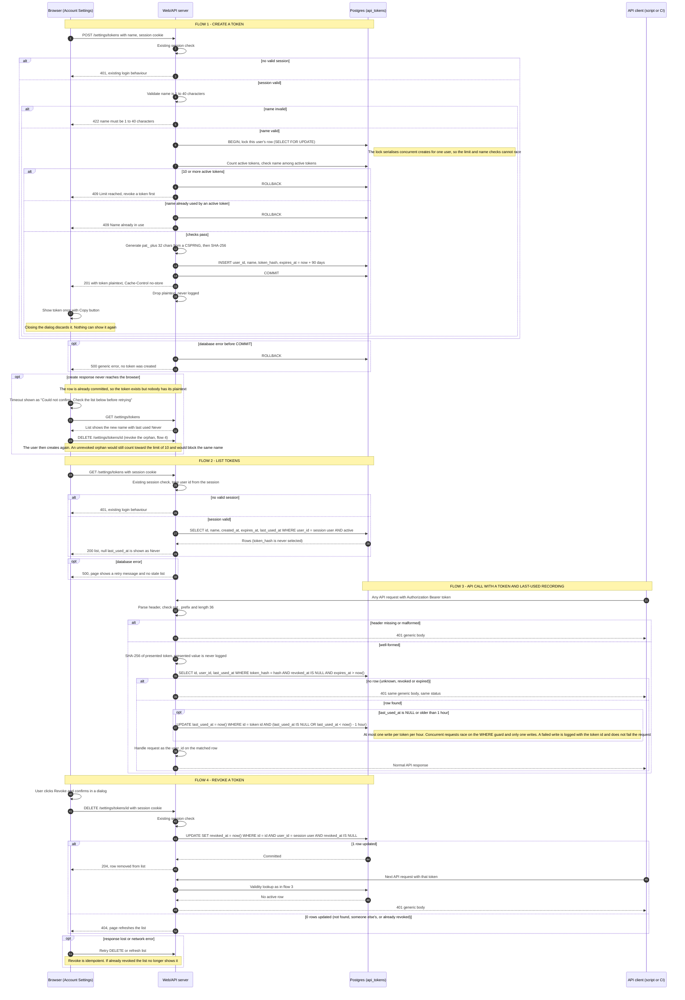

# Personal API tokens: sequence diagram and design notes

Signed-in users create personal API tokens on the existing Account Settings page, so their scripts and CI jobs can call our REST API without a password. Today, login uses a session cookie, and the settings endpoints sit behind it. This design adds one Postgres table, `api_tokens`, and four flows: create, list, use, and revoke. Every API request checks the table directly, with no cache. That is what makes a revoked token fail on the very next request.

## Terms

- **Personal API token**: a secret string `pat_` plus 32 characters. A script sends it in the header `Authorization: Bearer <token>` instead of a password.
- **Plaintext**: the full token string as the user sees it. The server never stores it. It stores only its SHA-256 hash.
- **CSPRNG**: a cryptographically secure random number generator, here the operating system's.
- **Active token**: `revoked_at IS NULL AND expires_at > now()`. Revoked and expired rows stay in the table, but are left out of the list, the limit count and the name check.
- **Orphan**: a token that was created and committed, but whose create response never reached the browser. It exists, and nobody has its plaintext.
- **`SELECT FOR UPDATE`**: a Postgres row lock. A second transaction that wants the same row waits until the first commits or rolls back.
- **Generic 401**: a 401 status with one fixed body, the same for every kind of token failure.
- **Session-cookie endpoints**: the existing login-protected endpoints. They are the only way to manage tokens.

## Where state lives

| State | Location | Notes |
|---|---|---|
| Token plaintext | Browser dialog memory, and server memory during the create request | It appears in the create response only. It is never written to the DB, logs, analytics, or any cache. Closing the dialog discards it. Nobody can show it again, including support and engineering. A user who loses a token creates a new one. |
| Token plaintext on later API calls | The client's `Authorization` header, and server memory for that request | The server redacts the `Authorization` header and the create response body from request logs and analytics. |
| Token record | Postgres table `api_tokens` | The only durable state, and the single source of truth for validity. |
| Login session | Existing session-cookie mechanism | Unchanged. A bearer token cannot create, list or revoke tokens. |
| Token validity cache | None | Every API request reads `api_tokens`. |

```
api_tokens
  id            uuid primary key
  user_id       fk to users, not null
  name          text, 1-40 chars, not null
  token_hash    bytea, SHA-256 of the full token, UNIQUE, not null
  created_at    timestamptz, not null
  expires_at    timestamptz, not null (created_at + 90 days, set by the server)
  revoked_at    timestamptz, null until revoked
  last_used_at  timestamptz, null until first recorded use
  index on (user_id) for list and count
```

Name uniqueness is enforced only by the check inside the locked create transaction, not by a DB constraint. A partial unique index cannot express "unique among active tokens", because "active" depends on `now()`. A revoked token's row keeps its name, and a new token may reuse it.

## Sequence diagram



## Notes

The diagram shows the order of steps and the status codes. These notes add the rules and reasons it cannot show.

**Creating**
- The token is `pat_` plus 32 characters from `[A-Za-z0-9]`, taken from the OS CSPRNG. Use rejection sampling so there is no modulo bias. That gives about 190 bits of entropy.
- Because the tokens are high-entropy, a plain SHA-256 is enough. No salt or slow hash is needed. The `token_hash` UNIQUE index doubles as the lookup index.
- The server code runs `SELECT FOR UPDATE` on the user's row inside the create transaction. A second create for the same user waits at that lock until the first commits or rolls back. It then counts and checks names against the committed state. This makes the limit of 10 and the name uniqueness safe under concurrent requests.
- `expires_at` is set once at insert. There is no renew endpoint.
- Log redaction is a requirement, not a nicety. The create response body, the `Authorization` request header, and the analytics payloads must all be excluded or scrubbed. Log only the token `id`.
- The create button must be disabled while a request is in flight. Do not auto-retry creates.

**Lost create response**
- We cannot replay the original response, because that would require storing or re-deriving the plaintext. The only recovery is "revoke the orphan, create again".
- The UI message for a timeout or network error must say the token may have been created and point to the list. An unused orphan shows "Never" as last used and expires on its own after 90 days if the user ignores it.

**Listing**
- The list endpoint is scoped by the session's user id in the query itself. It never takes a user id from the request, and it never returns `token_hash`.

**Using a token**
- The request runs as the `user_id` on the matched row. A token has the same API access as that user's session, with one exception: it cannot call the token-management endpoints, which accept the session cookie only. There are no per-token scopes.
- Missing, malformed, unknown, revoked and expired tokens all get the same status and body, so the response does not reveal why the token was rejected. This includes the cheap format check done before the DB call.
- Response timing is not equalised: the format check returns faster than a DB lookup. This is acceptable because valid tokens are about 190 bits of random data and cannot be guessed from timing.
- There is no in-process or shared cache of validity. This is deliberate. The cost is one indexed read per API request. The design assumes one primary Postgres with no read replica serving this lookup. A lagging replica would break "the very next request is rejected".
- The last-used guard keeps writes to at most one per token per hour, so the displayed value is up to 1 hour old, and there is no database write on every API request. The guard sits in the `WHERE` clause, so no application-level cache or lock is needed.
- A request that passed the lookup just before a revoke committed may still finish. Every request that starts after the revoke commits gets 401.

**Revoking**
- The `WHERE` clause includes `user_id = session user`. Another user's token id therefore gives 0 rows and a 404, identical to a nonexistent id, so nobody can probe for other users' token ids.
- Revoke sets `revoked_at` and does not delete the row. This keeps an audit trail and leaves the name free for reuse.
- The list hides expired tokens, so the UI never offers Revoke on one. A direct DELETE for an expired token id still sets `revoked_at` and returns 204, which is harmless.

## What happens when things fail

| Situation | Result |
|---|---|
| 11th active token | 409 with "revoke a token first". Nothing is written. |
| Duplicate active name | 409. Nothing is written. |
| Invalid name | 422. |
| No valid session | 401, existing login behaviour. |
| DB error during create | Transaction rolled back, 500, no token exists. |
| DB error during list | 500. The page shows a retry message, not a stale list. |
| Create response lost after commit | Token exists but is unrecoverable. The user revokes it from the list and creates a new one. |
| Bad, revoked, expired or absent bearer token | 401 with one generic body. |
| Bearer token used on token-management endpoints | Rejected, because these accept the session cookie only. |
| Last-used update fails | Logged. The API request still succeeds. |
| Revoke of a token not owned by the user, not found, or already revoked | 404. |

## Open questions

- What the existing session check returns on failure, and what the browser does on that 401 (for example redirect to login), is defined by the existing login code and is not specified here.
- No lock wait timeout is set for the per-user row lock. A waiting create uses the database default. If a timeout fires it is treated as a database error: 500, nothing created.
- The browser timeout value for a create request, and what the dialog shows while waiting, are not decided.
- Whether log and analytics redaction is one general filter or per-endpoint configuration depends on the existing logging stack and is not decided. The requirement above holds either way.
