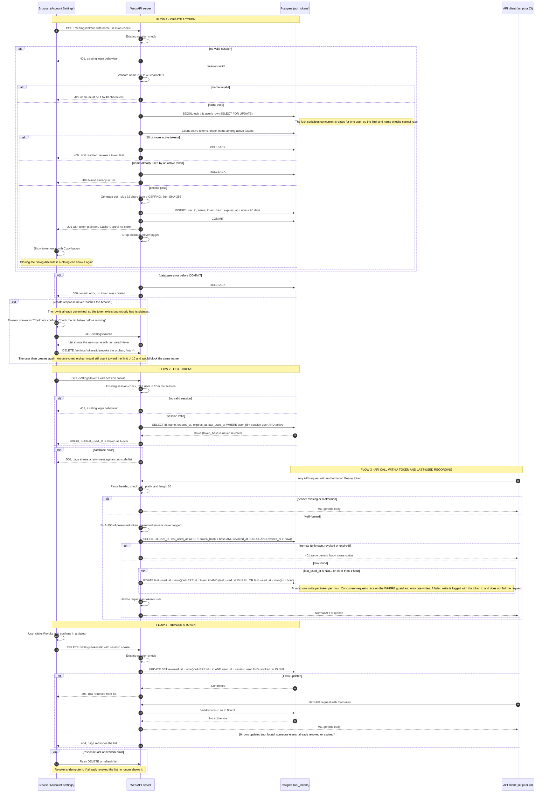

# Personal API tokens: sequence diagram and design notes

## Where state lives

| State | Location | Notes |
|---|---|---|
| Token plaintext | Browser dialog memory, and server memory during the create request | It appears in the create response only. It is never written to the DB, logs, analytics, or any cache. |
| Token plaintext on later API calls | The client's `Authorization` header, and server memory for that request | The server redacts `Authorization` and the create response body from request logs and analytics. |
| Token record | Postgres table `api_tokens` | This is the only durable state and the single source of truth for validity. |
| Login session | Existing session-cookie mechanism | Unchanged. Only the session-cookie endpoints manage tokens. A bearer token cannot create, list or revoke tokens. |
| Token validity cache | None | Every API request reads `api_tokens`, so revoke takes effect on the next request. |

```
api_tokens
  id            uuid primary key
  user_id       fk to users, not null
  name          text, 1-40 chars, not null
  token_hash    bytea, SHA-256 of the full token, UNIQUE, not null
  created_at    timestamptz, not null
  expires_at    timestamptz, not null (created_at + 90 days, set by the server)
  revoked_at    timestamptz, null until revoked
  last_used_at  timestamptz, null until first recorded use
  index on (user_id) for list and count
```

"Active" means `revoked_at IS NULL AND expires_at > now()`. Revoked and expired rows stay in the table. They are excluded from the list, the limit count, and the name-uniqueness check.

## Sequence diagram



## Notes

**Creating**
- The token is `pat_` plus 32 characters from `[A-Za-z0-9]`, taken from the OS CSPRNG. Use rejection sampling so there is no modulo bias. That gives about 190 bits of entropy.
- Because the tokens are high-entropy, a plain SHA-256 is enough. No salt or slow hash is needed. The `token_hash` UNIQUE index doubles as the lookup index.
- The per-user row lock makes the limit of 10 and the name uniqueness safe under concurrent requests. Expiry depends on `now()`, so a partial unique index cannot express "unique among active tokens". The check inside the locked transaction does that job.
- `expires_at` is set once at insert. There is no renew endpoint.
- Log redaction is a requirement, not a nicety. The create response body, the `Authorization` request header, and the analytics payloads must all be excluded or scrubbed. Log only the token `id`.
- The create button must be disabled while a request is in flight. Do not auto-retry creates.

**Lost create response**
- We cannot replay the original response, because that would require storing or re-deriving the plaintext. The only recovery is "revoke the orphan, create again".
- The UI message for a timeout or network error must say the token may have been created and point to the list. An unused orphan shows "Never" as last used and expires on its own after 90 days if the user ignores it.

**Listing**
- The list endpoint is scoped by the session's user id in the query itself. It never takes a user id from the request.
- It never returns `token_hash`.

**Using a token**
- All failures return the same status and body, so the response does not reveal why the token was rejected. This includes the cheap format check done before the DB call.
- Missing, malformed, unknown, revoked and expired tokens cannot be told apart from outside.
- There is no in-process or shared cache of validity. This is deliberate. The cost is one indexed read per API request. This design assumes one primary Postgres with no read replica serving this lookup. A lagging replica would break "the very next request is rejected".
- The last-used guard keeps writes to at most one per token per hour, so the displayed value is up to 1 hour old. The guard sits in the `WHERE` clause, so no application-level cache or lock is needed.
- A request that passed the lookup just before a revoke committed may still finish. Every request that starts after the revoke commits gets 401.

**Revoking**
- The `WHERE` clause includes `user_id = session user`. Another user's token id therefore gives 0 rows and a 404, identical to a nonexistent id, so nobody can probe for other users' token ids.
- Revoke sets `revoked_at` and does not delete the row. This keeps an audit trail and leaves the name free for reuse.

**Failure summary**

| Situation | Result |
|---|---|
| 11th active token | 409 with "revoke a token first". Nothing is written. |
| Duplicate active name | 409. Nothing is written. |
| Invalid name | 422. |
| DB error during create | Transaction rolled back, 500, no token exists. |
| Create response lost after commit | Token exists but is unrecoverable. The user revokes it from the list and creates a new one. |
| Bad, revoked, expired or absent bearer token | 401 with one generic body. |
| Bearer token used on token-management endpoints | Rejected, because these accept the session cookie only. |
| Last-used update fails | Logged. The API request still succeeds. |
| Revoke of a token not owned by the user, or already revoked | 404. |
