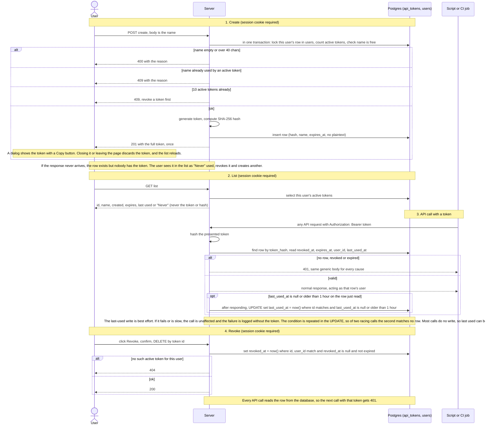

# Personal API tokens on the Account Settings page

Signed-in users create personal API tokens on Account Settings so scripts and CI jobs can call the REST API with `Authorization: Bearer <token>` instead of a password. Today the settings endpoints sit behind session-cookie login, and there is no token table. The single web/API server and its Postgres database do all the work. A new `api_tokens` table holds one row per token and keeps only a SHA-256 hash, so the full token exists once, in the create response, and nobody can show it again.

## Terms

- **Token**: `pat_` followed by 32 characters from a cryptographically secure random source.
- **Active token**: not revoked and not expired.
- **Token hash**: the SHA-256 of the full token. It is the only form the database keeps, and the lookup key on API calls. Unsalted is enough because the token is 32 random characters, so it cannot be guessed from its hash.
- **Session**: the existing cookie login, unchanged. Create, list and revoke need a session and take the user from it. A token cannot manage tokens.

## Table `api_tokens`

`id` (public row id, used to revoke), `user_id`, `name`, `token_hash` (unique index), `created_at`, `expires_at` (created_at + 90 days), `revoked_at` (null until revoked), `last_used_at` (null until first use).

## Rules

- Name: 1 to 40 characters, unique among that user's active tokens.
- At most 10 active tokens per user. Revoked and expired tokens do not count.
- Expiry is 90 days after creation and cannot be renewed. An expired token stays in the table. It is rejected on use and disappears from the list.
- The plaintext token never goes into the database, logs or analytics. This includes request logs of the Authorization header and the create response body.
- A user sees and revokes only their own tokens.
- Nobody can show a token again, including support and engineering. A lost token means creating a new one.
- Which login applies: token-management endpoints use the session only and ignore any Authorization header, so a token there gets 401 for having no session. On other API endpoints, if an Authorization header is present the token is used, and a bad token gets 401 with no fallback to the cookie.
- Errors from create and revoke are JSON with a human-readable message, in the same shape the settings endpoints already use.
- Tokens are sent only in the Authorization header, never in the query string.
- State lives only in Postgres. The server keeps no token cache, so revoke takes effect on the next call.

## Diagram

## Notes

- The count, the name check and the insert run in one transaction that first locks the user's row in the existing `users` table. Only other creates by the same user wait on that lock. Listing, revoking and API calls never take it. Two simultaneous creates by one user therefore cannot exceed 10 or reuse a name.
- Revoke only works on active tokens. Revoking one that is already revoked or expired gets 404, which is fine because the list no longer shows it. Revoking another user's token also gets 404.
- The list returns only active tokens, so revoked and expired ones are not shown.

## Open questions

- Which characters the 32-character part uses (for example base62) is not decided.
- Whether expired tokens are ever deleted from the table is not decided.
- The exact JSON field names of error bodies follow the existing settings endpoints and have not been checked.
- Whether the existing REST API also accepts session cookies on non-management endpoints has not been checked. The rule above holds either way.
