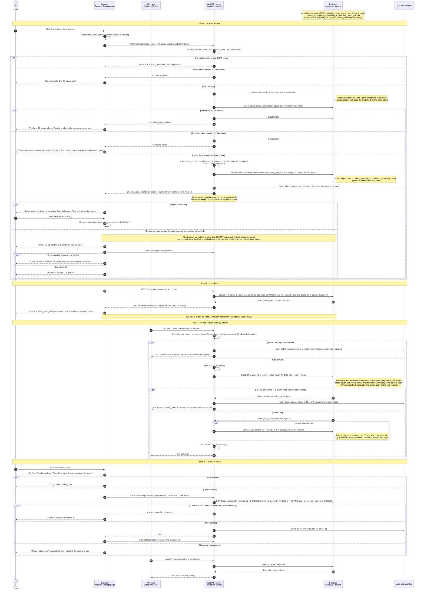

# Personal API tokens: sequence diagram

The diagram covers four flows on the existing Account Settings page and the single web/API server: create, list, an API call that uses a token, and revoke. Token state lives in one new Postgres table, `api_tokens`. The server keeps no token state in memory, so it has no validity cache and no buffer of last-used times. The only places the plaintext token ever exists are the CSPRNG output on the server while the create request runs, the create response, the browser dialog while it is open, and wherever the user pastes it.

Settings endpoints (`/settings/tokens...`) accept only the session cookie. A bearer token cannot create, list or revoke tokens, so a leaked token cannot make new ones for itself.

## Where state lives

| State | Location | Notes |
|---|---|---|
| Token record (name, dates, revoked flag) | `api_tokens` row in Postgres | Unique index on `token_hash`, index on `user_id`. Revoked and expired rows stay for audit. They are inactive, so they drop out of the list and the limit without any cleanup job. |
| Token hash | `api_tokens.token_hash` | SHA-256 of the full string, including `pat_`. No salt is needed because the token carries about 190 bits of randomness. Never returned by any endpoint or logged. |
| Plaintext token | The server's memory while the create request runs, the 201 response, the browser dialog, and the client's secret store | Never written to Postgres, logs, analytics or error reports. The browser drops it when the dialog closes. |
| Expiry | `expires_at`, set once at insert | No endpoint can change it, so tokens cannot be renewed. |
| Last-used time | `api_tokens.last_used_at` | Written at most once every 55 minutes per token. Postgres decides, so there is no in-memory buffer to lose and the lag stays under 1 hour. |
| Session | Existing session cookie and session store | Used only by the settings endpoints. |

## Failure handling

- **Limit reached.** Creating an 11th token returns 409 `token_limit_reached` and the message "Revoke a token before creating a new one." The lock on the user's row stops two parallel creates both slipping past the count.
- **Duplicate name.** Returns 409 `name_taken`. Names are compared exactly, after trimming whitespace. A name used only by revoked or expired tokens is free again. A double-click on Create also ends here, so it never makes two tokens.
- **Bad token.** Missing, malformed, unknown, revoked and expired tokens all get the same 401 body and `WWW-Authenticate` header. The reason goes only to the internal logs, recorded by token id.
- **Create response lost.** The server cannot replay the token, because that would mean storing the plaintext. The page reloads the list and tells the user either to revoke the orphan or to try again. If the user just retries, `name_taken` stops a silent duplicate, and its message explains what to do.
- **Revoke response lost.** Revoke is idempotent because of `COALESCE`, so the user can retry safely.
- **Revoke timing.** A request that starts after the revoke commits gets 401. A request that had already passed the token check before the commit may still finish.
- **last_used_at write fails.** The API call still succeeds. The next call retries the write. The 1-hour bound breaks only if that write fails and the token is never used again.

## Logging and analytics rules

- The request logger and error reporter redact the `Authorization` header on every route and drop the body of the create response.
- Analytics events carry `user_id` and `token_id` only.
- Any session-replay or DOM-capture script on the settings page must mask the token dialog.
- The token never goes in a URL or query string.

## Open questions

- If the account is deleted, its tokens are deleted with it (FK cascade). Whether a disabled or locked account should also fail token checks is not covered by the brief. If it should, add the user's status to the Flow 3 lookup.
- If read replicas are added later, the token lookup in Flow 3 must stay on the primary, or revoke would no longer apply to the very next request.
