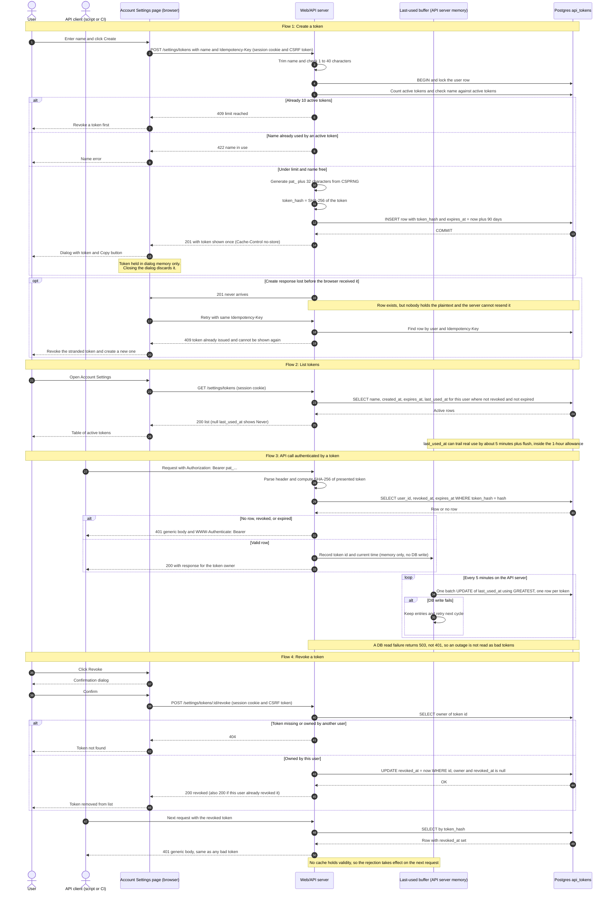

# Personal API tokens on Account Settings: sequence plan

Signed-in users create, list and revoke personal API tokens on the Account Settings page. Scripts and CI jobs send a token in an `Authorization: Bearer` header to call the REST API, so they never need a password. The full token is shown once, at creation. Only its SHA-256 hash is stored, and each API call looks that hash up in Postgres, so a revoke takes effect on the next request.

## Terms

- **Web/API server**: our single server. It serves the page and the REST API.
- **Postgres**: our database. The `api_tokens` table holds one row per token.
- **Session cookie**: the login cookie a signed-in browser already sends. The settings endpoints already require it.
- **Token**: the string `pat_` followed by 32 random characters. The server makes it.
- **CSPRNG**: a cryptographically secure random number generator. It makes tokens impossible to guess.
- **SHA-256 hash**: a fixed fingerprint of the token. We store only the fingerprint, so the database never holds a usable token.
- **CSRF token**: a secret the page sends with create and revoke requests. It stops another website from making a signed-in browser do those actions.
- **Idempotency-Key**: a value the browser sends with each create. It lets the server recognize a retry of the same create.
- **Row lock**: `SELECT ... FOR UPDATE` on the user's row. It makes two creates by the same user run one after the other.
- **Last-used buffer**: memory in the API server that records when each token was last seen.

## Where state lives

- **Plaintext token**: made in server memory and sent once, in the body of the 201 response. The browser keeps it only in the dialog's memory. Closing the dialog discards it. It is never written to the database, logs or analytics. After that nobody can show it again, including support and engineering. A user who loses a token creates a new one.
- **`api_tokens` row (Postgres)**: `id`, `user_id`, `name` (1 to 40 characters), `token_hash` (unique), `idempotency_key` (unique per user), `created_at`, `expires_at` (`created_at` plus 90 days, fixed), `revoked_at` (empty until revoked) and `last_used_at` (empty until first use).
- **Last-used buffer (API server memory)**: maps each token id to the latest time it was seen. It is written to Postgres every 5 minutes. A crash loses at most about 5 minutes of last-used data, which is inside the 1-hour allowance.
- **Logs and analytics**: only the token id, user id and an outcome code. The `Authorization` header and the create response body are redacted.
- **Validity cache**: none. Each API call reads `revoked_at` and `expires_at` from Postgres by hash.

## Sequence diagram

## How the four flows run

The diagram shows the order. These notes add the rules a reader needs for each flow.

1. **Create.** The user enters a name and clicks Create. The name must be 1 to 40 characters after trimming, and it must be unique among that user's active tokens. Active means not revoked and not expired. The limit check, the name check and the insert run in one transaction under a row lock. A user may have at most 10 active tokens, so an 11th create is refused with a message to revoke a token first. The server returns the full token once, and the dialog shows it with a Copy button.
2. **List.** Account Settings shows every active token with its name, created date, expiry date and last-used time. A token never used shows "Never". Last-used can be up to 1 hour out of date.
3. **API call.** The client sends `Authorization: Bearer pat_...`. The server hashes the token and looks up the row by hash. For a valid token it records the id and the current time in the last-used buffer, with no database write on that request. Every 5 minutes the buffer writes each token's latest time to Postgres in one batch.
4. **Revoke.** The user clicks Revoke and confirms. The server sets `revoked_at` for that user's own token. Repeating a revoke is safe. Nothing caches validity, so the next API request with that token is refused.

Rules that apply to every flow:

- Users see and revoke only their own tokens.
- Create and revoke need the session cookie and a CSRF token. Create responses use `Cache-Control: no-store`.
- A missing, unknown, revoked or expired token always gets a 401 with `{"error":"unauthorized"}` and the same headers. It goes through the same hash-and-lookup path each time, so the response does not reveal which case applied.
- Each token expires 90 days after creation, and cannot be renewed. There is no renew endpoint. Expired rows stay for history but are excluded from the list and from auth.

## What happens when things fail

| Case | What happens | Why |
|---|---|---|
| Name is empty or longer than 40 characters | Rejected before any database work | Enforces the 1 to 40 character rule |
| Name already used by an active token | 422, name error shown in the dialog | A plain unique index cannot express "active", because expiry depends on the current time and index conditions cannot call `now()`. The check runs in the locked transaction and compares trimmed names. |
| Limit reached (10 active tokens) | 409, message: "You already have 10 active tokens. Revoke one before creating another." | The count and the insert share one transaction under the row lock, so two parallel creates cannot both take the 10th slot. |
| Create response lost before the browser receives it | The row exists, but nobody holds the token and the server cannot resend it. A retry with the same Idempotency-Key gets 409 and no token. The stranded row counts toward the limit and shows "Never" until it is revoked or 90 days pass. | Recommended fix (open decision): the browser calls `POST /settings/tokens/:id/ack` when the dialog closes, and a sweep revokes any token not acked within 15 minutes. Revoking an unacked token is safe, because it was either never delivered or delivered and then abandoned. |
| Bad, unknown, revoked or expired token | 401 `{"error":"unauthorized"}` with the same headers | One path for every case, so the response does not reveal which case applied. |
| Database read fails during an API call | 503, not 401 | An outage must not be read as bad tokens. |
| Last-used write to Postgres fails | The buffer keeps its entries and retries on the next cycle | Last-used data may lag, and the 1-hour allowance covers it. |
| API server crashes before a flush | At most about 5 minutes of last-used data is lost | Accepted. Avoiding a database write on every request is the reason the buffer exists. |
| Revoke a token that is missing or owned by someone else | 404, same as a missing token | Users cannot learn about other users' tokens. |
| Revoke a token this user already revoked | 200 | Retries are safe. |

## Open questions

- Accept stranded tokens after a lost create response, or add the ack call and the 15-minute sweep.
- Should name uniqueness be case-insensitive? Recommended: yes.
- Confirm that the 10-token limit counts only active tokens, as the brief states.