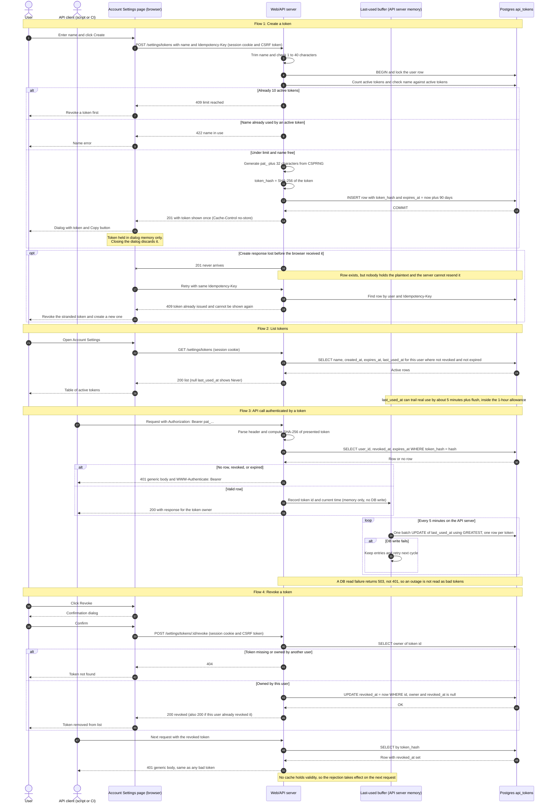

# Personal API tokens on Account Settings: sequence plan

Four flows on the existing Account Settings page, served by the web/API server and its Postgres database. The full token is returned once, in the create response, and only its SHA-256 hash is stored. Session-cookie auth already protects the settings endpoints. Token auth is added only for API calls.

## Where state lives

- **Plaintext token.** Generated in server memory and sent once in the 201 body. The browser holds it only in the dialog's memory. Closing the dialog discards it. It is never written to the database, logs or analytics.
- **`api_tokens` row (Postgres).** `id`, `user_id`, `name` (1 to 40 characters), `token_hash` (unique), `idempotency_key` (unique per user), `created_at`, `expires_at` (`created_at` + 90 days, fixed), `revoked_at` (nullable), `last_used_at` (nullable).
- **Last-used buffer (API server memory).** Maps token id to the latest time it was seen. It is flushed to Postgres every 5 minutes. A crash loses at most about 5 minutes of last-used data, which is inside the 1-hour allowance.
- **Logs and analytics.** Token id, user id and an outcome code only. The `Authorization` header and the create response body are redacted.
- **Validity cache.** None. Each API call reads `revoked_at` and `expires_at` from Postgres by hash, so revocation applies to the next request.

## Sequence diagram

## Failure notes

- **Limit reached.** The count and the insert run in one transaction under a per-user row lock (`SELECT ... FOR UPDATE` on the user row). Two parallel creates cannot both take the 10th slot. The message reads: "You already have 10 active tokens. Revoke one before creating another."
- **Name uniqueness.** A plain unique index cannot express "active" because expiry depends on the current time, and index predicates cannot call `now()`. Enforce it in the same locked transaction, comparing trimmed names.
- **Lost create response.** The server cannot resend the plaintext, so the row exists with no holder. A retry with the same `Idempotency-Key` returns 409 and no token. The row counts toward the limit and shows as Never used until revoked or until it expires after 90 days. Recommended fix: the browser calls `POST /settings/tokens/:id/ack` when the dialog closes, and a sweep revokes any token not acked within 15 minutes. Acking is safe because an unacked token either was never delivered or was delivered and then abandoned.
- **Bad, unknown, revoked or expired token.** All return the same 401 body (`{"error":"unauthorized"}`) with the same headers, after the same hash-and-lookup path, so the response does not reveal which case applied.
- **Revoke.** A token not owned by the caller returns 404, the same as a missing token. Repeating a revoke for a token this user already revoked returns 200, so retries are safe.
- **Expiry.** There is no renew endpoint. Expired rows stay for history but are excluded from the list and from auth.
- **Browser safety.** Create and revoke are protected by a CSRF token on top of the session cookie. Create responses use `Cache-Control: no-store`.

## Open decisions

- Accept stranded tokens after a lost response, or add the ack and 15-minute sweep above.
- Whether name uniqueness is case-insensitive. Recommended: yes.
- Confirm the 10-token limit counts only active tokens, as the brief states.