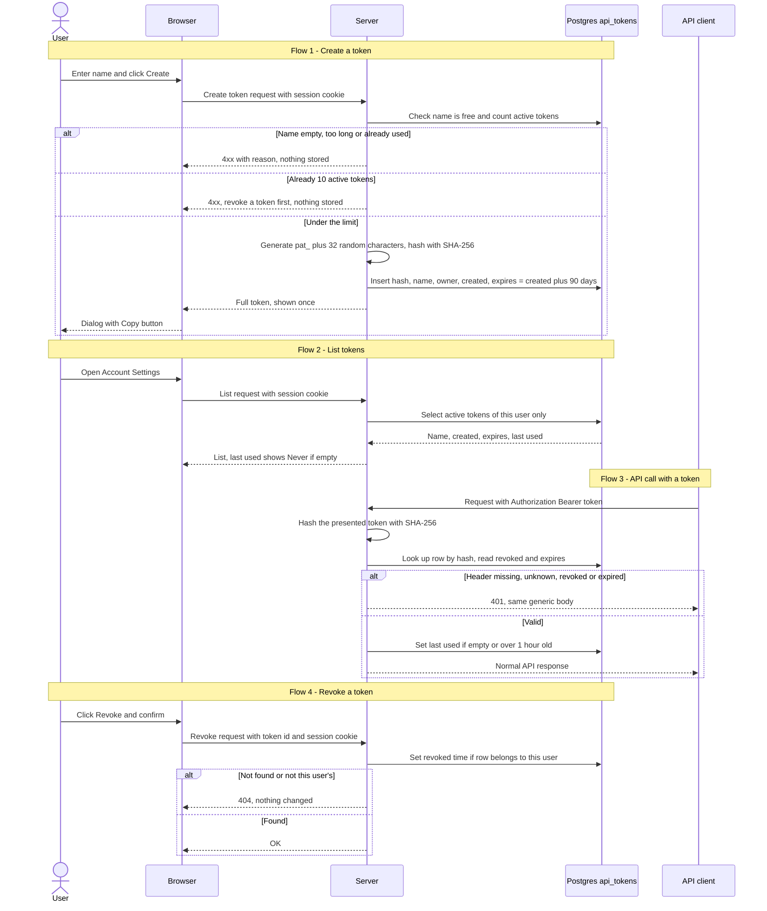

# Personal API tokens on Account Settings

Signed-in users create personal API tokens on the Account Settings page. Scripts and CI jobs send a token in an `Authorization: Bearer` header to call the REST API, so they never need a password. The server stores only a SHA-256 hash of each token, in a new `api_tokens` table in Postgres, and checks that hash on every API call. Because the check reads the table every time, a revoke takes effect on the next call.

**How it works today:** users sign in with a session cookie, and the settings endpoints already sit behind that login. There is no token table yet.

## Terms

- **Session cookie**: the browser's proof that the user is signed in.
- **Personal API token**: a secret string, `pat_` followed by 32 random characters. It acts as one user.
- **Bearer header**: the request header `Authorization: Bearer <token>` that API clients send.
- **SHA-256 hash**: a one-way fingerprint of the token. We store the fingerprint, and we cannot turn it back into the token.
- **CSPRNG**: a random number source designed for secrets, so tokens cannot be guessed.
- **Active token**: a token that is neither revoked nor expired.
- **Revoke**: the user marks a token as dead. This cannot be undone.
- **Last-used time**: when a token last made a successful API call. It may be up to 1 hour out of date.

## Where each piece of state lives

| Data | Where it lives | Notes |
|---|---|---|
| Full token | Only in the create response and the dialog the user sees once | Never stored, logged or sent to analytics |
| Token hash | `api_tokens.token_hash` | Used to find the row on each API call |
| Name, owner, created, expires, last used, revoked | The `api_tokens` row | Owner is the user's id |
| Signed-in user | Session cookie, checked by the server | Existing login |

## The four flows

## What each flow does and why

**Flow 1, create.** The user's name must be 1 to 40 characters and unique among that user's active tokens. The server refuses the request if the user already has 10 active tokens, and the message tells the user to revoke a token first. The server then generates the token from a CSPRNG, stores only its hash, and sets expiry to 90 days after creation. Expiry cannot be renewed. The full token is returned once, and the browser shows it with a Copy button. When the dialog closes, nobody can see the token again, including support and engineering. A user who loses it creates a new one.

**Flow 2, list.** The query is filtered to the signed-in user, so users see only their own tokens. Each row shows name, created date, expiry date and last-used time. A token never used shows "Never". The list never includes the token or its hash.

**Flow 3, API call.** The server hashes the presented token and reads the row each time. It does not cache validity, so a revoke is seen on the very next call. A missing, unknown, revoked or expired token gets the same 401 body in every case, so the response does not reveal which one it was. Last-used time is written only when the stored value is empty or more than 1 hour old. This keeps database writes to at most one per token per hour, not one per request.

**Flow 4, revoke.** The user clicks Revoke and confirms. The server marks only that user's own row as revoked. A token that belongs to someone else, or does not exist, gets a 404 and nothing changes. Revoking a token that is already revoked does nothing and still returns OK, so a retry is safe.

## What happens when things fail

| Where | What goes wrong | What happens |
|---|---|---|
| Create | Name empty, longer than 40 characters, or already used by an active token | 4xx with the reason. No row is written. |
| Create | User already has 10 active tokens | 4xx, with a message to revoke a token first. No row is written. |
| Create | Insert fails | Error response. No token is issued or shown. |
| Create | The response never reaches the browser (network drop, or crash after the insert) | The row exists and counts toward the 10. The token was never shown and cannot be shown later. The user sees the name on the list, revokes it, and creates a new token. The row also expires on its own after 90 days. |
| API call | Header missing, token unknown, revoked or expired | 401 with the same generic body each time. |
| API call | Writing last-used time fails | The API call still succeeds. The last-used time stays old until a later call writes it. |
| Revoke | Token belongs to someone else or does not exist | 404. Nothing changes. |
| Revoke | Response is lost | The revoke is already saved. The user retries safely. |

All refusals use the usual 4xx codes. A bad token always gets 401.

## Open questions

- The brief does not say which characters the 32 random characters may use. This must be decided before building.
- Two create requests sent at the same moment could both see 9 active tokens and both succeed, which would create an 11th. The count and the insert must be checked together to stop this. The brief does not say how strictly the limit must hold.
