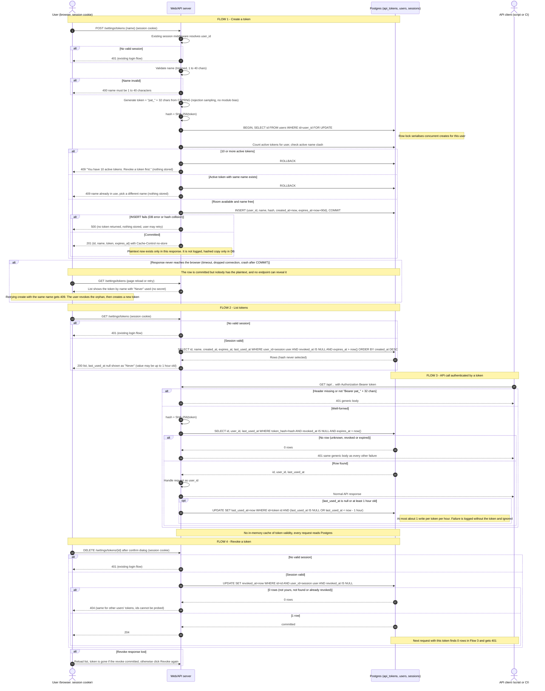

# Personal API tokens: sequence diagram and design notes

## Summary

Signed-in users create personal API tokens on the existing Account Settings page, so their scripts and CI jobs can call our REST API without a password. Today the single web/API server logs users in with a session cookie, and the settings endpoints already sit behind that login. There is no token table yet. The new design adds one Postgres table, `api_tokens`. The server creates a token, shows it once, and stores only its hash. Every API request then looks the hash up in Postgres, with no cache, so a revoke takes effect on the very next request.

## Terms

- **Token**: the string `pat_` followed by 32 characters from a cryptographically secure random source (a CSPRNG). Clients send it as `Authorization: Bearer <token>`.
- **Active token**: not revoked and not expired. Only active tokens count toward the limit, appear in the list or authenticate API calls.
- **Session authentication**: the existing cookie login. It is the only way to manage tokens.
- **Plaintext**: the full token as the user sees it. It is never stored.
- **Orphaned token**: a token whose create committed, but whose response never reached the browser. Nobody knows its plaintext.

## Rules that apply across the flows

- **Name**: 1 to 40 characters, unique among that user's active tokens.
- **Limit**: at most 10 active tokens per user. An 11th is refused with a message telling the user to revoke a token first.
- **Expiry**: 90 days after creation, set by the server, never renewed. There is no renew endpoint and no code writes `expires_at` after insert.
- **Time source**: every check uses the database clock.
- **Show once**: the full token appears only in the create response, with a Copy button. After the user closes the dialog nobody can show it again, including support and engineering. A user who loses a token creates a new one.
- **Never store plaintext**: the database holds a SHA-256 hash only. The plaintext must not appear in the database, logs or analytics.
- **Own tokens only**: users see and revoke only their own tokens.
- **No validity cache**: nothing caches whether a token is valid.

## Diagram

The `api_tokens` table has these columns: `id`, `user_id`, `name`, `token_hash` (SHA-256 of the whole token, bytea), `created_at`, `expires_at`, `revoked_at` (null until revoked) and `last_used_at` (null until first use). It has a unique index on `token_hash` and an index on `user_id`. "Active" in the SQL below means `revoked_at IS NULL AND expires_at > now()`.

## Notes on the diagram

Each note says why a part is shaped as it is.

- **Create lock.** A partial unique index cannot express "not expired", because `now()` is not allowed in an index predicate. So the create transaction locks the owner's `users` row (`SELECT ... FOR UPDATE`), counts active tokens, checks for a name clash, then inserts. Two simultaneous creates for one user are serialised, so the user cannot end up with 11 tokens or two tokens with the same name.
- **Revocation without a cache.** Each API request does one indexed lookup on `token_hash` and reads committed state. The revoke call returns only after its commit. A request validated before that commit may finish. Any request validated after it gets 401.
- **Last-used time.** The validation query already returns `last_used_at`. If it is null or at least 1 hour old, the server stamps `now()` with a conditional `UPDATE` after the response is sent. The `WHERE` clause stops concurrent requests from stacking writes. That gives at most about 1 write per token per hour, so the displayed value is never more than 1 hour behind. If the write fails, the API request is unaffected, and the next request retries it.
- **Session only.** `/settings/tokens` rejects `Authorization: Bearer`, so a stolen token cannot mint more tokens or revoke others.
- **Ownership in SQL.** Revoke and list use `user_id` from the session, never from the request.
- **Hash choice.** The token has about 190 bits of entropy, so an unsalted fast SHA-256 is adequate.
- **Keeping the plaintext out.** The plaintext lives only in server memory during the create request, then in the browser dialog's component state. It never goes into the URL, `localStorage` or analytics events. The create response carries `Cache-Control: no-store`. Request and response bodies for the create route are excluded from logs and analytics, and `Authorization` headers are redacted there.

## Where each piece of state lives

| State | Location | Notes |
|---|---|---|
| Token plaintext | Server memory during create, then the browser dialog's memory | Never in the DB, logs, analytics, URL or `localStorage`. Gone when the dialog closes |
| Token hash | `api_tokens.token_hash` | Unique index, used for lookup |
| Name, created, expiry | `api_tokens` | `expires_at` fixed at insert |
| Revoked | `api_tokens.revoked_at` | Source of truth, read on every request |
| Last used | `api_tokens.last_used_at` | At most 1 write per token per hour, up to 1 hour stale |
| Active count, name uniqueness | Computed from `api_tokens` under the user row lock | Not stored, so it cannot drift |
| Session | Existing session store and cookie | Only session auth manages tokens |
| Token validity cache | None | By requirement |

## Failure behaviour

| Failure | What happens |
|---|---|
| Limit reached | 409 with the revoke-first message. Nothing is written |
| Name clash | 409 asking for a different name |
| Bad token on an API call (missing header, malformed, unknown, revoked or expired) | Same 401 status, headers and JSON body in every case. Only the server's own logs record the real reason, and they never contain the token or its hash |
| Create fails before commit | 500, no row exists, retry is safe |
| Create commits but the response is lost | The orphaned token is live but unusable, counts toward the limit of 10 and shows in the list as "Never" used. The user revokes it and creates a new one. There is deliberately no replay or idempotency key, because replaying would mean storing or re-deriving the plaintext |
| Revoke response lost | The user reloads the list, then clicks Revoke again if the token is still there |
| Last-used write fails | The API request still succeeds. The displayed time is a little staler |

## Open questions

- Expired and revoked rows are kept, so the list query's filter matters. Add a periodic purge if the table grows. It does not change any behaviour above.
- Rate-limit failed token lookups per IP if abuse appears. Guessing a 32-character random token is not feasible, so this is not required for correctness.
