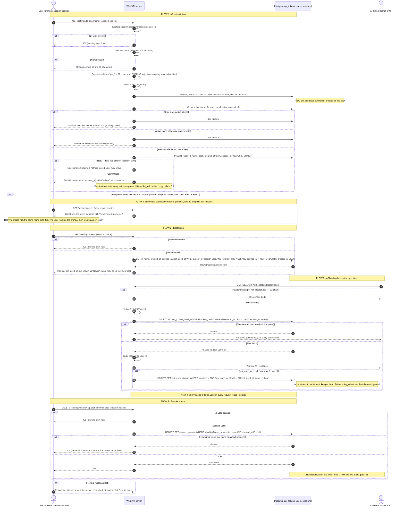

# Personal API tokens: sequence diagram and design notes

## Decisions that shape the diagram

- **One table, `api_tokens`, in Postgres.** Columns:
  - `id`
  - `user_id`
  - `name`
  - `token_hash`, a SHA-256 of the whole token stored as bytea, with a unique index
  - `created_at`
  - `expires_at`, set to `created_at + 90 days` by the server and never updated
  - `revoked_at`, which is null while the token is unrevoked
  - `last_used_at`, which is null until first use
  - Indexes: `(token_hash)` unique and `(user_id)`.
- **A token is active when `revoked_at IS NULL AND expires_at > now()`.** Every check uses the database clock. There is no renew endpoint, and no code path writes `expires_at` after insert.
- **No token validity cache anywhere.** Each API request does one indexed lookup on `token_hash`. Revocation takes effect for the next request because that lookup reads committed state.
- **Last-used time is throttled in the lookup, not cached.**
  - The validation query already returns `last_used_at`.
  - If it is null or at least 1 hour old, the server runs a conditional `UPDATE` that stamps `now()`.
  - That makes at most about 1 write per token per hour, and the displayed value is never more than 1 hour behind the real last use.
  - The write is best effort and runs after the response is sent. If it fails, the request is not affected.
  - The `WHERE` clause on the update stops concurrent requests from stacking writes.
- **Name uniqueness and the limit of 10 are enforced in one transaction.**
  - A partial unique index cannot express "not expired", because `now()` is not allowed in an index predicate.
  - The create transaction therefore locks the owner's `users` row (`SELECT ... FOR UPDATE`).
  - Under that lock it counts active tokens and checks for a name clash, then inserts.
  - Two simultaneous creates for one user are serialised, so the user cannot end up with 11 tokens or two tokens with the same name.
- **Token management accepts session authentication only.** `/settings/tokens` rejects `Authorization: Bearer`, so a stolen token cannot mint more tokens or revoke others.
- **Ownership is enforced in SQL.** Revoke and list use `user_id` from the session, never from the request. Revoking another user's token or a nonexistent one returns the same 404, so ids cannot be probed.
- **The plaintext is returned once and never stored.**
  - It exists only in server memory for the duration of the create request, and then in the browser dialog's memory.
  - The create response carries `Cache-Control: no-store`.
  - Request and response bodies for the create route are excluded from logs and analytics.
  - `Authorization` headers are redacted in logs and analytics.
  - The frontend keeps the token only in the dialog's component state. It never goes into the URL, `localStorage` or analytics events.

## Diagram

## Where each piece of state lives

| State | Location | Notes |
|---|---|---|
| Token plaintext | Server memory during the create request, then the browser dialog's memory | Never in the DB, logs, analytics, URL or `localStorage`. Gone when the dialog closes |
| Token SHA-256 hash | `api_tokens.token_hash` (Postgres) | Unique index, used for lookup. The token has about 190 bits of entropy, so an unsalted fast hash is adequate |
| Name, created, expiry | `api_tokens` | `expires_at` is fixed at insert |
| Revoked | `api_tokens.revoked_at` | Source of truth for revocation, read on every request |
| Last used | `api_tokens.last_used_at` | At most 1 write per token per hour, up to 1 hour stale |
| Active count and name uniqueness | Computed from `api_tokens` under the user row lock | Not stored separately, so it cannot drift |
| Session | Existing session store and cookie | Only session auth can manage tokens |
| Token validity cache | None | By requirement |

## Failure behaviour

- **Limit reached.** `409` with "You have 10 active tokens. Revoke a token first." Nothing is written.
- **Name clash.** `409`, and the message asks for a different name.
- **Bad token on an API call.** This covers a missing header, a malformed value, an unknown token, a revoked token and an expired token.
  - All of them return the same `401` status, headers and JSON body.
  - Only the server's own logs record the real reason.
  - Logs never contain the token or its hash.
- **Create fails before commit.** The user sees `500`, no row exists, and a retry is safe.
- **Create commits but the response is lost.**
  - The orphaned token is live but unusable, because nobody knows it.
  - It counts toward the limit of 10 and appears in the list as "Never" used.
  - The user fixes this by revoking it and creating a new token.
  - There is deliberately no replay or idempotency key, since replaying would mean storing or re-deriving the plaintext.
- **Revoke race.** A request already validated before the revoke commits may finish. Any request validated after the commit gets `401`, and the revoke call returns only after the commit.
- **Last-used write fails.** The API request still succeeds. The displayed time is a little more stale, and the next request retries the write.

## Open points

- Expired and revoked rows are kept, so the list query's filter matters. Add a periodic purge if the table grows. It does not affect any behaviour above.
- Rate-limit failed token lookups per IP if abuse appears. Guessing a 32-character random token is not feasible, so this is not required for correctness.
