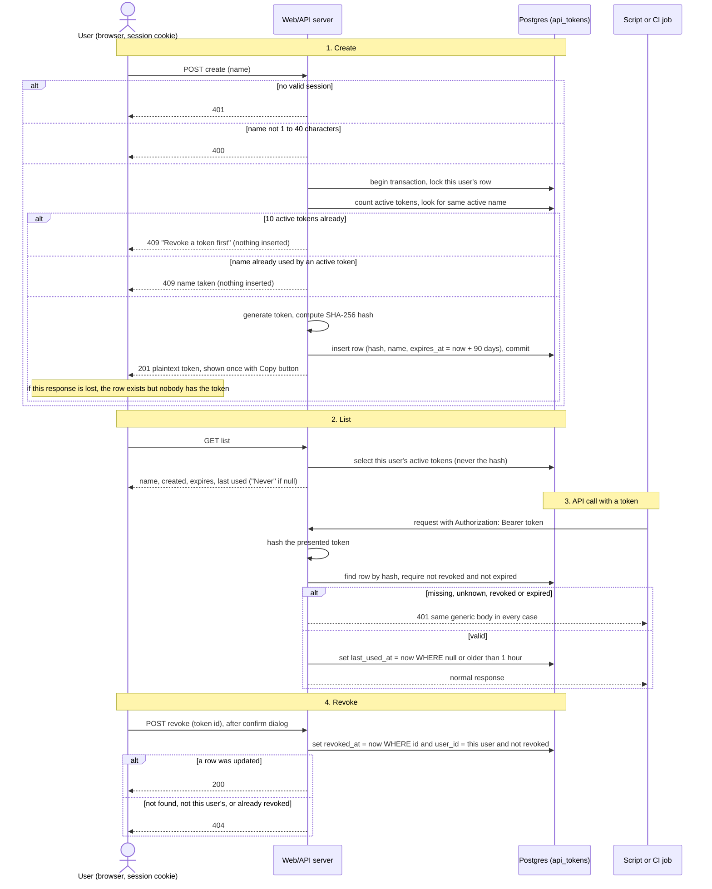

# Personal API tokens

Signed-in users create personal API tokens on the existing Account Settings page, so their scripts and CI jobs can call our REST API without a password. Today the single web/API server and its Postgres database log users in with a session cookie, and the settings endpoints sit behind that login. We add one table, `api_tokens`. The server creates a token, shows it once, and stores only its SHA-256 hash. API clients then send the token in a header, and the server checks its hash against the table on every request.

## Terms

- **Token**: the secret string `pat_` followed by 32 characters from a cryptographically secure random source. The server generates it. The user never chooses it.
- **Hash**: the SHA-256 of the token. It is the only form we store, so a database leak does not leak usable tokens.
- **Active token**: not revoked and not expired.
- **Session**: the existing cookie login. The create, list and revoke calls need it. API calls with a token do not.
- **`api_tokens` table** (new, in Postgres): one row per token, with `id`, `user_id`, `name`, `token_hash` (unique index), `created_at`, `expires_at`, `revoked_at` (null until revoked) and `last_used_at` (null until first use).

## Rules

- Name: 1 to 40 characters, unique among that user's active tokens. A revoked or expired token's name can be reused.
- Expiry: `expires_at` is `created_at` plus 90 days. Tokens cannot be renewed.
- Limit: at most 10 active tokens per user.
- The plaintext token is shown exactly once, in the response to the create request, with a Copy button. Nobody can show it again, including support and engineering. A user who loses a token creates a new one.
- The plaintext token never appears in the database, the logs or analytics. This includes request logs of the create response and of the `Authorization` header.
- Last-used time may be up to 1 hour out of date. We do not write to the database on every API request.
- Revoking takes effect on the very next API request. Token validity is never cached.
- Users see and revoke only their own tokens.

## Diagram

## Notes

**Where state lives.** All token state is in the `api_tokens` table. The browser holds the plaintext only while the create dialog is open. The server keeps no token state in memory, in a cache or between requests.

**Create.** Locking the user's row inside the transaction makes the limit and name checks safe when two create requests arrive together. Without it, both could pass the count and the user would end up with 11. A create response that never reaches the browser leaves an active token that nobody holds. It counts toward the limit of 10. The user finds it in the list by name and revokes it, then creates a new one. We do not try to resend it, because the server cannot recover the plaintext.

**List.** The list returns active tokens only. It never returns the hash.

**API call.** The last-used update is a single conditional statement. It writes only when the stored time is empty or more than 1 hour old, so a busy client causes about one write per hour per token. This is why the displayed time can be up to 1 hour old. If that write fails, the request still succeeds and the error is logged without the token. Because every request reads the row, a revoked token fails on its next request with no cache to wait for.

**Revoke.** The update filters by both token id and the signed-in user's id, so another user's token looks the same as one that does not exist. Revoking twice is harmless and returns 404 the second time.

## Failures

| Where | What goes wrong | What happens |
|---|---|---|
| Create, list, revoke | No valid session | 401 |
| Create | Name empty or over 40 characters | 400 |
| Create | 10 active tokens | 409, message tells the user to revoke a token first |
| Create | Name used by an active token | 409 |
| Create | Response lost on the way to the browser | Token exists but nobody has it. User revokes it by name and creates another |
| Create or revoke | Database error | 500, nothing partly written because each is one transaction or one statement |
| API call | Header missing, token unknown, revoked or expired | 401, same generic body each time |
| API call | Last-used update fails | Request still succeeds, error logged without the token |
| Revoke | Token not found, not the user's, or already revoked | 404 |

## Open questions

- The exact status codes for the name and limit errors (400 and 409 above) follow our usual conventions and are not fixed by the brief. Change them if the existing API uses others.
